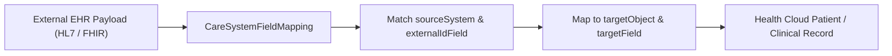

## Architectural Overview

In enterprise healthcare implementations, patient demographics and clinical encounters often originate across multiple Electronic Health Record (EHR) platforms such as Epic, Cerner, or Meditech. The `CareSystemFieldMapping` metadata type provides a declarative mapping layer within Salesforce Health Cloud that links external source system identifiers and fields directly to target Salesforce objects (`targetObject`) and fields (`targetField`).

Rather than hardcoding field transformations in middleware or Apex integration handlers, architects use `CareSystemFieldMapping` to maintain source-to-target schema definitions in version control. When Health Cloud ingests clinical payloads, it evaluates active mappings by source system and role to populate patient accounts, contacts, or clinical data model records accurately.



## Directory Location and File Suffix

In Salesforce DX (SFDX) source format and Metadata API projects, `CareSystemFieldMapping` components are stored in the `careSystemFieldMappings` directory.

| Property | Value |
| :--- | :--- |
| **Directory Path (SFDX)** | `force-app/main/default/careSystemFieldMappings/` |
| **File Suffix (SFDX)** | `.careSystemFieldMapping-meta.xml` |
| **Classic Metadata Suffix** | `.careSystemFieldMapping` |
| **Metadata Type Name** | `CareSystemFieldMapping` |

## Key Metadata Fields

The following table details the core XML elements available on `CareSystemFieldMapping` as of API version `68.0` (Winter '27):

| Field Name | Field Type | Required | Architectural Description |
| :--- | :--- | :--- | :--- |
| `masterLabel` | `string` | Yes | The human-readable label for the care system field mapping in Salesforce Setup. |
| `isActive` | `boolean` | No | Indicates whether the field mapping is active (`true`) and evaluated during Health Cloud data ingestion. |
| `sourceSystem` | `string` | No | The name of the external EHR or clinical source system sending the data (for example, `Epic_Central_Hospital`). |
| `sourceSystemId` | `string` | No | The unique identifier representing the external source system or facility. |
| `externalIdField` | `string` | No | The API name of the external ID field on the target object used for upsert matching. |
| `role` | `CareSystemFieldMappingRole` | No | Defines the functional role of the mapped entity, such as `Patient`, `Provider`, or `Facility`. |
| `targetObject` | `string` | No | The API name of the Salesforce object receiving the mapped value (for example, `Account`, `Contact`, or `MemberPlan`). |
| `targetField` | `string` | No | The API name of the destination field on the `targetObject` where the external attribute is stored. |
| `isProtected` | `boolean` | No | Indicates whether the component is protected inside a managed package (`true`) or accessible to subscribers (`false`). |

## Declarative Metadata Example

The following example configures a `CareSystemFieldMapping` record that maps an external Epic medical record number (MRN) to the `Medical_Record_Number__c` external ID field on the `Account` (Person Account) object for patient records.

```xml title="force-app/main/default/careSystemFieldMappings/Epic_Patient_MRN_Mapping.careSystemFieldMapping-meta.xml"
<?xml version="1.0" encoding="UTF-8"?>
<CareSystemFieldMapping xmlns="http://soap.sforce.com/2006/04/metadata">
    <externalIdField>Medical_Record_Number__c</externalIdField>
    <isActive>true</isActive>
    <isProtected>false</isProtected>
    <masterLabel>Epic Patient MRN Mapping</masterLabel>
    <role>Patient</role>
    <sourceSystem>Epic_EHR_Prod</sourceSystem>
    <sourceSystemId>EPIC-FAC-001</sourceSystemId>
    <targetField>Medical_Record_Number__c</targetField>
    <targetObject>Account</targetObject>
</CareSystemFieldMapping>
```

### Package Manifest (`package.xml`)

Include `CareSystemFieldMapping` in your manifest to retrieve or deploy mappings across Health Cloud environments:

```xml title="manifest/package.xml"
<?xml version="1.0" encoding="UTF-8"?>
<Package xmlns="http://soap.sforce.com/2006/04/metadata">
    <types>
        <members>Epic_Patient_MRN_Mapping</members>
        <name>CareSystemFieldMapping</name>
    </types>
    <version>68.0</version>
</Package>
```

## SOQL Queries and SFDX CLI Commands

You can query `CareSystemFieldMapping` records directly in SOQL to audit active EHR field mappings in an org, or retrieve them using the Salesforce CLI (`sf`).

```soql
SELECT DeveloperName, MasterLabel, SourceSystem, SourceSystemId,
       Role, TargetObject, TargetField, ExternalIdField, IsActive
FROM CareSystemFieldMapping
WHERE IsActive = true
ORDER BY SourceSystem ASC, TargetObject ASC
```

Use the `sf` CLI to retrieve and deploy mappings during CI/CD runs:

```bash
# Retrieve all CareSystemFieldMapping components from the target org
sf project retrieve start --metadata CareSystemFieldMapping

# Deploy a specific CareSystemFieldMapping component
sf project deploy start --metadata CareSystemFieldMapping:Epic_Patient_MRN_Mapping
```

## Architect Best Practices and Gotchas

> [!WARNING]
> Every `targetObject`, `targetField`, and `externalIdField` referenced in a `CareSystemFieldMapping` must exist in the target org or be included in the same deployment package. If `externalIdField` is not marked with `<externalId>true</externalId>` on its [CustomField](/docs/metadata/custom-field-metadata-type/) definition, deployment validation fails.

- **Bundle Schema Dependencies:** Always deploy custom fields on [CustomObject](/docs/metadata/custom-object-metadata-type/) alongside or prior to `CareSystemFieldMapping` in CI/CD pipelines.
- **Standardize Source System Naming:** Use consistent naming conventions for `sourceSystem` and `sourceSystemId` across sandboxes and production. Avoid embedding environment-specific URLs in `sourceSystemId` so that the same metadata file deploys cleanly across QA, UAT, and Production.
- **Deactivate Instead of Deleting:** When retiring an legacy EHR feed, set `<isActive>false</isActive>` and deploy the update before executing destructive changes, ensuring in-flight integration jobs fail gracefully.

> [!TIP]
> Pair `CareSystemFieldMapping` with a [PermissionSet](/docs/metadata/permission-set-metadata-type/) specifically designed for your Health Cloud integration user so the integration account has Field-Level Security (FLS) edit access to every `targetField` and `externalIdField`.
