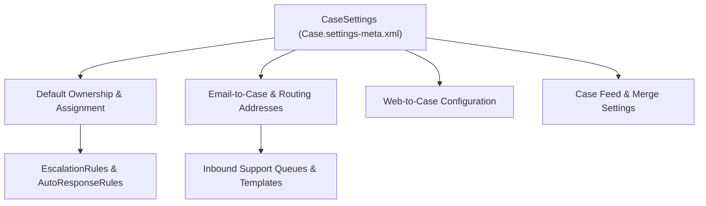

## Architectural Overview

The `CaseSettings` metadata type is the central configuration backbone for Salesforce Service Cloud. It governs org-wide support processes, including default Case ownership, Email-to-Case (`emailToCase`), Web-to-Case (`webToCase`), Case Feed item visibility (`caseFeedItemSettings`), Case Merge behavior (`keepRecordTypeOnAssignmentRule`), and automated customer/owner email notifications.

From a release engineering perspective, `CaseSettings` is one of the most environment-sensitive metadata files in a Salesforce repository. Because it frequently embeds usernames (`defaultCaseOwner`, `defaultCaseUser`), queue names, and email templates (`closeCaseThroughStatusChange`, `notifyContactOnCaseComment`), architects must carefully parameterize or scrub org-specific references before promoting `Case.settings-meta.xml` through a CI/CD pipeline.



## Directory Location and File Suffix

In Salesforce DX projects, `CaseSettings` is stored in the `settings` directory as `Case.settings-meta.xml` and referenced via the `Settings` type in `package.xml`.

| Property | Value |
| :--- | :--- |
| **Directory Path (SFDX)** | `force-app/main/default/settings/` |
| **File Name (SFDX)** | `Case.settings-meta.xml` |
| **Classic Metadata File** | `settings/Case.settings` |
| **Package.xml Type & Member** | `<name>Settings</name>` with `<members>Case</members>` |

## Key Metadata Fields

The `CaseSettings` metadata schema contains critical Service Cloud switches and nested configuration blocks:

| Field Name | Field Type | Architectural Description |
| :--- | :--- | :--- |
| `defaultCaseOwner` | `string` | The username or queue name assigned to cases when no assignment rule matches. |
| `defaultCaseOwnerType` | `string` | Specifies whether `defaultCaseOwner` is a `User` or `Queue`. Prefer `Queue` for CI/CD portability. |
| `defaultCaseUser` | `string` | The automated system user recorded in Case History for automated actions such as escalation or Web-to-Case. |
| `closeCaseThroughStatusChange` | `boolean` | Allows support agents to close cases simply by selecting a closed status picklist value on the edit page. |
| `enableCaseFeed` | `boolean` | Enables the Chatter-based Case Feed interface in Service Cloud Console and Lightning Experience. |
| `enableDraftEmails` | `boolean` | Allows agents to save draft emails on cases and optionally submit them for approval. |
| `enableEarlyEscalationRuleTriggers` | `boolean` | Evaluates [EscalationRules](/docs/metadata/escalation-rules-metadata-type/) immediately on case creation before first save completion. |
| `keepRecordTypeOnAssignmentRule` | `boolean` | Preserves the existing Case Record Type instead of overwriting it with the new owner's default record type during assignment. |
| `emailToCase` | `EmailToCaseSettings` | Nested block controlling `enableEmailToCase`, `enableOnDemandEmailToCase`, `enableThreadIDInBody`, and `routingAddresses`. |
| `webToCase` | `WebToCaseSettings` | Nested block controlling `enableWebToCase`, `defaultResponseTemplate`, and `webToCaseOrigin`. |

## Declarative Metadata Example

The following `Case.settings-meta.xml` file configures a Queue as the `defaultCaseOwner` (avoiding hard-coded usernames where possible), enables Lightning threading and On-Demand Email-to-Case, and preserves Record Types during assignment rule execution.

```xml title="force-app/main/default/settings/Case.settings-meta.xml"
<?xml version="1.0" encoding="UTF-8"?>
<CaseSettings xmlns="http://soap.sforce.com/2006/04/metadata">
    <caseAssignNotificationTemplate>unfiled$public/SupportCaseAssignmentNotification</caseAssignNotificationTemplate>
    <caseCreateNotificationTemplate>unfiled$public/SupportCaseCreatedPhoneInquiries</caseCreateNotificationTemplate>
    <caseFeedItemSettings>
        <characterLimit>400</characterLimit>
        <displayFormat>Default</displayFormat>
        <feedItemType>EmailMessageEvent</feedItemType>
    </caseFeedItemSettings>
    <closeCaseThroughStatusChange>true</closeCaseThroughStatusChange>
    <defaultCaseOwner>Tier_1_Support_Queue</defaultCaseOwner>
    <defaultCaseOwnerType>Queue</defaultCaseOwnerType>
    <enableCaseFeed>true</enableCaseFeed>
    <enableCollapseEmailThread>true</enableCollapseEmailThread>
    <enableDraftEmails>true</enableDraftEmails>
    <enableEarlyEscalationRuleTriggers>false</enableEarlyEscalationRuleTriggers>
    <enableSuggestedSolutions>false</enableSuggestedSolutions>
    <keepRecordTypeOnAssignmentRule>true</keepRecordTypeOnAssignmentRule>
    <notifyContactOnCaseComment>false</notifyContactOnCaseComment>
    <notifyDefaultCaseOwner>true</notifyDefaultCaseOwner>
    <notifyOwnerOnCaseComment>true</notifyOwnerOnCaseComment>
    <notifyOwnerOnCaseOwnerChange>true</notifyOwnerOnCaseOwnerChange>
    <showEmailAttachmentsInCaseAttachmentsRL>true</showEmailAttachmentsInCaseAttachmentsRL>
    <useSystemEmailAddress>true</useSystemEmailAddress>
    <useSystemUserAsDefaultCaseUser>true</useSystemUserAsDefaultCaseUser>
    <emailToCase>
        <enableE2CAttachmentAsFile>true</enableE2CAttachmentAsFile>
        <enableE2CDeduplicateAttachments>true</enableE2CDeduplicateAttachments>
        <enableE2CExternalServer>false</enableE2CExternalServer>
        <enableEmailToCase>true</enableEmailToCase>
        <enableHtmlEmail>true</enableHtmlEmail>
        <enableM2CModeration>false</enableM2CModeration>
        <enableOnDemandEmailToCase>true</enableOnDemandEmailToCase>
        <enableThreadTokenInBody>true</enableThreadTokenInBody>
        <enableThreadTokenInSubject>true</enableThreadTokenInSubject>
        <overEmailLimitAction>Requeue</overEmailLimitAction>
        <preQuoteSignature>true</preQuoteSignature>
        <unauthorizedSenderAction>Discard</unauthorizedSenderAction>
    </emailToCase>
    <webToCase>
        <caseOrigin>Web</caseOrigin>
        <enableWebToCase>true</enableWebToCase>
    </webToCase>
</CaseSettings>
```

### Package Manifest (`package.xml`)

```xml title="manifest/package.xml"
<?xml version="1.0" encoding="UTF-8"?>
<Package xmlns="http://soap.sforce.com/2006/04/metadata">
    <types>
        <members>Case</members>
        <name>Settings</name>
    </types>
    <version>68.0</version>
</Package>
```

## SFDX CLI Retrieval and Deployment

`CaseSettings` is retrieved and deployed through the Metadata API `Settings:Case` target:

```bash
# Retrieve CaseSettings into force-app/main/default/settings/Case.settings-meta.xml
sf project retrieve start --metadata Settings:Case

# Validate CaseSettings deployment before promoting to production
sf project deploy start --metadata Settings:Case --dry-run
```

## Architect Best Practices and Gotchas

> [!TIP]
> Set `<useSystemUserAsDefaultCaseUser>true</useSystemUserAsDefaultCaseUser>` and `<defaultCaseOwnerType>Queue</defaultCaseOwnerType>` in `Case.settings-meta.xml`. This eliminates hardcoded `<defaultCaseUser>` usernames that otherwise break scratch org creation and sandbox deployments because usernames differ per environment.

- **Email-to-Case Routing Address Traps:** When you retrieve `Settings:Case` from Production, Salesforce includes every `<routingAddresses>` block under `<emailToCase>`. Deploying those routing addresses to a sandbox triggers verification emails or fails if the routing address `caseOwner` user does not exist in the sandbox. Exclude `<routingAddresses>` from version control or manage them via environment-specific replacements.
- **Lightning Threading vs. Ref ID:** In API version 50.0 and later (`68.0` in Winter '27), Ref ID threading (`enableThreadIDInBody` and `enableThreadIDInSubject`) is superseded by Lightning threading (`enableThreadTokenInBody` and `enableThreadTokenInSubject`). Always enable thread tokens for secure header and token-based email matching.
- **Email Template Dependencies:** Any email template referenced in `caseAssignNotificationTemplate`, `caseCreateNotificationTemplate`, or `caseCloseNotificationTemplate` must be deployed prior to or alongside `CaseSettings`.

> [!WARNING]
> Once `enableEmailToCase` is set to `true` in an org, it cannot be disabled (`false`) via Metadata API deployment. Attempting to deploy `<enableEmailToCase>false</enableEmailToCase>` to an org where Email-to-Case is already active will result in a deployment error.
