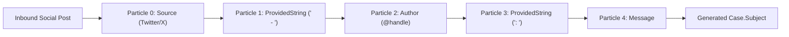

## Architectural Overview

When cases are generated automatically from social media channels via Social Customer Service, raw post content often makes poor Case subjects for Service Console agents. The `CaseSubjectParticle` metadata type allows architects to declaratively define an ordered sequence of tokens ("particles") that Salesforce concatenates to build a structured, scannable `Case.Subject` string.

Each `CaseSubjectParticle` metadata component represents one segment in the subject template—such as the social network `Source`, the `Author` handle, a `ProvidedString` delimiter (like ` | `), or the `Message` body—ordered by a zero-based `index`. Storing these particles in SFDX version control ensures uniform case subject formatting across all sandboxes and production.



## Directory Location and File Suffix

In Salesforce DX projects, `CaseSubjectParticle` files reside in the `caseSubjectParticles` folder.

| Property | Value |
| :--- | :--- |
| **Directory Path (SFDX)** | `force-app/main/default/caseSubjectParticles/` |
| **File Suffix (SFDX)** | `.caseSubjectParticle-meta.xml` |
| **Classic Metadata Suffix** | `.caseSubjectParticle` |
| **Metadata Type Name** | `CaseSubjectParticle` |

## Key Metadata Fields

`CaseSubjectParticle` is a concise metadata type with three primary configuration fields:

| Field Name | Field Type | Required | Architectural Description |
| :--- | :--- | :--- | :--- |
| `index` | `int` | Yes | Zero-based integer (`0`, `1`, `2`, ...) specifying the position of this particle in the assembled Case subject. |
| `type` | `CaseSubjectParticleType` | Yes | The token source. Valid values include `ProvidedString`, `Source`, `MessageType`, `SocialHandle`, `RealName`, `Message`, `Sentiment`, `Pipe`, and `Hyphen`. |
| `textField` | `string` | Conditional | Custom literal string inserted into the subject when `type` is set to `ProvidedString`. Omit for dynamic token types. |

## Declarative Metadata Example

Below are two `CaseSubjectParticle` files working together: the first inserts a custom prefix string (`[SOCIAL] `) at index `0`, and the second appends the inbound social `Source` at index `1`.

```xml title="force-app/main/default/caseSubjectParticles/Social_Prefix_Particle.caseSubjectParticle-meta.xml"
<?xml version="1.0" encoding="UTF-8"?>
<CaseSubjectParticle xmlns="http://soap.sforce.com/2006/04/metadata">
    <index>0</index>
    <textField>[SOCIAL] </textField>
    <type>ProvidedString</type>
</CaseSubjectParticle>
```

```xml title="force-app/main/default/caseSubjectParticles/Social_Source_Particle.caseSubjectParticle-meta.xml"
<?xml version="1.0" encoding="UTF-8"?>
<CaseSubjectParticle xmlns="http://soap.sforce.com/2006/04/metadata">
    <index>1</index>
    <type>Source</type>
</CaseSubjectParticle>
```

### Package Manifest (`package.xml`)

```xml title="manifest/package.xml"
<?xml version="1.0" encoding="UTF-8"?>
<Package xmlns="http://soap.sforce.com/2006/04/metadata">
    <types>
        <members>Social_Prefix_Particle</members>
        <members>Social_Source_Particle</members>
        <name>CaseSubjectParticle</name>
    </types>
    <version>68.0</version>
</Package>
```

## SOQL Queries and SFDX CLI Commands

You can query `CaseSubjectParticle` via SOQL to inspect the exact order in which inbound social Case subjects are assembled:

```soql
SELECT Id, DeveloperName, MasterLabel, Index, Type, TextField
FROM CaseSubjectParticle
ORDER BY Index ASC
```

Use the Salesforce CLI to retrieve and deploy all subject particles together:

```bash
# Retrieve all CaseSubjectParticle components
sf project retrieve start --metadata CaseSubjectParticle

# Deploy the full set of CaseSubjectParticle components
sf project deploy start --metadata CaseSubjectParticle
```

## Architect Best Practices and Gotchas

> [!WARNING]
> Always deploy the entire set of `CaseSubjectParticle` records in a single transaction. Deploying a single particle with an `index` that collides with an existing record's `index` in the target org will cause a duplicate index validation failure.

- **255-Character Case Subject Limit:** The standard `Case.Subject` field has a maximum length of 255 characters. Place high-value routing tokens (`Source`, `Sentiment`, `SocialHandle`) at low index numbers (`0`–`3`) and place `Message` last so that long social posts are truncated cleanly without losing the channel or author identifier.
- **Downstream Routing Dependencies:** If [EscalationRules](/docs/metadata/escalation-rules-metadata-type/) or record-triggered [Flow](/docs/metadata/flow-metadata-type/) automations parse `Case.Subject` prefixes (such as `[SOCIAL]`), document that dependency inside the Flow description so admins do not inadvertently reorder `CaseSubjectParticle` indexes.
