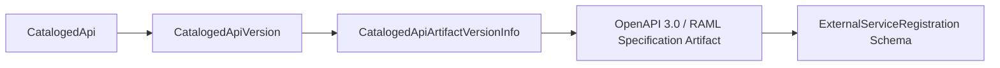

## Architectural Overview

Within the Salesforce API Catalog architecture, an API version (`CatalogedApiVersion`) is backed by one or more concrete specification artifacts—such as an OpenAPI 3.0 JSON/YAML document or a MuleSoft Exchange FAT-RAML archive. The `CatalogedApiArtifactVersionInfo` metadata type captures the exact artifact version, classifier, and specification payload link for a cataloged API version.

By tracking `CatalogedApiArtifactVersionInfo` as distinct metadata, Salesforce can detect when an upstream specification artifact in MuleSoft Anypoint Exchange has been patched or re-published, enabling controlled schema updates for downstream External Services, [Flow](/docs/metadata/flow-metadata-type/) callouts, and Agentforce actions.



## Directory Location and File Suffix

In Salesforce DX projects, `CatalogedApiArtifactVersionInfo` files are stored in the `catalogedApiArtifactVersionInfos` directory.

| Property | Value |
| :--- | :--- |
| **Directory Path (SFDX)** | `force-app/main/default/catalogedApiArtifactVersionInfos/` |
| **File Suffix (SFDX)** | `.catalogedApiArtifactVersionInfo-meta.xml` |
| **Classic Metadata Suffix** | `.catalogedApiArtifactVersionInfo` |
| **Metadata Type Name** | `CatalogedApiArtifactVersionInfo` |

## Key Metadata Fields

The following table summarizes the XML fields of `CatalogedApiArtifactVersionInfo` in API version `68.0` (Winter '27):

| Field Name | Field Type | Required | Architectural Description |
| :--- | :--- | :--- | :--- |
| `masterLabel` | `string` | Yes | The human-readable label for the API specification artifact version info record. |
| `catalogedApiVersion` | `string` | Yes | The developer name of the parent `CatalogedApiVersion` record this artifact belongs to. |
| `artifactId` | `string` | Yes | The identifier of the specification artifact in the external catalog (for example, `erp-order-status-oas`). |
| `artifactVersion` | `string` | Yes | The exact version string of the specification artifact (for example, `1.2.0`). |
| `classifier` | `string` | No | The artifact format classifier, such as `oas`, `oas3`, or `fat-raml`. |
| `packaging` | `string` | No | The archive or file packaging format of the artifact, such as `zip`, `json`, or `yaml`. |
| `mainFile` | `string` | No | The entry-point specification filename inside the artifact package (for example, `erp-order-status.yaml`). |

## Declarative Metadata Example

The following metadata file links an OpenAPI 3.0 specification artifact (`1.2.0`) to its parent `ERP_Order_Status_API_v1` version record.

```xml title="force-app/main/default/catalogedApiArtifactVersionInfos/ERP_Order_Status_OAS_1_2_0.catalogedApiArtifactVersionInfo-meta.xml"
<?xml version="1.0" encoding="UTF-8"?>
<CatalogedApiArtifactVersionInfo xmlns="http://soap.sforce.com/2006/04/metadata">
    <artifactId>erp-order-status-system-api</artifactId>
    <artifactVersion>1.2.0</artifactVersion>
    <catalogedApiVersion>ERP_Order_Status_API_v1</catalogedApiVersion>
    <classifier>oas3</classifier>
    <mainFile>erp-order-status-api.yaml</mainFile>
    <masterLabel>ERP Order Status OAS 1.2.0</masterLabel>
    <packaging>zip</packaging>
</CatalogedApiArtifactVersionInfo>
```

### Package Manifest (`package.xml`)

Always include the parent `CatalogedApi` and `CatalogedApiVersion` alongside `CatalogedApiArtifactVersionInfo`:

```xml title="manifest/package.xml"
<?xml version="1.0" encoding="UTF-8"?>
<Package xmlns="http://soap.sforce.com/2006/04/metadata">
    <types>
        <members>ERP_Order_Status_API</members>
        <name>CatalogedApi</name>
    </types>
    <types>
        <members>ERP_Order_Status_API_v1</members>
        <name>CatalogedApiVersion</name>
    </types>
    <types>
        <members>ERP_Order_Status_OAS_1_2_0</members>
        <name>CatalogedApiArtifactVersionInfo</name>
    </types>
    <version>68.0</version>
</Package>
```

## Tooling API Queries and SFDX CLI Commands

Retrieve and deploy artifact version metadata using the Salesforce CLI:

```bash
# Retrieve all CatalogedApiArtifactVersionInfo metadata
sf project retrieve start --metadata CatalogedApiArtifactVersionInfo

# Deploy the complete API Catalog chain together
sf project deploy start --metadata CatalogedApi,CatalogedApiVersion,CatalogedApiArtifactVersionInfo
```

You can also query `CatalogedApiArtifactVersionInfo` via Tooling API (`sf data query --use-tooling-api`):

```soql
SELECT Id, DeveloperName, MasterLabel, ArtifactId, ArtifactVersion, Classifier, MainFile
FROM CatalogedApiArtifactVersionInfo
ORDER BY ArtifactId ASC, ArtifactVersion DESC
```

## Architect Best Practices and Gotchas

> [!WARNING]
> Do not manually edit `artifactVersion` or `mainFile` in `CatalogedApiArtifactVersionInfo` without regenerating the downstream External Service registration if breaking schema changes were introduced in the OpenAPI contract.

- **Strict Parent Ordering:** In CI/CD deployments, `CatalogedApiArtifactVersionInfo` has a hard foreign-key dependency on `CatalogedApiVersion`. Never deploy artifact version info files in a separate job prior to their parent API version.
- **Immutable Artifact Versions:** Treat each `artifactVersion` (`1.2.0`, `1.2.1`) as immutable once promoted to production so audit trails clearly reflect which OpenAPI contract version backed a given release.
