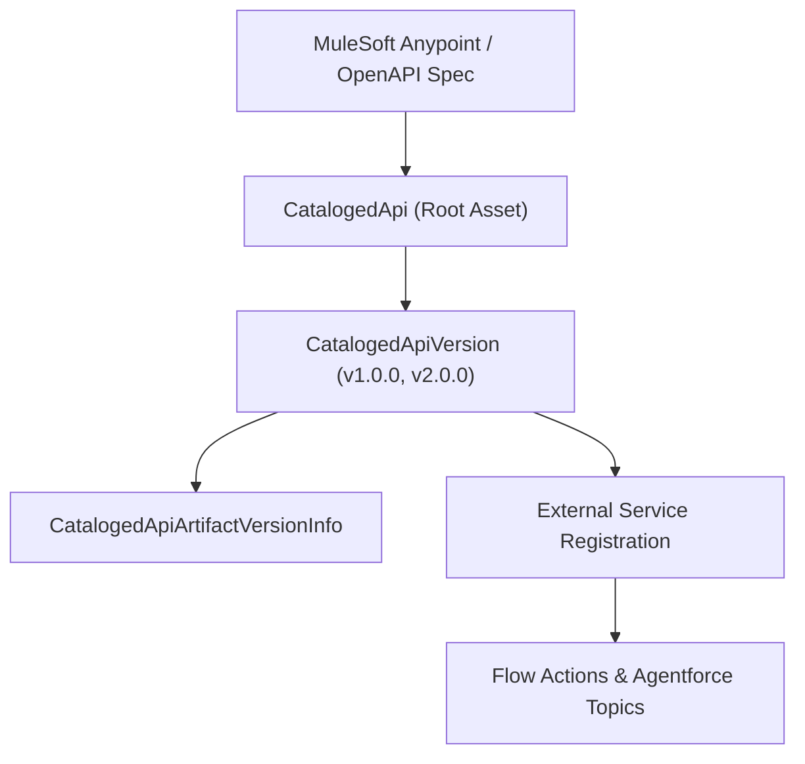

## Architectural Overview

Modern Salesforce architectures rely heavily on composable APIs—whether hosted in MuleSoft Anypoint Platform or external cloud gateways—to power [Flow](/docs/metadata/flow-metadata-type/) callouts and Agentforce autonomous actions. The `CatalogedApi` metadata type represents the top-level parent entry in the Salesforce **API Catalog**, centralizing API discovery, provider lineage, and lifecycle governance inside Salesforce Setup.

In the API Catalog data model, `CatalogedApi` acts as the root container for an API asset (for example, an Order Management or ERP Billing API). Individual semantic versions of that API are tracked via `CatalogedApiVersion`, while the raw specification artifact bindings are stored in `CatalogedApiArtifactVersionInfo`.



## Directory Location and File Suffix

In Salesforce DX source format, `CatalogedApi` definitions live under `force-app/main/default/catalogedApis/`.

| Property | Value |
| :--- | :--- |
| **Directory Path (SFDX)** | `force-app/main/default/catalogedApis/` |
| **File Suffix (SFDX)** | `.catalogedApi-meta.xml` |
| **Classic Metadata Suffix** | `.catalogedApi` |
| **Metadata Type Name** | `CatalogedApi` |

## Key Metadata Fields

The `CatalogedApi` metadata type captures the identity, origin provider, and descriptive metadata of a cataloged API:

| Field Name | Field Type | Required | Architectural Description |
| :--- | :--- | :--- | :--- |
| `masterLabel` | `string` | Yes | The display name of the cataloged API shown in the Salesforce API Catalog UI. |
| `apiAssetId` | `string` | Yes | The unique asset identifier for the API (such as the MuleSoft Exchange asset ID or external registry identifier). |
| `providerName` | `string` | Yes | The source provider system where the API is cataloged, such as `MuleSoft` or `OpenApi`. |
| `providerId` | `string` | No | The external organization or business group identifier within the API provider platform. |
| `description` | `string` | No | Architectural summary of the API's capabilities, domain boundaries, and intended consumers. |
| `protocol` | `string` | No | The communication protocol of the cataloged API, such as `REST` or `HTTP`. |

## Declarative Metadata Example

The following `CatalogedApi` metadata file registers an enterprise ERP Order Status API synced from MuleSoft Exchange into the Salesforce API Catalog.

```xml title="force-app/main/default/catalogedApis/ERP_Order_Status_API.catalogedApi-meta.xml"
<?xml version="1.0" encoding="UTF-8"?>
<CatalogedApi xmlns="http://soap.sforce.com/2006/04/metadata">
    <apiAssetId>erp-order-status-system-api</apiAssetId>
    <description>Provides real-time ERP order fulfillment status and shipment tracking for Service Cloud and Agentforce.</description>
    <masterLabel>ERP Order Status System API</masterLabel>
    <protocol>REST</protocol>
    <providerId>org-8f92a1b4-mulesoft-prod</providerId>
    <providerName>MuleSoft</providerName>
</CatalogedApi>
```

### Package Manifest (`package.xml`)

```xml title="manifest/package.xml"
<?xml version="1.0" encoding="UTF-8"?>
<Package xmlns="http://soap.sforce.com/2006/04/metadata">
    <types>
        <members>ERP_Order_Status_API</members>
        <name>CatalogedApi</name>
    </types>
    <version>68.0</version>
</Package>
```

## Tooling API Queries and SFDX CLI Commands

Architects can inspect registered APIs using the Salesforce CLI or Tooling API to verify which external APIs are available in a target org:

```bash
# Retrieve all CatalogedApi definitions from an org
sf project retrieve start --metadata CatalogedApi

# Deploy a specific CatalogedApi definition
sf project deploy start --metadata CatalogedApi:ERP_Order_Status_API
```

If querying via Tooling API (`sf data query --use-tooling-api`), inspect the `CatalogedApi` entity:

```soql
SELECT Id, DeveloperName, MasterLabel, ApiAssetId, ProviderName, Protocol
FROM CatalogedApi
ORDER BY MasterLabel ASC
```

## Architect Best Practices and Gotchas

> [!NOTE]
> `CatalogedApi` represents the catalog metadata entry—it does not contain the invocable actions themselves. To invoke operations from a `CatalogedApi` inside a [Flow](/docs/metadata/flow-metadata-type/) or [ApexClass](/docs/metadata/apex-class-metadata-type/), you must also deploy the corresponding `ExternalServiceRegistration` and Named Credential.

- **Deploy the Full API Catalog Hierarchy:** Always bundle `CatalogedApi`, `CatalogedApiVersion`, and `CatalogedApiArtifactVersionInfo` together in your `package.xml` manifest so version lineage remains intact across environments.
- **Permission Governance:** Granting users or agents access to invocable actions generated from a `CatalogedApi` still requires assigning External Credential Principal access via a [PermissionSet](/docs/metadata/permission-set-metadata-type/).
