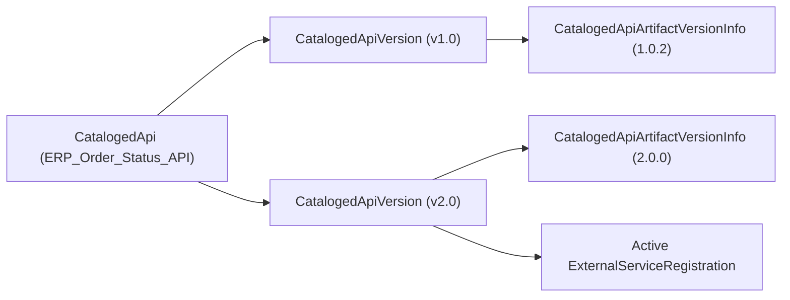

## Architectural Overview

Enterprise APIs evolve through major and minor versions (`v1`, `v2`) as request payloads and endpoints change. Within the Salesforce API Catalog, the `CatalogedApiVersion` metadata type represents a specific version of a parent `CatalogedApi` asset.

Architecturally, `CatalogedApiVersion` acts as the bridge between the high-level API catalog entry (`CatalogedApi`), its underlying OpenAPI or RAML specification artifact (`CatalogedApiArtifactVersionInfo`), and the generated Salesforce `ExternalServiceRegistration` that exposes invocable actions to [Flow](/docs/metadata/flow-metadata-type/), [ApexClass](/docs/metadata/apex-class-metadata-type/), and Agentforce.



## Directory Location and File Suffix

In Salesforce DX source format, `CatalogedApiVersion` components are stored in the `catalogedApiVersions` directory.

| Property | Value |
| :--- | :--- |
| **Directory Path (SFDX)** | `force-app/main/default/catalogedApiVersions/` |
| **File Suffix (SFDX)** | `.catalogedApiVersion-meta.xml` |
| **Classic Metadata Suffix** | `.catalogedApiVersion` |
| **Metadata Type Name** | `CatalogedApiVersion` |

## Key Metadata Fields

The following table lists the key fields on `CatalogedApiVersion` as of API version `68.0` (Winter '27):

| Field Name | Field Type | Required | Architectural Description |
| :--- | :--- | :--- | :--- |
| `masterLabel` | `string` | Yes | The display label of the API version shown in the Salesforce API Catalog. |
| `catalogedApi` | `string` | Yes | The developer name of the parent `CatalogedApi` record to which this version belongs. |
| `apiVersion` | `string` | Yes | The semantic or major version identifier of the API (for example, `v1` or `1.0.0`). |
| `status` | `string` | No | The lifecycle state of the API version in the catalog, such as `Active` or `Deprecated`. |
| `description` | `string` | No | Release notes or architectural description of the changes introduced in this API version. |

## Declarative Metadata Example

The following example defines version `v1` of the `ERP_Order_Status_API` cataloged API:

```xml title="force-app/main/default/catalogedApiVersions/ERP_Order_Status_API_v1.catalogedApiVersion-meta.xml"
<?xml version="1.0" encoding="UTF-8"?>
<CatalogedApiVersion xmlns="http://soap.sforce.com/2006/04/metadata">
    <apiVersion>v1</apiVersion>
    <catalogedApi>ERP_Order_Status_API</catalogedApi>
    <description>Initial production version of the ERP Order Status REST API supporting order lookup by number.</description>
    <masterLabel>ERP Order Status System API v1</masterLabel>
    <status>Active</status>
</CatalogedApiVersion>
```

### Package Manifest (`package.xml`)

```xml title="manifest/package.xml"
<?xml version="1.0" encoding="UTF-8"?>
<Package xmlns="http://soap.sforce.com/2006/04/metadata">
    <types>
        <members>ERP_Order_Status_API</members>
        <name>CatalogedApi</name>
    </types>
    <types>
        <members>ERP_Order_Status_API_v1</members>
        <name>CatalogedApiVersion</name>
    </types>
    <version>68.0</version>
</Package>
```

## Tooling API Queries and SFDX CLI Commands

Use the Salesforce CLI (`sf`) to retrieve and deploy `CatalogedApiVersion` metadata:

```bash
# Retrieve all CatalogedApiVersion components
sf project retrieve start --metadata CatalogedApiVersion

# Deploy a specific CatalogedApiVersion alongside its parent CatalogedApi
sf project deploy start --metadata CatalogedApi:ERP_Order_Status_API,CatalogedApiVersion:ERP_Order_Status_API_v1
```

You can also query `CatalogedApiVersion` via the Tooling API (`sf data query --use-tooling-api`):

```soql
SELECT Id, DeveloperName, MasterLabel, ApiVersion, Status
FROM CatalogedApiVersion
ORDER BY DeveloperName ASC
```

## Architect Best Practices and Gotchas

> [!TIP]
> When introducing a breaking change to an external API, register a new `CatalogedApiVersion` (for example, `ERP_Order_Status_API_v2`) rather than overwriting `v1` in-place. This allows you to migrate [Flow](/docs/metadata/flow-metadata-type/) actions incrementally without breaking active transactions.

- **Parent-Child Deployment Integrity:** Always include the parent `CatalogedApi` and child `CatalogedApiArtifactVersionInfo` in the same deployment package when promoting a new `CatalogedApiVersion` across sandboxes.
- **Lifecycle Hygiene:** Mark older `CatalogedApiVersion` entries as deprecated once all dependent Flows and Apex classes have been cut over to the new version, before attempting destructive removal.
