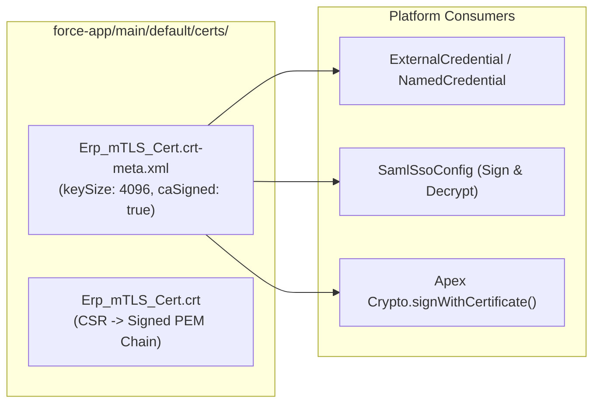

## Why the `Certificate` Metadata Type Is Critical for Enterprise Identity & mTLS

In Salesforce Certificate and Key Management, **`Certificate`** (`certs/<Name>.crt` and `certs/<Name>.crt-meta.xml`) represents an X.509 key pair owned by your Salesforce org. Architects reference `Certificate` components across four critical security boundaries:

1. **SAML SSO Request Signing & Assertion Decryption:** Referenced by [SamlSsoConfig](/docs/metadata/saml-sso-config-metadata-type/) (`requestSigningCertId` and `decryptionCertificate`).
2. **Outbound Mutual TLS (mTLS) Callouts:** Referenced by [ExternalCredential](/docs/metadata/external-credential-metadata-type/), [NamedCredential](/docs/metadata/named-credential-metadata-type/), and [ExternalDataSource](/docs/metadata/external-data-source-metadata-type/) (`certificate`) to prove Salesforce's identity to enterprise API gateways.
3. **Salesforce as an Identity Provider (IdP):** Signing SAML assertions or OAuth JWT tokens issued by Salesforce.
4. **Apex Crypto Digital Signatures:** Invoked via `Crypto.signWithCertificate('RSA-SHA256', data, 'CertDeveloperName')` and `HttpRequest.setClientCertificateName('CertDeveloperName')`.



---

## Key Metadata Fields on `Certificate`

| Field | Type | Required | Description |
|---|---|---|---|
| `masterLabel` | `string` | Yes | Friendly name in Certificate and Key Management (up to 64 characters). |
| `caSigned` | `boolean` | Yes | `true` for a Certificate Authority (CA)-signed certificate (generates a CSR); `false` for a self-signed certificate. |
| `keySize` | `int` | No | `2048` (1-year validity for self-signed; faster handshake) or `4096` (2-year validity for self-signed). Defaults to `2048`. |
| `privateKeyExportable` | `boolean` | No | Controls whether admins can export the certificate into a `.jks` keystore file from the Setup UI. Defaults to `true`. |
| `expirationDate` | `dateTime` | No | Read/updated automatically (`YYYY-MM-DD`) based on `keySize` or the uploaded CA-signed certificate chain. |
| `encryptedWithPlatformEncryption` | `boolean` | No | Encrypts the private key at rest using Salesforce Shield Platform Encryption. |

---

## Real-World XML Example (`certs/MuleSoft_Gateway_mTLS.crt-meta.xml`)

```xml
<?xml version="1.0" encoding="UTF-8"?>
<Certificate xmlns="http://soap.sforce.com/2006/04/metadata">
    <caSigned>false</caSigned>
    <encryptedWithPlatformEncryption>false</encryptedWithPlatformEncryption>
    <keySize>4096</keySize>
    <masterLabel>MuleSoft Gateway mTLS</masterLabel>
    <privateKeyExportable>false</privateKeyExportable>
</Certificate>
```

---

## Auditing Expiring Certificates via Tooling API

Certificate expiration is one of the top causes of sudden production SSO and integration outages. You can query `Certificate` via the **Tooling API** to monitor upcoming expirations:

```sql
SELECT Id, DeveloperName, MasterLabel, KeySize, ExpirationDate,
       OptionsIsCaSigned, OptionsIsPrivateKeyExportable, CreatedDate
FROM Certificate
ORDER BY ExpirationDate ASC
```

*(Execute this query against the **Tooling API**.)*

---

## Senior Architect Best Practices & Gotchas

> [!WARNING]
> **Deploying a `Certificate` Generates a Different Key Pair in Every Org:** Because private keys are never transmitted in `.crt` metadata files, deploying `MuleSoft_Gateway_mTLS.crt-meta.xml` from a Sandbox to Production creates a **brand-new** public/private key pair in Production! If an external API gateway or Identity Provider trusts your certificate thumbprint, you must either upload the Production public cert to the external system or import a shared `.jks` keystore via **Setup → Certificate and Key Management → Import from Keystore**.

