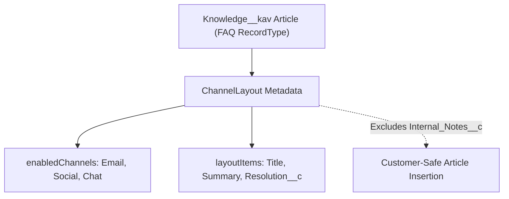

## Architectural Overview

In Salesforce Service Cloud with Lightning Knowledge (`Knowledge__kav`), a single Knowledge article often contains both customer-facing content (such as `Summary` and `Resolution__c`) and internal-only agent notes (such as `Internal_Escalation_Steps__c`). When a support agent clicks **Insert Article into Email** or shares an article in a social/chat channel, the `ChannelLayout` metadata type dictates exactly which fields are included for that specific channel and article Record Type.

Architecting `ChannelLayout` properly is critical for data loss prevention (DLP): if an internal troubleshooting field is accidentally added to the `Email` channel layout, agents inserting an article into a customer email will inadvertently copy internal notes into the outbound message body.



## Directory Location and File Suffix

In Salesforce DX projects, `ChannelLayout` components are stored in the `channelLayouts` directory.

| Property | Value |
| :--- | :--- |
| **Directory Path (SFDX)** | `force-app/main/default/channelLayouts/` |
| **File Suffix (SFDX)** | `.channelLayout-meta.xml` |
| **Classic Metadata Suffix** | `.channelLayout` |
| **Naming Convention** | `<KnowledgeObjectName>-<DeveloperName>.channelLayout-meta.xml` |

## Key Metadata Fields

The `ChannelLayout` metadata type includes the following elements in API version `68.0` (Winter '27):

| Field Name | Field Type | Required | Architectural Description |
| :--- | :--- | :--- | :--- |
| `label` | `string` | Yes | The human-readable label for the channel layout in Setup. |
| `recordType` | `string` | No | The developer name of the `Knowledge__kav` Record Type this channel layout applies to (for example, `FAQ` or `How_To`). |
| `doesExcludeFiles` | `boolean` | No | When `true`, file attachments on the Knowledge article are excluded when inserting the article into an email. |
| `enabledChannels` | `string[]` | No | List of channels where this layout is active, such as `Email`, `Social`, or `Text`. |
| `layoutItems` | `ChannelLayoutItem[]` | No | Ordered list of `<field>` elements specifying the API names of `Knowledge__kav` fields to include in the channel output. |

## Declarative Metadata Example

The following `ChannelLayout` configures the `FAQ` record type on `Knowledge__kav` so that inserting an FAQ article into an Email includes only `Title`, `Summary`, and `Public_Answer__c`, while excluding attached files and internal notes.

```xml title="force-app/main/default/channelLayouts/Knowledge__kav-FAQ_Email_Channel.channelLayout-meta.xml"
<?xml version="1.0" encoding="UTF-8"?>
<ChannelLayout xmlns="http://soap.sforce.com/2006/04/metadata">
    <doesExcludeFiles>true</doesExcludeFiles>
    <enabledChannels>Email</enabledChannels>
    <label>FAQ Customer Email Channel Layout</label>
    <layoutItems>
        <field>Title</field>
    </layoutItems>
    <layoutItems>
        <field>Summary</field>
    </layoutItems>
    <layoutItems>
        <field>Public_Answer__c</field>
    </layoutItems>
    <recordType>FAQ</recordType>
</ChannelLayout>
```

### Package Manifest (`package.xml`)

```xml title="manifest/package.xml"
<?xml version="1.0" encoding="UTF-8"?>
<Package xmlns="http://soap.sforce.com/2006/04/metadata">
    <types>
        <members>Knowledge__kav-FAQ_Email_Channel</members>
        <name>ChannelLayout</name>
    </types>
    <version>68.0</version>
</Package>
```

## SFDX CLI Retrieval and Deployment

Retrieve and deploy `ChannelLayout` definitions using the `sf` CLI:

```bash
# Retrieve all ChannelLayout definitions in the org
sf project retrieve start --metadata ChannelLayout

# Deploy a specific Knowledge ChannelLayout
sf project deploy start --metadata "ChannelLayout:Knowledge__kav-FAQ_Email_Channel"
```

## Architect Best Practices and Gotchas

> [!WARNING]
> `ChannelLayout` only governs which fields are copied when sharing articles through communication actions (such as Insert Article into Email). It is **not** a substitute for Field-Level Security (FLS). External users browsing articles on an Experience Cloud site can still query or view fields unless FLS is restricted on their [Profile](/docs/metadata/profile-metadata-type/) or [PermissionSet](/docs/metadata/permission-set-metadata-type/).

- **Deploy Knowledge Schema First:** Ensure `Knowledge__kav` [CustomField](/docs/metadata/custom-field-metadata-type/) components (`Public_Answer__c`) and `RecordType` definitions (`FAQ`) are included in the deployment manifest whenever deploying `ChannelLayout` files.
- **File Attachment Governance:** Set `<doesExcludeFiles>true</doesExcludeFiles>` on external email channel layouts if Knowledge articles contain internal PDFs or large media attachments that could exceed outbound email size limits.
