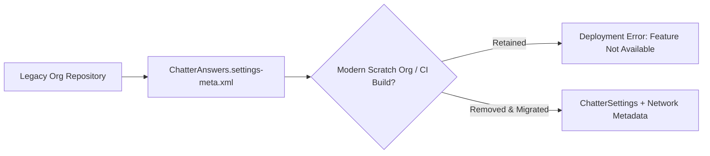

## Architectural Overview

The `ChatterAnswersSettings` metadata type represents org-wide settings for the legacy **Chatter Answers** self-service Q&A portal feature. While Salesforce officially retired Chatter Answers and replaced it with **Chatter Questions** inside Experience Cloud ([Network](/docs/metadata/network-metadata-type/) and [ExperienceBundle](/docs/metadata/experience-bundle-metadata-type/)), the `ChatterAnswersSettings` metadata schema remains documented in the Metadata API (`68.0`) so enterprise orgs with historical metadata repositories can understand, audit, or clean up legacy settings files.

For Senior Salesforce Architects modernizing legacy Metadata API repositories into SFDX source format, recognizing `ChatterAnswersSettings` is essential because leaving `<enableChatterAnswers>true</enableChatterAnswers>` in a repository will block scratch org creation and fail CI/CD validation against modern org shapes.



## Directory Location and File Suffix

In Salesforce DX projects, `ChatterAnswersSettings` maps to `ChatterAnswers.settings-meta.xml` under the `settings` folder.

| Property | Value |
| :--- | :--- |
| **Directory Path (SFDX)** | `force-app/main/default/settings/` |
| **File Name (SFDX)** | `ChatterAnswers.settings-meta.xml` |
| **Classic Metadata File** | `settings/ChatterAnswers.settings` |
| **Package.xml Type & Member** | `<name>Settings</name>` with `<members>ChatterAnswers</members>` |

## Key Metadata Fields

The `ChatterAnswersSettings` schema defines the following historical boolean flags:

| Field Name | Field Type | Architectural Description |
| :--- | :--- | :--- |
| `enableChatterAnswers` | `boolean` | Master switch for the legacy Chatter Answers feature (`false` in all modern orgs). |
| `enableAnswerViaEmail` | `boolean` | Allowed users to reply to Chatter Answers notification emails to post an answer. |
| `enableFacebookSSO` | `boolean` | Enabled legacy Facebook Single Sign-On integration for Chatter Answers portals (`AuthProvider` is used today). |
| `enableInlinePublisher` | `boolean` | Controlled whether the question/answer publisher rendered inline on the legacy portal page. |
| `enableReputation` | `boolean` | Enabled reputation points and levels in Chatter Answers (now configured on [Network](/docs/metadata/network-metadata-type/)). |
| `enableRichTextEditor` | `boolean` | Allowed rich text formatting and image uploads inside legacy Chatter Answers posts. |
| `emailFollowersOnBestAnswer` | `boolean` | Sent an email notification to question followers when a Best Answer was selected. |
| `emailFollowersOnReply` | `boolean` | Sent an email notification to followers whenever a new reply was posted. |
| `emailOwnerOnPrivateReply` | `boolean` | Sent an email notification to the question owner when support posted a private reply. |
| `emailOwnerOnReply` | `boolean` | Sent an email notification to the question author when a public reply was posted. |

## Declarative Metadata Example

If an older repository still tracks `ChatterAnswers.settings-meta.xml`, it typically appears with `enableChatterAnswers` set to `false`:

```xml title="force-app/main/default/settings/ChatterAnswers.settings-meta.xml"
<?xml version="1.0" encoding="UTF-8"?>
<ChatterAnswersSettings xmlns="http://soap.sforce.com/2006/04/metadata">
    <emailFollowersOnBestAnswer>false</emailFollowersOnBestAnswer>
    <emailFollowersOnReply>false</emailFollowersOnReply>
    <emailOwnerOnPrivateReply>false</emailOwnerOnPrivateReply>
    <emailOwnerOnReply>false</emailOwnerOnReply>
    <enableAnswerViaEmail>false</enableAnswerViaEmail>
    <enableChatterAnswers>false</enableChatterAnswers>
    <enableFacebookSSO>false</enableFacebookSSO>
    <enableInlinePublisher>false</enableInlinePublisher>
    <enableReputation>false</enableReputation>
    <enableRichTextEditor>false</enableRichTextEditor>
</ChatterAnswersSettings>
```

### Package Manifest (`package.xml`)

```xml title="manifest/package.xml"
<?xml version="1.0" encoding="UTF-8"?>
<Package xmlns="http://soap.sforce.com/2006/04/metadata">
    <types>
        <members>ChatterAnswers</members>
        <name>Settings</name>
    </types>
    <version>68.0</version>
</Package>
```

## SFDX CLI Commands

```bash
# Retrieve ChatterAnswersSettings (only if supported by the org shape)
sf project retrieve start --metadata Settings:ChatterAnswers
```

## Architect Best Practices and Gotchas

> [!WARNING]
> Do not include `<members>*</members>` under `<name>Settings</name>` in CI/CD manifests when migrating legacy orgs to scratch orgs. Wildcard `Settings` retrievals pull obsolete files like `ChatterAnswers.settings-meta.xml` that fail deployment in newly provisioned scratch orgs.

- **Prune from Source Control:** If your Git repository contains `force-app/main/default/settings/ChatterAnswers.settings-meta.xml`, delete the file from Git (without running destructive changes against the org) so scratch org builds remain clean.
- **Modern Replacement Architecture:** Use `ChatterSettings` (`Chatter.settings-meta.xml`) for feed capabilities, [Network](/docs/metadata/network-metadata-type/) for Experience Cloud reputation rules and question-to-case escalation, and [ExperienceBundle](/docs/metadata/experience-bundle-metadata-type/) for Q&A UI components.
