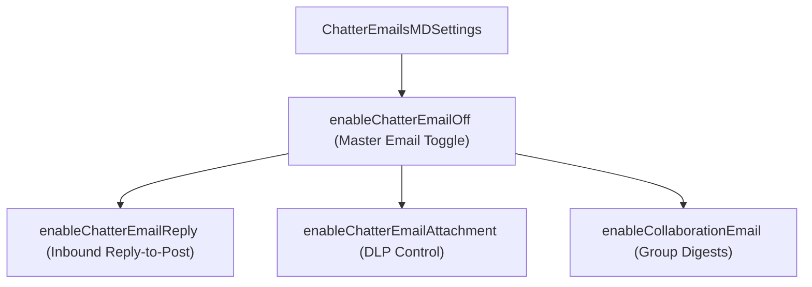

## Architectural Overview

The `ChatterEmailsMDSettings` metadata type governs org-wide email notification and inbound email-reply capabilities for Salesforce Chatter. In Setup, these options appear under **Chatter** > **Email Settings**.

For enterprise architects, controlling `ChatterEmailsMDSettings` via SFDX source format is critical for two reasons:
1. **Data Loss Prevention (DLP):** Preventing confidential files or post attachments from being sent outside the org as raw email attachments (`enableChatterEmailAttachment`).
2. **Release & Migration Hygiene:** Suppressing outbound Chatter email storms during large data migrations, bulk `@mention` [Flow](/docs/metadata/flow-metadata-type/) backfills, or sandbox testing (`enableChatterDigestEmailsApiOnly`, `enableChatterEmailOff`).



## Directory Location and File Suffix

In Salesforce DX projects, `ChatterEmailsMDSettings` is stored in the `settings` folder as `ChatterEmailsMD.settings-meta.xml`.

| Property | Value |
| :--- | :--- |
| **Directory Path (SFDX)** | `force-app/main/default/settings/` |
| **File Name (SFDX)** | `ChatterEmailsMD.settings-meta.xml` |
| **Classic Metadata File** | `settings/ChatterEmailsMD.settings` |
| **Package.xml Type & Member** | `<name>Settings</name>` with `<members>ChatterEmailsMD</members>` |

## Key Metadata Fields

The following table describes the configuration fields available on `ChatterEmailsMDSettings` in API version `68.0` (Winter '27):

| Field Name | Field Type | Architectural Description |
| :--- | :--- | :--- |
| `enableChatterEmailOff` | `boolean` | When `false`, Chatter emails are enabled org-wide (the field name is inverted: setting `enableChatterEmailOff` to `true` turns off Chatter emails). |
| `enableChatterEmailReply` | `boolean` | Allows users to reply to Chatter email notifications to post comments or send private messages. |
| `enableChatterEmailAttachment` | `boolean` | Includes file attachments directly in outbound Chatter notification emails. Set to `false` in regulated industries (HIPAA, FINRA). |
| `enableCollaborationEmail` | `boolean` | Enables personal and group Chatter digest emails and notification delivery. |
| `enableChatterDigestEmailsApiOnly` | `boolean` | Restricts digest configuration to API updates rather than end-user self-service where applicable. |
| `enableEmailToChatter` | `boolean` | Allows users to post to their feed or groups by sending an email to a dedicated Salesforce address. |

## Declarative Metadata Example

The following `ChatterEmailsMD.settings-meta.xml` enables Chatter emails and email replies while blocking physical file attachments from being emailed outside Salesforce (`<enableChatterEmailAttachment>false</enableChatterEmailAttachment>`).

```xml title="force-app/main/default/settings/ChatterEmailsMD.settings-meta.xml"
<?xml version="1.0" encoding="UTF-8"?>
<ChatterEmailsMDSettings xmlns="http://soap.sforce.com/2006/04/metadata">
    <enableChatterDigestEmailsApiOnly>false</enableChatterDigestEmailsApiOnly>
    <enableChatterEmailAttachment>false</enableChatterEmailAttachment>
    <enableChatterEmailOff>false</enableChatterEmailOff>
    <enableChatterEmailReply>true</enableChatterEmailReply>
    <enableCollaborationEmail>true</enableCollaborationEmail>
    <enableEmailToChatter>true</enableEmailToChatter>
</ChatterEmailsMDSettings>
```

### Package Manifest (`package.xml`)

```xml title="manifest/package.xml"
<?xml version="1.0" encoding="UTF-8"?>
<Package xmlns="http://soap.sforce.com/2006/04/metadata">
    <types>
        <members>ChatterEmailsMD</members>
        <name>Settings</name>
    </types>
    <version>68.0</version>
</Package>
```

## SFDX CLI Retrieval and Deployment

Use the `sf` CLI to retrieve or deploy `ChatterEmailsMDSettings`:

```bash
# Retrieve Chatter email settings into force-app/main/default/settings/ChatterEmailsMD.settings-meta.xml
sf project retrieve start --metadata Settings:ChatterEmailsMD

# Deploy updated Chatter email settings to the target org
sf project deploy start --metadata Settings:ChatterEmailsMD
```

## Architect Best Practices and Gotchas

> [!WARNING]
> Watch out for the inverted boolean naming of `enableChatterEmailOff`: setting `<enableChatterEmailOff>true</enableChatterEmailOff>` **disables** Chatter emails across the entire org, whereas `<enableChatterEmailOff>false</enableChatterEmailOff>` **enables** them.

- **Security Hardening for Regulated Industries:** Always set `<enableChatterEmailAttachment>false</enableChatterEmailAttachment>` in healthcare, financial services, and public sector orgs so users must authenticate into Salesforce to view files posted in Chatter rather than receiving them over unencrypted email.
- **Sandbox Post-Refresh Automation:** Include a sandbox-specific `ChatterEmailsMD.settings-meta.xml` with `<enableChatterEmailOff>true</enableChatterEmailOff>` in your sandbox post-refresh script to guarantee UAT testing never sends accidental `@mention` emails to real addresses before email masking completes.
