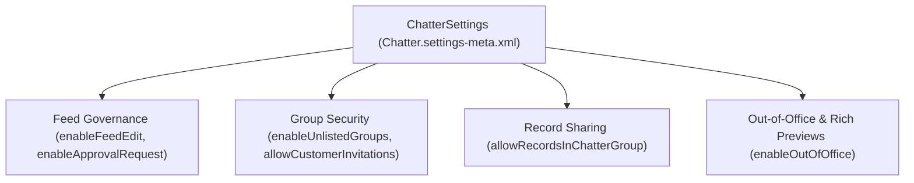

## Architectural Overview

The `ChatterSettings` metadata type is the master control plane for Salesforce Chatter collaboration across internal Lightning Experience apps, Service Cloud Case Feeds, and Experience Cloud ([Network](/docs/metadata/network-metadata-type/)) sites. Stored as `Chatter.settings-meta.xml`, it controls feed post mutability (`enableFeedEdit`), unlisted group privacy (`enableUnlistedGroups`), rich link metadata fetching (`enableRichLinkPreviewsInFeed`), and records sharing via Chatter groups (`allowRecordsInChatterGroup`).

From a security and compliance standpoint, `ChatterSettings` directly impacts data governance. For example, financial services and healthcare architects often disable `enableFeedEdit` or `allowCustomerInvitations` via `Chatter.settings-meta.xml` so that feed posts remain immutable for regulatory compliance and external guests cannot be invited ad-hoc outside governed Experience Cloud portals.



## Directory Location and File Suffix

In Salesforce DX source format, `ChatterSettings` is stored in the `settings` directory as `Chatter.settings-meta.xml`.

| Property | Value |
| :--- | :--- |
| **Directory Path (SFDX)** | `force-app/main/default/settings/` |
| **File Name (SFDX)** | `Chatter.settings-meta.xml` |
| **Classic Metadata File** | `settings/Chatter.settings` |
| **Package.xml Type & Member** | `<name>Settings</name>` with `<members>Chatter</members>` |

## Key Metadata Fields

The following table highlights the primary configuration flags on `ChatterSettings` in API version `68.0` (Winter '27):

| Field Name | Field Type | Architectural Description |
| :--- | :--- | :--- |
| `enableChatter` | `boolean` | Master toggle that enables Chatter across the entire Salesforce organization. |
| `enableFeedEdit` | `boolean` | Allows authors and record owners to edit published Chatter feed posts and comments. |
| `enableFeedPinning` | `boolean` | Allows authorized users to pin up to three important posts to the top of group and topics feeds. |
| `enableUnlistedGroups` | `boolean` | Enables hidden, invite-only Chatter groups (`Unlisted`) that do not appear in list views or search results for non-members. |
| `allowRecordsInChatterGroup` | `boolean` | Enables associating records (such as Accounts or Opportunities) with Chatter groups via `CollaborationGroupRecord`. |
| `allowCustomerInvitations` | `boolean` | Allows internal users to invite external customers into private Chatter groups as Chatter External users. |
| `allowChatterGroupArchiving` | `boolean` | Allows group owners and managers to archive inactive Chatter groups manually or after 90 days of inactivity. |
| `enableOutOfOffice` | `boolean` | Lets users schedule Out of Office messages next to their name in Chatter feeds and `@mentions`. |
| `enableRichLinkPreviewsInFeed` | `boolean` | Automatically renders rich title, thumbnail, and summary previews for URLs shared in Chatter posts. |
| `enableTodayRecsInFeed` | `boolean` | Displays Einstein/Today recommendations inside user feeds. |

## Declarative Metadata Example

The following `Chatter.settings-meta.xml` configures enterprise-hardened Chatter settings: enabling feed pinning, unlisted groups, out-of-office status, and record associations in groups, while blocking ad-hoc external customer invitations (`<allowCustomerInvitations>false</allowCustomerInvitations>`).

```xml title="force-app/main/default/settings/Chatter.settings-meta.xml"
<?xml version="1.0" encoding="UTF-8"?>
<ChatterSettings xmlns="http://soap.sforce.com/2006/04/metadata">
    <allowChatterGroupArchiving>true</allowChatterGroupArchiving>
    <allowCustomerInvitations>false</allowCustomerInvitations>
    <allowRecordsInChatterGroup>true</allowRecordsInChatterGroup>
    <enableApprovalRequest>true</enableApprovalRequest>
    <enableChatter>true</enableChatter>
    <enableChatterEmoticons>true</enableChatterEmoticons>
    <enableFeedEdit>true</enableFeedEdit>
    <enableFeedPinning>true</enableFeedPinning>
    <enableInviteCsnUsers>false</enableInviteCsnUsers>
    <enableOutOfOffice>true</enableOutOfOffice>
    <enableRichLinkPreviewsInFeed>true</enableRichLinkPreviewsInFeed>
    <enableTodayRecsInFeed>false</enableTodayRecsInFeed>
    <enableUnlistedGroups>true</enableUnlistedGroups>
</ChatterSettings>
```

### Package Manifest (`package.xml`)

```xml title="manifest/package.xml"
<?xml version="1.0" encoding="UTF-8"?>
<Package xmlns="http://soap.sforce.com/2006/04/metadata">
    <types>
        <members>Chatter</members>
        <name>Settings</name>
    </types>
    <version>68.0</version>
</Package>
```

## SFDX CLI Retrieval and Deployment

Retrieve and deploy `ChatterSettings` using the Salesforce CLI (`sf`):

```bash
# Retrieve ChatterSettings into force-app/main/default/settings/Chatter.settings-meta.xml
sf project retrieve start --metadata Settings:Chatter

# Deploy ChatterSettings to the target org
sf project deploy start --metadata Settings:Chatter
```

## Architect Best Practices and Gotchas

> [!TIP]
> Include `Settings:Chatter` in your baseline scratch org definition or initial pipeline pre-deployment stage before deploying [CustomObject](/docs/metadata/custom-object-metadata-type/) files that set `<allowInChatterGroups>true</allowInChatterGroups>` or `<enableFeeds>true</enableFeeds>`.

- **Dependency with `allowInChatterGroups`:** If a [CustomObject](/docs/metadata/custom-object-metadata-type/) specifies `<allowInChatterGroups>true</allowInChatterGroups>`, `allowRecordsInChatterGroup` in `ChatterSettings` must be `true` in the target org.
- **Compliance & eDiscovery Immutability:** In FINRA or SEC-regulated environments where communications cannot be altered after publication without an audit log, either set `<enableFeedEdit>false</enableFeedEdit>` or ensure your compliance archiving tool queries the `FeedRevision` object via SOAP/REST API.
