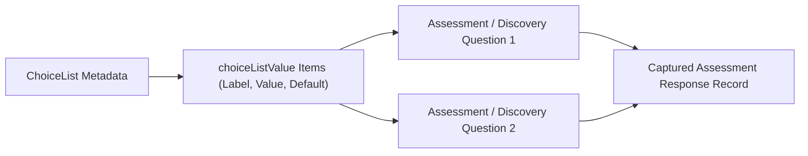

## Architectural Overview

Across Salesforce Industry Clouds (such as Health Cloud, Financial Services Cloud, and Public Sector Solutions) and dynamic questionnaire engines, intake forms and assessments require hundreds of standardized single-select or multi-select answer sets (for example, *Yes / No / Unable to Assess* or *Low / Moderate / High / Critical*). Creating database-level [CustomField](/docs/metadata/custom-field-metadata-type/) picklists for every questionnaire prompt quickly exhausts object field governor limits.

The `ChoiceList` metadata type decouples form answer options from physical database columns. It defines a reusable collection of choice values (`choiceListValue`) that dynamic assessments, Discovery Framework questions, and guided [Flow](/docs/metadata/flow-metadata-type/) screens can reference declaratively.



## Directory Location and File Suffix

In Salesforce DX source format, `ChoiceList` components are stored in the `choiceLists` directory.

| Property | Value |
| :--- | :--- |
| **Directory Path (SFDX)** | `force-app/main/default/choiceLists/` |
| **File Suffix (SFDX)** | `.choiceList-meta.xml` |
| **Classic Metadata Suffix** | `.choiceList` |
| **Metadata Type Name** | `ChoiceList` |

## Key Metadata Fields

The following table describes the fields available on `ChoiceList` and its nested `ChoiceListValue` items in API version `68.0` (Winter '27):

| Field Name | Field Type | Required | Architectural Description |
| :--- | :--- | :--- | :--- |
| `name` | `string` | Yes | The display name or label of the choice list in Setup. |
| `description` | `string` | No | Documents the intended clinical, financial, or regulatory context for this option list. |
| `choiceListValue` | `ChoiceListValue[]` | No | Collection of individual selectable options belonging to the choice list. |
| `choiceListValue.valueName` | `string` | Yes | The stored API value recorded when the user selects this choice option. |
| `choiceListValue.label` | `string` | Yes | The user-facing display label rendered in the assessment or dynamic form UI. |
| `choiceListValue.isDefaultValue` | `boolean` | No | Specifies whether this option is pre-selected by default when the form loads. |
| `choiceListValue.displayOrder` | `int` | No | Controls the numeric sort sequence (`1`, `2`, `3`) of options in the dropdown or radio group. |

## Declarative Metadata Example

The following `ChoiceList` defines a standardized Clinical Risk Severity scale (`Low`, `Moderate`, `High`, `Critical`) for patient intake assessments.

```xml title="force-app/main/default/choiceLists/Clinical_Risk_Severity_Scale.choiceList-meta.xml"
<?xml version="1.0" encoding="UTF-8"?>
<ChoiceList xmlns="http://soap.sforce.com/2006/04/metadata">
    <choiceListValue>
        <displayOrder>1</displayOrder>
        <isDefaultValue>true</isDefaultValue>
        <label>Low Risk</label>
        <valueName>LOW</valueName>
    </choiceListValue>
    <choiceListValue>
        <displayOrder>2</displayOrder>
        <isDefaultValue>false</isDefaultValue>
        <label>Moderate Risk</label>
        <valueName>MODERATE</valueName>
    </choiceListValue>
    <choiceListValue>
        <displayOrder>3</displayOrder>
        <isDefaultValue>false</isDefaultValue>
        <label>High Risk</label>
        <valueName>HIGH</valueName>
    </choiceListValue>
    <choiceListValue>
        <displayOrder>4</displayOrder>
        <isDefaultValue>false</isDefaultValue>
        <label>Critical Risk</label>
        <valueName>CRITICAL</valueName>
    </choiceListValue>
    <description>Standardized four-tier risk severity choices for patient and member intake assessments.</description>
    <name>Clinical Risk Severity Scale</name>
</ChoiceList>
```

### Package Manifest (`package.xml`)

```xml title="manifest/package.xml"
<?xml version="1.0" encoding="UTF-8"?>
<Package xmlns="http://soap.sforce.com/2006/04/metadata">
    <types>
        <members>Clinical_Risk_Severity_Scale</members>
        <name>ChoiceList</name>
    </types>
    <version>68.0</version>
</Package>
```

## SFDX CLI Retrieval and Deployment

Manage `ChoiceList` metadata across environments with the Salesforce CLI (`sf`):

```bash
# Retrieve all ChoiceList components from the org
sf project retrieve start --metadata ChoiceList

# Deploy a specific ChoiceList component
sf project deploy start --metadata ChoiceList:Clinical_Risk_Severity_Scale
```

## Architect Best Practices and Gotchas

> [!TIP]
> Keep `valueName` uppercase and machine-friendly (such as `LOW`, `MODERATE`, `HIGH`) while modifying `label` for user-facing wording changes. This prevents downstream [Flow](/docs/metadata/flow-metadata-type/) decision elements or scoring formulas from breaking when business stakeholders request label copy updates.

- **Avoid Duplicate `ChoiceList` Definitions:** Before creating a new `ChoiceList` for an assessment, audit existing `force-app/main/default/choiceLists/` files to reuse common scales (such as Yes/No/NA or Likert 1–5 scales).
- **Preserve Historical `valueName` Entries:** Never rename an active `valueName` that has already been captured in production assessment responses; add a new `choiceListValue` instead so historical reporting remains consistent.
