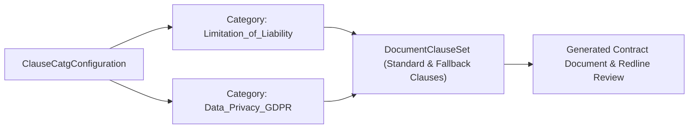

## Architectural Overview

In Salesforce Contracts Lifecycle Management (CLM) and Revenue Cloud, enterprise legal teams maintain a central Clause Library containing standard, fallback, and alternate contract clauses. The `ClauseCatgConfiguration` metadata type defines the structural **Clause Categories** (for example, *Data Privacy & GDPR*, *Intellectual Property*, *Limitation of Liability*, and *Governing Law*) used to classify those clauses.

Because `ClauseCatgConfiguration` is a first-class Metadata API type rather than volatile record data, architects can version-control the legal clause taxonomy in Git and promote it reliably alongside contract approval [Flow](/docs/metadata/flow-metadata-type/) definitions and document generation templates.



## Directory Location and File Suffix

In Salesforce DX projects, `ClauseCatgConfiguration` files are stored in the `clauseCatgConfigurations` folder.

| Property | Value |
| :--- | :--- |
| **Directory Path (SFDX)** | `force-app/main/default/clauseCatgConfigurations/` |
| **File Suffix (SFDX)** | `.clauseCatgConfiguration-meta.xml` |
| **Classic Metadata Suffix** | `.clauseCatgConfiguration` |
| **Metadata Type Name** | `ClauseCatgConfiguration` |

## Key Metadata Fields

The following table lists the key XML elements of `ClauseCatgConfiguration` in API version `68.0` (Winter '27):

| Field Name | Field Type | Required | Architectural Description |
| :--- | :--- | :--- | :--- |
| `masterLabel` | `string` | Yes | The human-readable name of the clause category displayed in the Clause Library UI. |
| `usageType` | `string` | Yes | Defines the functional domain where the clause category is used, such as `ContractLifecycleManagement`. |
| `description` | `string` | No | Explains the legal scope and approval requirements for clauses assigned to this category. |
| `parentCategory` | `string` | No | Optional developer name of a parent `ClauseCatgConfiguration` when building hierarchical clause taxonomies. |

## Declarative Metadata Example

The following `ClauseCatgConfiguration` metadata file defines a `Limitation_of_Liability` category for Contract Lifecycle Management:

```xml title="force-app/main/default/clauseCatgConfigurations/Limitation_of_Liability.clauseCatgConfiguration-meta.xml"
<?xml version="1.0" encoding="UTF-8"?>
<ClauseCatgConfiguration xmlns="http://soap.sforce.com/2006/04/metadata">
    <description>Covers standard, mutual, and super-cap limitation of liability clauses requiring Legal Counsel review upon deviation.</description>
    <masterLabel>Limitation of Liability</masterLabel>
    <usageType>ContractLifecycleManagement</usageType>
</ClauseCatgConfiguration>
```

### Package Manifest (`package.xml`)

```xml title="manifest/package.xml"
<?xml version="1.0" encoding="UTF-8"?>
<Package xmlns="http://soap.sforce.com/2006/04/metadata">
    <types>
        <members>Limitation_of_Liability</members>
        <name>ClauseCatgConfiguration</name>
    </types>
    <version>68.0</version>
</Package>
```

## SOQL Queries and SFDX CLI Commands

You can query `ClauseCatgConfiguration` via SOQL or Tooling API to inspect configured legal clause categories in an org:

```soql
SELECT Id, DeveloperName, MasterLabel, UsageType, Description
FROM ClauseCatgConfiguration
ORDER BY MasterLabel ASC
```

Retrieve and deploy clause categories with the Salesforce CLI (`sf`):

```bash
# Retrieve all ClauseCatgConfiguration components
sf project retrieve start --metadata ClauseCatgConfiguration

# Deploy a specific ClauseCatgConfiguration component
sf project deploy start --metadata ClauseCatgConfiguration:Limitation_of_Liability
```

## Architect Best Practices and Gotchas

> [!TIP]
> When designing hierarchical clause categories using `parentCategory`, include both the parent and child `ClauseCatgConfiguration` components in the same `package.xml` deployment so Salesforce resolves the self-referential hierarchy in a single pass.

- **Prerequisite Contract Settings:** Ensure Salesforce Contracts (`ContractSettings` / CLM license) is enabled in the target org before deploying `ClauseCatgConfiguration`, or the deployment will fail with an invalid type error.
- **Stable Developer Names:** Avoid changing the filename (`DeveloperName`) of a deployed `ClauseCatgConfiguration` once `DocumentClauseSet` records in production reference it; update `<masterLabel>` instead if Legal renames a category.
