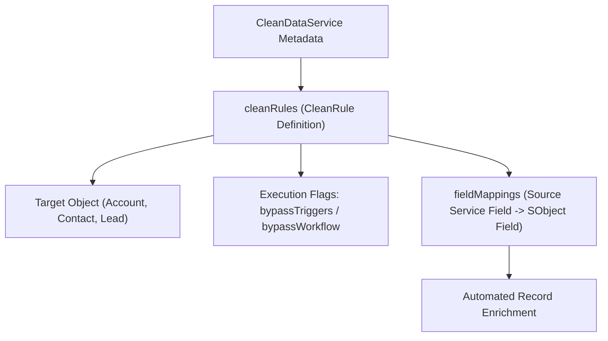

## Architectural Overview

Maintaining accurate firmographic, demographic, and geolocation data on `Account`, `Contact`, and `Lead` records requires continuous background enrichment. The `CleanDataService` metadata type represents a **Data Integration Service** (such as built-in Address Geocoding or an installed Lightning Data provider package) along with its embedded `cleanRules` (`CleanRule`), field mappings (`fieldMappings`), and trigger/workflow bypass switches.

For Salesforce Technical Architects, `CleanDataService` is especially important because of its execution side effects: each nested `CleanRule` specifies whether background data enrichment bypasses Apex triggers (`bypassTriggers`) and workflow/Flow rules (`bypassWorkflow`). Misconfiguring these flags can either cause unexpected governor limit spikes during bulk enrichment or silently skip critical integration triggers.



## Directory Location and File Suffix

In Salesforce DX projects, `CleanDataService` files are located in the `cleanDataServices` directory.

| Property | Value |
| :--- | :--- |
| **Directory Path (SFDX)** | `force-app/main/default/cleanDataServices/` |
| **File Suffix (SFDX)** | `.cleanDataService-meta.xml` |
| **Classic Metadata Suffix** | `.cleanDataService` |
| **Metadata Type Name** | `CleanDataService` |

## Key Metadata Fields

The following table details the core XML elements of `CleanDataService` and its nested `cleanRules` in API version `68.0` (Winter '27):

| Field Name | Field Type | Required | Architectural Description |
| :--- | :--- | :--- | :--- |
| `masterLabel` | `string` | Yes | The display label of the data service in Setup (**Data Integration Rules**). |
| `description` | `string` | Yes | Describes the data enrichment service provider and purpose. |
| `matchEngine` | `string` | Yes | The internal matching engine identifier used to link Salesforce records to external data entities. |
| `cleanRules` | `CleanRule[]` | No | Collection of data integration rules governing how specific target objects are enriched. |
| `cleanRules.developerName` | `string` | Yes | Unique API name of the individual data integration rule. |
| `cleanRules.targetEntity` | `string` | Yes | Target standard object (`Account`, `Contact`, `Lead`) enriched by the rule. |
| `cleanRules.status` | `CleanRuleStatus` | Yes | Rule activation status (`Active` or `Inactive`). |
| `cleanRules.bypassTriggers` | `boolean` | Yes | When `true`, record updates made by this data integration rule do not fire Apex triggers or record-triggered Flows. |
| `cleanRules.bypassWorkflow` | `boolean` | Yes | When `true`, record updates made by this rule skip workflow rules and processes. |
| `cleanRules.enableContinuousClean` | `boolean` | Yes | Automatically re-evaluates and updates records whenever external provider data changes. |

## Declarative Metadata Example

The following `CleanDataService` example illustrates the structure of a geocoding data integration service with an active `CleanRule` on `Account` Billing Address that bypasses triggers and workflows during background geocoding updates:

```xml title="force-app/main/default/cleanDataServices/DataCloudGeoLocation.cleanDataService-meta.xml"
<?xml version="1.0" encoding="UTF-8"?>
<CleanDataService xmlns="http://soap.sforce.com/2006/04/metadata">
    <cleanRules>
        <bulkEnabled>true</bulkEnabled>
        <bypassTriggers>true</bypassTriggers>
        <bypassWorkflow>true</bypassWorkflow>
        <description>Automatically adds latitude, longitude, and geocode accuracy to Account Billing Addresses.</description>
        <developerName>GeoService_AccountBillingAddress_Rule</developerName>
        <enableContinuousClean>false</enableContinuousClean>
        <masterLabel>Geocodes for Account Billing Address</masterLabel>
        <matchRule>GeoLookupMatchRule</matchRule>
        <sourceSobjectType>DataCloudAddress</sourceSobjectType>
        <status>Active</status>
        <targetEntity>Account</targetEntity>
    </cleanRules>
    <description>Platform geocoding data integration service for standard address fields.</description>
    <masterLabel>Data.com GeoLocation Service</masterLabel>
    <matchEngine>GeoLookupEngine</matchEngine>
</CleanDataService>
```

### Package Manifest (`package.xml`)

```xml title="manifest/package.xml"
<?xml version="1.0" encoding="UTF-8"?>
<Package xmlns="http://soap.sforce.com/2006/04/metadata">
    <types>
        <members>DataCloudGeoLocation</members>
        <name>CleanDataService</name>
    </types>
    <version>68.0</version>
</Package>
```

## SOQL Queries and SFDX CLI Commands

You can query `CleanRule` via SOQL to audit which Data Integration Rules are currently active and whether they bypass triggers in your org:

```soql
SELECT Id, DeveloperName, MasterLabel, SobjectType, Status,
       DoesBypassTriggers, DoesBypassWorkflow, IsBulkEnabled
FROM CleanRule
ORDER BY SobjectType ASC, DeveloperName ASC
```

Retrieve and deploy `CleanDataService` components using the `sf` CLI:

```bash
# Retrieve all CleanDataService configurations from the org
sf project retrieve start --metadata CleanDataService

# Deploy a specific CleanDataService configuration
sf project deploy start --metadata CleanDataService:DataCloudGeoLocation
```

## Architect Best Practices and Gotchas

> [!WARNING]
> If an [ApexClass](/docs/metadata/apex-class-metadata-type/) trigger or record-triggered [Flow](/docs/metadata/flow-metadata-type/) depends on `BillingLatitude` and `BillingLongitude` being populated after an Account is inserted, remember that geocoding runs asynchronously via `CleanDataService`—and if `<bypassTriggers>true</bypassTriggers>` is set, the asynchronous geocode update will **not** fire your `Account` trigger!

- **Evaluate `bypassTriggers` Carefully:** Keep `<bypassTriggers>true</bypassTriggers>` enabled during initial bulk data loads to avoid CPU timeout limits, and only set `<bypassTriggers>false</bypassTriggers>` if downstream logic explicitly checks for geocode or firmographic field changes and is properly bulkified.
- **Mapping Custom Fields:** When mapping third-party Lightning Data attributes to custom fields on `Account`, `Contact`, or `Lead`, ensure the target [CustomField](/docs/metadata/custom-field-metadata-type/) definitions are deployed in the same package.
