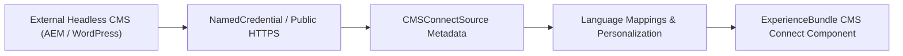

## Architectural Overview

Many enterprises maintain marketing assets, global navigation headers, and localized blog content in an external Content Management System (such as Adobe Experience Manager, Drupal, Sitecore, SDL, or WordPress) while hosting authenticated customer and partner portals on Salesforce Experience Cloud ([Network](/docs/metadata/network-metadata-type/) and [ExperienceBundle](/docs/metadata/experience-bundle-metadata-type/)). The `CMSConnectSource` metadata type declaratively configures **CMS Connect** connections so Experience Builder components can dynamically fetch and render HTML fragments, CSS/JS assets, and JSON feeds from the external CMS.



## Directory Location and File Suffix

In Salesforce DX projects, `CMSConnectSource` files reside in the `cmsConnectSources` directory.

| Property | Value |
| :--- | :--- |
| **Directory Path (SFDX)** | `force-app/main/default/cmsConnectSources/` |
| **File Suffix (SFDX)** | `.cmsConnectSource-meta.xml` |
| **Classic Metadata Suffix** | `.cmsConnectSource` |
| **Metadata Type Name** | `CMSConnectSource` |

## Key Metadata Fields

The following table details the XML configuration elements of `CMSConnectSource` in API version `68.0` (Winter '27):

| Field Name | Field Type | Required | Architectural Description |
| :--- | :--- | :--- | :--- |
| `name` | `string` | Yes | The display label of the CMS Connect source in Experience Workspaces. |
| `developerName` | `string` | Yes | Unique API name of the CMS connection within the Experience Cloud site. |
| `network` | `string` | Yes | The developer name of the Experience Cloud [Network](/docs/metadata/network-metadata-type/) site to which this CMS connection belongs. |
| `type` | `CMSConnectSourceType` | Yes | External CMS vendor type (`AEM`, `Drupal`, `WordPress`, `SDL`, `Sitecore`, or `Other`). |
| `connectionType` | `CMSConnectionType` | Yes | Authentication model (`Public` or `Authenticated` via a Named Credential). |
| `status` | `string` | Yes | Connection activation state (`Active` or `Inactive`). |
| `rootPath` | `string` | No | The base path or root URL on the external CMS server where content assets reside. |
| `namedCredential` | `string` | Conditional | The API name of the `NamedCredential` used when `connectionType` is `Authenticated` or when decoupling host URLs across environments. |
| `cssScope` | `string` | No | Optional CSS selector prefix applied to scope external CMS stylesheets so they do not override Lightning Design System (SLDS) styles. |
| `languageMappings` | `CMSConnectLanguage[]` | No | Maps Salesforce language codes (such as `en_US`, `fr`) to the corresponding external CMS locale paths. |
| `cmsConnectAsset` | `CMSConnectAsset[]` | No | Optional list of external CSS or JavaScript asset paths loaded with the CMS connection. |

## Declarative Metadata Example

The following `CMSConnectSource` connects an Adobe Experience Manager (`AEM`) server to the `Customer_Support_Portal` network using a `NamedCredential` (`AEM_Prod_Content_Endpoint`), CSS scoping, and language mappings for English and French.

```xml title="force-app/main/default/cmsConnectSources/Corporate_AEM_Feed.cmsConnectSource-meta.xml"
<?xml version="1.0" encoding="UTF-8"?>
<CMSConnectSource xmlns="http://soap.sforce.com/2006/04/metadata">
    <cmsConnectAsset>
        <assetPath>etc/designs/corporate/clientlib-site.min.css</assetPath>
        <assetType>CSS</assetType>
        <sortOrder>1</sortOrder>
    </cmsConnectAsset>
    <connectionType>Authenticated</connectionType>
    <cssScope>.cms-corporate-wrapper</cssScope>
    <developerName>Corporate_AEM_Feed</developerName>
    <languageMappings>
        <cmsLanguage>en</cmsLanguage>
        <language>en_US</language>
    </languageMappings>
    <languageMappings>
        <cmsLanguage>fr</cmsLanguage>
        <language>fr</language>
    </languageMappings>
    <name>Corporate AEM Feed</name>
    <namedCredential>AEM_Prod_Content_Endpoint</namedCredential>
    <network>Customer_Support_Portal</network>
    <personalizationEnabled>false</personalizationEnabled>
    <rootPath>content/corporate/global</rootPath>
    <status>Active</status>
    <type>AEM</type>
</CMSConnectSource>
```

### Package Manifest (`package.xml`)

```xml title="manifest/package.xml"
<?xml version="1.0" encoding="UTF-8"?>
<Package xmlns="http://soap.sforce.com/2006/04/metadata">
    <types>
        <members>Corporate_AEM_Feed</members>
        <name>CMSConnectSource</name>
    </types>
    <version>68.0</version>
</Package>
```

## SFDX CLI Retrieval and Deployment

Use the Salesforce CLI (`sf`) to retrieve and deploy `CMSConnectSource` configurations:

```bash
# Retrieve all CMSConnectSource metadata files
sf project retrieve start --metadata CMSConnectSource

# Deploy a specific CMSConnectSource to the target org
sf project deploy start --metadata CMSConnectSource:Corporate_AEM_Feed
```

## Architect Best Practices and Gotchas

> [!TIP]
> Always bind `CMSConnectSource` to a `NamedCredential` rather than hardcoding an environment-specific domain inside `rootPath`. This allows you to point Dev and UAT sandboxes to your staging CMS server and Production to your production CDN without modifying `Corporate_AEM_Feed.cmsConnectSource-meta.xml`.

- **CSP and CORS Alignment:** When using CMS Connect to render JSON or HTML/CSS in an [ExperienceBundle](/docs/metadata/experience-bundle-metadata-type/) site, you must also deploy a `CspTrustedSite` metadata component for the external CMS domain and configure CORS headers (`Access-Control-Allow-Origin`) on the external CMS CDN.
- **Always Set `cssScope`:** External CMS stylesheets often define global rules for `body`, `h1`, or `a` tags that break standard Lightning Web Components on the page. Specify a `cssScope` class (such as `.cms-corporate-wrapper`) to isolate external styles.
