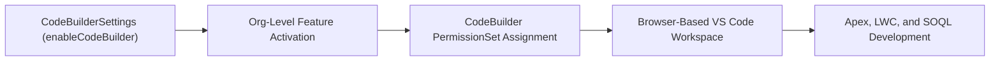

## Architectural Overview

Salesforce **Code Builder** provides a full-featured, browser-based Visual Studio Code environment preloaded with the Salesforce Extension Pack, `sf` CLI, Apex Replay Debugger, and Einstein for Developers. The `CodeBuilderSettings` metadata type (`CodeBuilder.settings-meta.xml`) governs the org-wide activation of Code Builder.

From a DevSecOps perspective, managing `CodeBuilderSettings` declaratively in version control allows platform engineering teams to automatically enable Code Builder in developer sandboxes while enforcing strict access controls in production orgs.



## Directory Location and File Suffix

In Salesforce DX projects, `CodeBuilderSettings` is stored in the `settings` directory as `CodeBuilder.settings-meta.xml`.

| Property | Value |
| :--- | :--- |
| **Directory Path (SFDX)** | `force-app/main/default/settings/` |
| **File Name (SFDX)** | `CodeBuilder.settings-meta.xml` |
| **Classic Metadata File** | `settings/CodeBuilder.settings` |
| **Package.xml Type & Member** | `<name>Settings</name>` with `<members>CodeBuilder</members>` |

## Key Metadata Fields

`CodeBuilderSettings` exposes a single boolean flag in API version `68.0` (Winter '27):

| Field Name | Field Type | Architectural Description |
| :--- | :--- | :--- |
| `enableCodeBuilder` | `boolean` | Enables (`true`) or disables (`false`) Salesforce Code Builder across the organization. Defaults to `false`. |

## Declarative Metadata Example

The following `CodeBuilder.settings-meta.xml` file enables Code Builder in the target environment:

```xml title="force-app/main/default/settings/CodeBuilder.settings-meta.xml"
<?xml version="1.0" encoding="UTF-8"?>
<CodeBuilderSettings xmlns="http://soap.sforce.com/2006/04/metadata">
    <enableCodeBuilder>true</enableCodeBuilder>
</CodeBuilderSettings>
```

### Package Manifest (`package.xml`)

```xml title="manifest/package.xml"
<?xml version="1.0" encoding="UTF-8"?>
<Package xmlns="http://soap.sforce.com/2006/04/metadata">
    <types>
        <members>CodeBuilder</members>
        <name>Settings</name>
    </types>
    <version>68.0</version>
</Package>
```

## SFDX CLI Retrieval and Deployment

Retrieve and deploy `CodeBuilderSettings` using the `sf` CLI:

```bash
# Retrieve CodeBuilderSettings from an org
sf project retrieve start --metadata Settings:CodeBuilder

# Deploy CodeBuilderSettings to enable or disable Code Builder
sf project deploy start --metadata Settings:CodeBuilder
```

## Architect Best Practices and Gotchas

> [!TIP]
> Even when `enableCodeBuilder` is `true` in Production so developers can launch a cloud IDE connected to their sandboxes, ensure developers connect Code Builder to **Sandboxes or Scratch Orgs** and commit via Git rather than deploying directly from a Code Builder workspace into Production.

- **Least-Privilege Access via Permission Sets:** Do not grant Code Builder access via standard [Profile](/docs/metadata/profile-metadata-type/) assignments. Instead, assign the `CodeBuilder` [PermissionSet](/docs/metadata/permission-set-metadata-type/) only to licensed developers and technical architects.
- **Edition Support:** Verify that the target org edition supports Code Builder before including `Settings:CodeBuilder` in universal multi-org deployment manifests.
