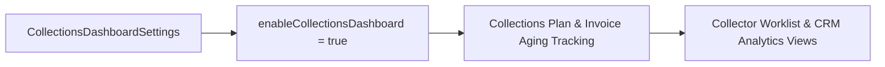

## Architectural Overview

In Salesforce Revenue Cloud and Subscription Management / Billing implementations, accounts receivable specialists rely on the **Collections Dashboard** to monitor past-due invoices, promised payments, dunning stages, and collector performance metrics. The `CollectionsDashboardSettings` metadata type (`CollectionsDashboard.settings-meta.xml`) provides the declarative org-level toggle to enable this capability.

By managing `CollectionsDashboardSettings` in SFDX source format, architects ensure that collections analytics and underlying collections objects are consistently enabled across SIT, UAT, and Production orgs before deploying collections [Flow](/docs/metadata/flow-metadata-type/) automations or custom lightning pages.



## Directory Location and File Suffix

In Salesforce DX projects, `CollectionsDashboardSettings` is stored in the `settings` directory as `CollectionsDashboard.settings-meta.xml`.

| Property | Value |
| :--- | :--- |
| **Directory Path (SFDX)** | `force-app/main/default/settings/` |
| **File Name (SFDX)** | `CollectionsDashboard.settings-meta.xml` |
| **Classic Metadata File** | `settings/CollectionsDashboard.settings` |
| **Package.xml Type & Member** | `<name>Settings</name>` with `<members>CollectionsDashboard</members>` |

## Key Metadata Fields

The following table describes the primary boolean flag on `CollectionsDashboardSettings` in API version `68.0` (Winter '27):

| Field Name | Field Type | Architectural Description |
| :--- | :--- | :--- |
| `enableCollectionsDashboard` | `boolean` | Enables (`true`) or disables (`false`) the Revenue Cloud Collections Dashboard in the org. Defaults to `false`. |

## Declarative Metadata Example

The following `CollectionsDashboard.settings-meta.xml` file enables the Collections Dashboard:

```xml title="force-app/main/default/settings/CollectionsDashboard.settings-meta.xml"
<?xml version="1.0" encoding="UTF-8"?>
<CollectionsDashboardSettings xmlns="http://soap.sforce.com/2006/04/metadata">
    <enableCollectionsDashboard>true</enableCollectionsDashboard>
</CollectionsDashboardSettings>
```

### Package Manifest (`package.xml`)

```xml title="manifest/package.xml"
<?xml version="1.0" encoding="UTF-8"?>
<Package xmlns="http://soap.sforce.com/2006/04/metadata">
    <types>
        <members>CollectionsDashboard</members>
        <name>Settings</name>
    </types>
    <version>68.0</version>
</Package>
```

## SFDX CLI Retrieval and Deployment

Retrieve and deploy `CollectionsDashboardSettings` using the Salesforce CLI (`sf`):

```bash
# Retrieve CollectionsDashboardSettings from an org
sf project retrieve start --metadata Settings:CollectionsDashboard

# Deploy CollectionsDashboardSettings to the target org
sf project deploy start --metadata Settings:CollectionsDashboard
```

## Architect Best Practices and Gotchas

> [!WARNING]
> Deploying `<enableCollectionsDashboard>true</enableCollectionsDashboard>` requires that Revenue Cloud Billing / Collections licenses are active in the target org. If you maintain a shared repository across orgs with different license footprints, isolate `CollectionsDashboard.settings-meta.xml` in your Revenue Cloud package directory.

- **Assign Collector Permission Sets:** Enabling `CollectionsDashboardSettings` turns on the org-wide feature, but finance users still need the Collections permission set license and [PermissionSet](/docs/metadata/permission-set-metadata-type/) assignments to view the dashboard and manage `CollectionPlan` records.
