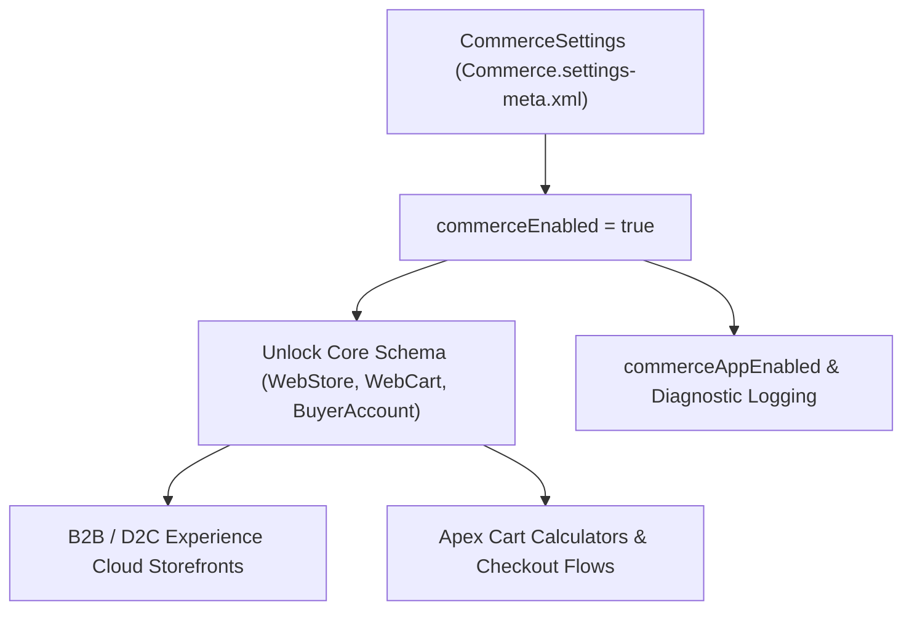

## Architectural Overview

Salesforce **B2B Commerce** and **D2C Commerce** built natively on the core Lightning platform rely on `CommerceSettings` (`Commerce.settings-meta.xml`) as their foundational activation switch. Enabling `commerceEnabled` provisions the core Commerce data model—including `WebStore`, `WebCart`, `CartDeliveryGroup`, `BuyerGroup`, `PriceAdjustmentSchedule`, and `ProductAttributeSet`—and integrates Commerce workspaces into Experience Cloud ([Network](/docs/metadata/network-metadata-type/) and [ExperienceBundle](/docs/metadata/experience-bundle-metadata-type/)).

In CI/CD pipelines, `CommerceSettings` must be deployed in the earliest pre-deployment phase (or baked into the scratch org definition) because any [CustomObject](/docs/metadata/custom-object-metadata-type/) customizations, Apex cart calculators, or checkout [Flow](/docs/metadata/flow-metadata-type/) definitions referencing `WebCart` or `WebStore` will fail compilation until `commerceEnabled` is `true`.



## Directory Location and File Suffix

In Salesforce DX projects, `CommerceSettings` is stored in the `settings` folder as `Commerce.settings-meta.xml`.

| Property | Value |
| :--- | :--- |
| **Directory Path (SFDX)** | `force-app/main/default/settings/` |
| **File Name (SFDX)** | `Commerce.settings-meta.xml` |
| **Classic Metadata File** | `settings/Commerce.settings` |
| **Package.xml Type & Member** | `<name>Settings</name>` with `<members>Commerce</members>` |

## Key Metadata Fields

The following table details the key XML flags on `CommerceSettings` in API version `68.0` (Winter '27):

| Field Name | Field Type | Required | Architectural Description |
| :--- | :--- | :--- | :--- |
| `commerceEnabled` | `boolean` | Yes | Master switch that enables Salesforce B2B/D2C Commerce and unlocks Commerce standard objects. Once `true`, it cannot be reverted to `false`. |
| `commerceAppEnabled` | `boolean` | No | Enables the Commerce Lightning application and workspace navigation for merchandising admins. |
| `commerceDiscoveryExpansion` | `boolean` | No | Enables expanded catalog and Einstein Commerce discovery capabilities where licensed. |
| `commerceDiagnosticEventEnabled` | `boolean` | No | Emits diagnostic events for cart, checkout, and pricing extensions to assist with troubleshooting storefront errors. |

## Declarative Metadata Example

The following `Commerce.settings-meta.xml` activates Commerce, the Commerce App, and diagnostic events for storefront troubleshooting:

```xml title="force-app/main/default/settings/Commerce.settings-meta.xml"
<?xml version="1.0" encoding="UTF-8"?>
<CommerceSettings xmlns="http://soap.sforce.com/2006/04/metadata">
    <commerceAppEnabled>true</commerceAppEnabled>
    <commerceDiagnosticEventEnabled>true</commerceDiagnosticEventEnabled>
    <commerceDiscoveryExpansion>false</commerceDiscoveryExpansion>
    <commerceEnabled>true</commerceEnabled>
</CommerceSettings>
```

### Package Manifest (`package.xml`)

```xml title="manifest/package.xml"
<?xml version="1.0" encoding="UTF-8"?>
<Package xmlns="http://soap.sforce.com/2006/04/metadata">
    <types>
        <members>Commerce</members>
        <name>Settings</name>
    </types>
    <version>68.0</version>
</Package>
```

## SFDX CLI Retrieval and Deployment

Retrieve and deploy `CommerceSettings` using the Salesforce CLI (`sf`):

```bash
# Retrieve CommerceSettings into force-app/main/default/settings/Commerce.settings-meta.xml
sf project retrieve start --metadata Settings:Commerce

# Deploy CommerceSettings to enable Commerce in a target org
sf project deploy start --metadata Settings:Commerce
```

## Architect Best Practices and Gotchas

> [!WARNING]
> `CommerceSettings` depends on Experience Cloud (`CommunitiesSettings` / `enableNetworksEnabled`) and Person Accounts (for D2C Commerce) being enabled in the target org. If you deploy `Settings:Commerce` before `Settings:Communities`, the deployment will fail.

- **Two-Stage CI/CD Deployment:** When initializing a brand-new sandbox or scratch org, deploy `Settings:Communities` and `Settings:Commerce` first before deploying `WebCart` custom fields, `BuyerAccount` sharing rules, or `WebStore` [ExperienceBundle](/docs/metadata/experience-bundle-metadata-type/) storefronts.
- **Enable Diagnostic Events in Lower Environments:** Keep `<commerceDiagnosticEventEnabled>true</commerceDiagnosticEventEnabled>` enabled in SIT and UAT sandboxes so architects can inspect `CommerceDiagnosticEvent` logs when debugging custom Pricing, Inventory, or Tax extension providers.
