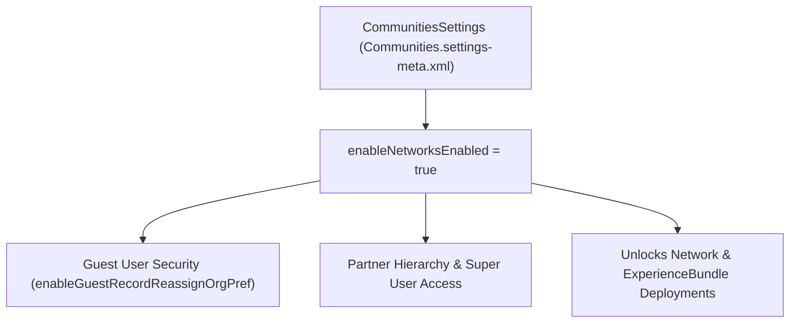

## Architectural Overview

The `CommunitiesSettings` metadata type (`Communities.settings-meta.xml`) is the org-wide foundation for **Salesforce Experience Cloud** (formerly Communities). Before a single [Network](/docs/metadata/network-metadata-type/) or [ExperienceBundle](/docs/metadata/experience-bundle-metadata-type/) can be deployed to an org, `enableNetworksEnabled` in `CommunitiesSettings` must be `true`.

Beyond basic Experience Cloud enablement, `CommunitiesSettings` controls critical security and sharing architecture boundaries across all sites in the org—including whether records created by unauthenticated Guest Users are automatically reassigned to an internal owner (`enableGuestRecordReassignOrgPref`), whether external users are restricted by Account Role Optimization (ARO) and role depth, and whether Partner Super User access (`enablePartnerSuperUserAccess`) is permitted.



## Directory Location and File Suffix

In Salesforce DX projects, `CommunitiesSettings` is stored in the `settings` directory as `Communities.settings-meta.xml`.

| Property | Value |
| :--- | :--- |
| **Directory Path (SFDX)** | `force-app/main/default/settings/` |
| **File Name (SFDX)** | `Communities.settings-meta.xml` |
| **Classic Metadata File** | `settings/Communities.settings` |
| **Package.xml Type & Member** | `<name>Settings</name>` with `<members>Communities</members>` |

## Key Metadata Fields

The following table highlights the most architecturally significant fields on `CommunitiesSettings` in API version `68.0` (Winter '27):

| Field Name | Field Type | Architectural Description |
| :--- | :--- | :--- |
| `enableNetworksEnabled` | `boolean` | Master switch that enables Digital Experiences (Experience Cloud) in the org. Required before deploying any `Network` or `CustomSite`. |
| `enableGuestRecordReassignOrgPref` | `boolean` | Security best practice: automatically reassigns any record created by an unauthenticated Guest User to a designated default internal owner. |
| `enableOwdBasedExtUserVisibility` | `boolean` | Enforces Organization-Wide Default (OWD) external user visibility rules across Experience Cloud sites. |
| `enablePartnerSuperUserAccess` | `boolean` | Allows designated partner users with Partner Super User permission to view data owned by peers at the same role level or below on their Partner Account. |
| `canModerateAllFeedPosts` | `boolean` | Allows community moderators to moderate all feed posts visible in the site. |
| `enableCommunityWorkspaces` | `boolean` | Enables the modern Experience Workspaces management interface in Setup. |
| `enableSubdomain` | `boolean` | Enables Experience Cloud enhanced domains/subdomains for site URLs. |

## Declarative Metadata Example

The following `Communities.settings-meta.xml` enables Experience Cloud, enforces Guest User record reassignment (`<enableGuestRecordReassignOrgPref>true</enableGuestRecordReassignOrgPref>`), and enables OWD-based external user visibility:

```xml title="force-app/main/default/settings/Communities.settings-meta.xml"
<?xml version="1.0" encoding="UTF-8"?>
<CommunitiesSettings xmlns="http://soap.sforce.com/2006/04/metadata">
    <canModerateAllFeedPosts>true</canModerateAllFeedPosts>
    <enableCommunityWorkspaces>true</enableCommunityWorkspaces>
    <enableGuestRecordReassignOrgPref>true</enableGuestRecordReassignOrgPref>
    <enableNetworksEnabled>true</enableNetworksEnabled>
    <enableOwdBasedExtUserVisibility>true</enableOwdBasedExtUserVisibility>
    <enablePartnerSuperUserAccess>true</enablePartnerSuperUserAccess>
</CommunitiesSettings>
```

### Package Manifest (`package.xml`)

```xml title="manifest/package.xml"
<?xml version="1.0" encoding="UTF-8"?>
<Package xmlns="http://soap.sforce.com/2006/04/metadata">
    <types>
        <members>Communities</members>
        <name>Settings</name>
    </types>
    <version>68.0</version>
</Package>
```

## SFDX CLI Retrieval and Deployment

Retrieve and deploy `CommunitiesSettings` using the Salesforce CLI (`sf`):

```bash
# Retrieve CommunitiesSettings into force-app/main/default/settings/Communities.settings-meta.xml
sf project retrieve start --metadata Settings:Communities

# Deploy CommunitiesSettings to the target org
sf project deploy start --metadata Settings:Communities
```

## Architect Best Practices and Gotchas

> [!WARNING]
> Never set `<enableGuestRecordReassignOrgPref>false</enableGuestRecordReassignOrgPref>` in production. Unauthenticated Guest Users should never remain the persistent `OwnerId` of records in Salesforce, as doing so complicates sharing calculations and violates Guest User security hardening standards.

- **Deployment Order in CI/CD:** Always ensure `Settings:Communities` is enabled in your `project-scratch-def.json` (`"communitiesSettings": { "enableNetworksEnabled": true }`) or deployed before [Network](/docs/metadata/network-metadata-type/), `CustomSite`, `CMSConnectSource`, and [ExperienceBundle](/docs/metadata/experience-bundle-metadata-type/) metadata.
- **External Sharing & User Visibility:** Enabling `enableOwdBasedExtUserVisibility` recalculates external user visibility across portals. Schedule changes to this setting during off-peak maintenance windows in orgs with ratusan thousands of Customer Community Plus or Partner Community users.
