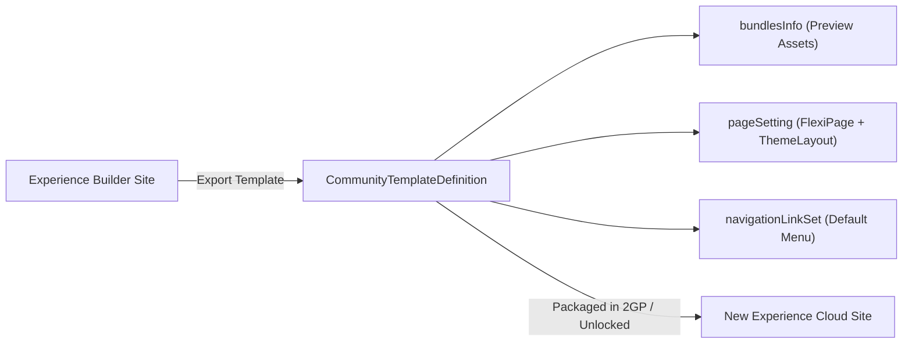

## Architectural Overview

In multi-brand or multi-region Salesforce implementations, provisioning new Experience Cloud portals manually leads to inconsistent layouts, divergent branding, and governance drift. The `CommunityTemplateDefinition` metadata type solves this by capturing a complete, reusable Experience Builder site template (the core metadata behind **Lightning Bolt Solutions**).

Architecturally, `CommunityTemplateDefinition` acts as a blueprint for site creation rather than a live site instance. While `ExperienceBundle` or `DigitalExperienceBundle` defines an active Experience Cloud site, `CommunityTemplateDefinition` packages the structural recipe—its base template (`baseTemplate`), category, preview images (`bundlesInfo`), default navigation link set (`navigationLinkSet`), and page-to-theme-layout bindings (`pageSetting`)—so new sites can be spun up with a single click in the Experience Cloud creation wizard.



## SFDX Directory and File Suffix

| Property | Value |
| :--- | :--- |
| **Metadata Type Name** | `CommunityTemplateDefinition` |
| **SFDX Source Directory** | `force-app/main/default/communityTemplateDefinitions/` |
| **SFDX File Suffix** | `.communityTemplateDefinition-meta.xml` |
| **Classic Metadata Suffix** | `.communityTemplateDefinition` |

## Key Metadata Fields

The `CommunityTemplateDefinition` XML structure binds visual assets, navigation structures, and page definitions into a single distributable template artifact.

| Field Name | Type | Required | Architectural Purpose |
| :--- | :--- | :--- | :--- |
| `masterLabel` | `string` | Yes | The human-readable label displayed in the Experience Cloud site creation wizard. |
| `baseTemplate` | `CommunityTemplateBaseTemplate` | No | Specifies the underlying system template (`c` for standard Customer Service / Aura base). |
| `category` | `CommunityTemplateCategory` | Yes | Categorizes the template in the wizard (`IT`, `Marketing`, `Sales`, `Service`, `Commerce`). |
| `defaultThemeDefinition` | `string` | Yes | DeveloperName of the [CommunityThemeDefinition](/docs/metadata/community-theme-definition-metadata-type/) applied by default. |
| `description` | `string` | No | Detailed summary shown to administrators when evaluating the template in Setup. |
| `enableExtendedCleanUpOnDelete` | `boolean` | No | When `true`, deletes associated template child metadata cleanly when the template is removed. |
| `bundlesInfo` | `CommunityTemplateBundleInfo[]` | No | Defines marketing summary metadata, highlight bullets, and preview `ContentAsset` images for the Bolt wizard. |
| `navigationLinkSet` | `NavigationMenuItem[]` | No | Embedded default navigation menu items provisioned when a new site is created from this template. |
| `pageSetting` | `CommunityTemplatePageSetting[]` | No | Maps each template `page` (`FlexiPage`) to its default `themeLayout` (`CommunityThemeDefinition` layout). |
| `publisher` | `string` | No | Name of the organization or ISV publishing the Lightning Bolt template. |

### `CommunityTemplateBundleInfo` Subtype Fields

| Field Name | Type | Description |
| :--- | :--- | :--- |
| `title` | `string` | Heading for a feature highlight or preview image in the template selection screen (up to 4 items). |
| `description` | `string` | Descriptive text explaining the feature highlight or screenshot. |
| `order` | `int` | Display sequence from `1` to `4` in the template details modal. |
| `type` | `CommunityTemplateBundleInfoType` | Either `Highlight` (text callout) or `PreviewImage` (screenshot reference). |
| `image` | `string` | DeveloperName of the [ContentAsset](/docs/metadata/content-asset-metadata-type/) used when `type` is `PreviewImage`. |

## Declarative XML Example

Below is a production-grade `Partner_Onboarding_Bolt.communityTemplateDefinition-meta.xml` file defining a B2B Partner Onboarding template with feature highlights, preview assets, and page-to-theme mappings.

```xml title="force-app/main/default/communityTemplateDefinitions/Partner_Onboarding_Bolt.communityTemplateDefinition-meta.xml"
<?xml version="1.0" encoding="UTF-8"?>
<CommunityTemplateDefinition xmlns="http://soap.sforce.com/2006/04/metadata">
    <baseTemplate>c</baseTemplate>
    <bundlesInfo>
        <description>Streamlined dealer registration, tier tracking, and MDF claim workflows.</description>
        <order>1</order>
        <title>Automated Partner Onboarding</title>
        <type>Highlight</type>
    </bundlesInfo>
    <bundlesInfo>
        <description>Pre-configured Lead Inbox and Deal Registration workspaces.</description>
        <order>2</order>
        <title>Channel Sales Pipeline</title>
        <type>Highlight</type>
    </bundlesInfo>
    <bundlesInfo>
        <description>Home page dashboard view for authenticated channel partners.</description>
        <image>Partner_Bolt_Preview_Hero</image>
        <order>1</order>
        <title>Partner Executive Dashboard</title>
        <type>PreviewImage</type>
    </bundlesInfo>
    <category>Sales</category>
    <defaultThemeDefinition>Partner_Portal_Theme</defaultThemeDefinition>
    <description>Enterprise Lightning Bolt template for regional B2B partner portals.</description>
    <enableExtendedCleanUpOnDelete>true</enableExtendedCleanUpOnDelete>
    <masterLabel>Global Partner Onboarding Bolt</masterLabel>
    <navigationLinkSet>
        <navigationMenuItem>
            <defaultListViewId>AllOpenLeads</defaultListViewId>
            <label>Lead Inbox</label>
            <position>1</position>
            <publiclyAvailable>false</publiclyAvailable>
            <target>Lead</target>
            <type>SalesforceObject</type>
        </navigationMenuItem>
        <navigationMenuItem>
            <label>Deal Registration</label>
            <position>2</position>
            <publiclyAvailable>false</publiclyAvailable>
            <target>/deal-registration</target>
            <type>InternalLink</type>
        </navigationMenuItem>
    </navigationLinkSet>
    <pageSetting>
        <page>Partner_Overview_Home</page>
        <themeLayout>Partner_Portal_Theme_HomeLayout</themeLayout>
    </pageSetting>
    <pageSetting>
        <page>Partner_Deal_Registration</page>
        <themeLayout>Partner_Portal_Theme_InnerLayout</themeLayout>
    </pageSetting>
    <publisher>Acme Global Channel Architecture</publisher>
</CommunityTemplateDefinition>
```

### `package.xml` Manifest

When retrieving or deploying a `CommunityTemplateDefinition`, always include its dependent `CommunityThemeDefinition`, `FlexiPage` records, and preview `ContentAsset` files so the dependency graph resolves cleanly.

```xml title="manifest/package.xml"
<?xml version="1.0" encoding="UTF-8"?>
<Package xmlns="http://soap.sforce.com/2006/04/metadata">
    <types>
        <members>Partner_Onboarding_Bolt</members>
        <name>CommunityTemplateDefinition</name>
    </types>
    <types>
        <members>Partner_Portal_Theme</members>
        <name>CommunityThemeDefinition</name>
    </types>
    <types>
        <members>Partner_Bolt_Preview_Hero</members>
        <name>ContentAsset</name>
    </types>
    <version>68.0</version>
</Package>
```

## SFDX CLI Retrieval and Deployment

Because `CommunityTemplateDefinition` is a declarative Metadata API type without direct SOQL exposure in standard runtime queries, manage it through Salesforce CLI (`sf`) commands:

```bash
# Retrieve a specific CommunityTemplateDefinition by DeveloperName
sf project retrieve start --metadata CommunityTemplateDefinition:Partner_Onboarding_Bolt

# Retrieve all custom Experience Builder templates in the org
sf project retrieve start --metadata CommunityTemplateDefinition

# Validate deployment of the Bolt template and its theme dependencies
sf project deploy start \
  --metadata CommunityTemplateDefinition:Partner_Onboarding_Bolt \
  --metadata CommunityThemeDefinition:Partner_Portal_Theme \
  --dry-run
```

## Architect Best Practices and Gotchas

> [!TIP]
> **Decouple Templates from Live Portals:** Use `CommunityTemplateDefinition` when building a "Portal Factory" model where regional teams self-provision new sites from a governed template. For ongoing CI/CD updates to an *existing* site, deploy changes via [ExperienceBundle](/docs/metadata/experience-bundle-metadata-type/) instead.

- **Missing `FlexiPage` or `CommunityThemeDefinition` Dependencies:** Every `<page>` referenced in `<pageSetting>` must exist as an Experience Cloud `FlexiPage` (`CommsPage`), and every `<themeLayout>` must match a valid `themeLayout` inside the target `CommunityThemeDefinition`. Deploying `CommunityTemplateDefinition` alone without those artifacts fails with a missing reference error.
- **Preview Image Asset Limits:** The `bundlesInfo` array supports up to 4 `Highlight` entries and up to 3 `PreviewImage` entries. Each `PreviewImage` must reference a valid [ContentAsset](/docs/metadata/content-asset-metadata-type/) included in the package.
- **Default List View Portability:** If `<navigationLinkSet>` includes a `SalesforceObject` menu item with `<defaultListViewId>`, ensure that `ListView` API name exists in the target org; never hardcode 15/18-character record IDs.

> [!WARNING]
> Updating and redeploying a `CommunityTemplateDefinition` in a target org **does not retroactively update** Experience Cloud sites that were already created from that template. Existing sites maintain their own independent `ExperienceBundle` metadata after initial provisioning.
