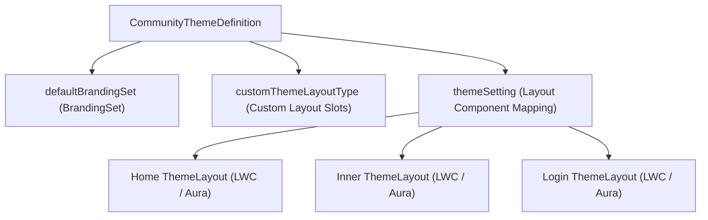

## Architectural Overview

Enterprise design systems require strict visual consistency across customer, partner, and employee Experience Cloud portals. The `CommunityThemeDefinition` metadata type packages a complete custom theme for Experience Builder, binding custom theme layout components (Aura or Lightning Web Components) to standardized layout slots (`Home`, `Inner`, `Login`) and associating them with a `BrandingSet`.

When architects distribute a corporate design system across multiple Salesforce orgs or business units, `CommunityThemeDefinition` ensures that administrators selecting the corporate theme in **Experience Builder -> Theme** automatically receive the approved header/footer shell components (`customThemeLayoutType`), color tokens (`defaultBrandingSet`), and preview thumbnails (`bundlesInfo`).



## SFDX Directory and File Suffix

| Property | Value |
| :--- | :--- |
| **Metadata Type Name** | `CommunityThemeDefinition` |
| **SFDX Source Directory** | `force-app/main/default/communityThemeDefinitions/` |
| **SFDX File Suffix** | `.communityThemeDefinition-meta.xml` |
| **Classic Metadata Suffix** | `.communityThemeDefinition` |

## Key Metadata Fields

The `CommunityThemeDefinition` schema governs how Experience Builder maps page layout regions to custom shell components and branding tokens.

| Field Name | Type | Required | Architectural Purpose |
| :--- | :--- | :--- | :--- |
| `masterLabel` | `string` | Yes | Display name of the theme shown in the Experience Builder Theme panel and Bolt wizard. |
| `defaultBrandingSet` | `string` | No | DeveloperName of the `BrandingSet` component supplying colors, fonts, and brand logos. |
| `description` | `string` | No | Summary of the theme's visual design and intended portal audience. |
| `enableExtendedCleanUpOnDelete` | `boolean` | No | Removes associated child theme settings cleanly when the theme definition is deleted. |
| `bundlesInfo` | `CommunityTemplateBundleInfo[]` | No | Stores feature highlights and `PreviewImage` (`ContentAsset`) references for the theme gallery. |
| `customThemeLayoutType` | `CommunityCustomThemeLayoutType[]` | No | Defines custom layout slots beyond the standard `Home`, `Inner`, and `Login` categories. |
| `themeSetting` | `CommunityThemeSetting[]` | No | Binds each standard or custom theme layout slot to a concrete Aura or LWC theme layout component. |
| `publisher` | `string` | No | Organization or design system team publishing the theme. |

### `CommunityThemeSetting` Subtype Fields

| Field Name | Type | Required | Description |
| :--- | :--- | :--- | :--- |
| `themeLayout` | `string` | Yes | DeveloperName of the Aura (`forceCommunity:themeLayout`) or LWC (`lightningCommunity__Theme_Layout`) component. |
| `themeLayoutType` | `CommunityThemeLayoutType` | No | Standard layout slot (`Home`, `Inner`, or `Login`). Leave blank when using `customThemeLayoutType`. |
| `customThemeLayoutType` | `string` | No | References the `label` of a `customThemeLayoutType` entry defined in the same file. |

## Declarative XML Example

The following `Partner_Portal_Theme.communityThemeDefinition-meta.xml` configures a corporate theme with standard `Home`, `Inner`, and `Login` layout shells plus a custom `FullWidthLanding` layout type for marketing campaigns.

```xml title="force-app/main/default/communityThemeDefinitions/Partner_Portal_Theme.communityThemeDefinition-meta.xml"
<?xml version="1.0" encoding="UTF-8"?>
<CommunityThemeDefinition xmlns="http://soap.sforce.com/2006/04/metadata">
    <bundlesInfo>
        <description>WCAG 2.1 AA compliant contrast tokens and responsive navigation shell.</description>
        <order>1</order>
        <title>Accessible Enterprise Design System</title>
        <type>Highlight</type>
    </bundlesInfo>
    <bundlesInfo>
        <description>Preview of the responsive partner portal theme header and hero region.</description>
        <image>Partner_Theme_Preview_Asset</image>
        <order>1</order>
        <title>Partner Portal Shell</title>
        <type>PreviewImage</type>
    </bundlesInfo>
    <customThemeLayoutType>
        <description>Edge-to-edge layout without sidebar padding for product launch pages.</description>
        <label>FullWidthLanding</label>
    </customThemeLayoutType>
    <defaultBrandingSet>Partner_Portal_Branding</defaultBrandingSet>
    <description>Standardized corporate theme for B2B partner and distributor portals.</description>
    <enableExtendedCleanUpOnDelete>true</enableExtendedCleanUpOnDelete>
    <masterLabel>Acme Partner Design System</masterLabel>
    <publisher>Acme Digital Experience Platform Team</publisher>
    <themeSetting>
        <customThemeLayoutType>FullWidthLanding</customThemeLayoutType>
        <themeLayout>c:partnerFullWidthThemeLayout</themeLayout>
    </themeSetting>
    <themeSetting>
        <themeLayout>c:partnerHomeThemeLayout</themeLayout>
        <themeLayoutType>Home</themeLayoutType>
    </themeSetting>
    <themeSetting>
        <themeLayout>c:partnerInnerThemeLayout</themeLayout>
        <themeLayoutType>Inner</themeLayoutType>
    </themeSetting>
    <themeSetting>
        <themeLayout>c:partnerLoginThemeLayout</themeLayout>
        <themeLayoutType>Login</themeLayoutType>
    </themeSetting>
</CommunityThemeDefinition>
```

### `package.xml` Manifest

Include the underlying LWC or Aura theme layout bundles, the `BrandingSet`, and any `ContentAsset` preview images alongside `CommunityThemeDefinition`:

```xml title="manifest/package.xml"
<?xml version="1.0" encoding="UTF-8"?>
<Package xmlns="http://soap.sforce.com/2006/04/metadata">
    <types>
        <members>Partner_Portal_Theme</members>
        <name>CommunityThemeDefinition</name>
    </types>
    <types>
        <members>Partner_Portal_Branding</members>
        <name>BrandingSet</name>
    </types>
    <types>
        <members>partnerHomeThemeLayout</members>
        <members>partnerInnerThemeLayout</members>
        <members>partnerLoginThemeLayout</members>
        <members>partnerFullWidthThemeLayout</members>
        <name>LightningComponentBundle</name>
    </types>
    <types>
        <members>Partner_Theme_Preview_Asset</members>
        <name>ContentAsset</name>
    </types>
    <version>68.0</version>
</Package>
```

## SFDX CLI Retrieval and Deployment

Use the Salesforce CLI to retrieve and deploy `CommunityThemeDefinition` components across scratch orgs and sandboxes:

```bash
# Retrieve a specific CommunityThemeDefinition and its BrandingSet
sf project retrieve start \
  --metadata CommunityThemeDefinition:Partner_Portal_Theme \
  --metadata BrandingSet:Partner_Portal_Branding

# Deploy the theme definition to a target org
sf project deploy start --source-dir force-app/main/default/communityThemeDefinitions/Partner_Portal_Theme.communityThemeDefinition-meta.xml
```

## Architect Best Practices and Gotchas

> [!NOTE]
> In each `<themeSetting>` block, `themeLayoutType` (for standard `Home`, `Inner`, or `Login` slots) and `customThemeLayoutType` (for custom layout slots) are **mutually exclusive**. Specifying both in the same `<themeSetting>` entry causes a Metadata API schema validation failure.

- **Component Target Validation:** Every component referenced in `<themeLayout>` must be deployed either before or in the same transaction as `CommunityThemeDefinition`, and it must explicitly declare `lightningCommunity__Theme_Layout` (for LWC) or `forceCommunity:themeLayout` (for Aura).
- **Namespace Prefixing in Packages:** When packaging `CommunityThemeDefinition` inside a namespaced Second-Generation Managed Package (2GP), reference local theme layout components with the package namespace prefix (or `c:` in unlocked/unmanaged source that resolves during packaging).
- **BrandingSet Coupling:** If `defaultBrandingSet` is specified, omitting the corresponding `BrandingSet` metadata file from your deployment manifest will fail the deployment with a missing reference error.

> [!TIP]
> Define semantic custom layout types via `<customThemeLayoutType>` (for example, `CheckoutLayout`, `KnowledgeArticleLayout`, `FullWidthLanding`) so site builders can switch page shells declaratively in Experience Builder without creating duplicate themes.
