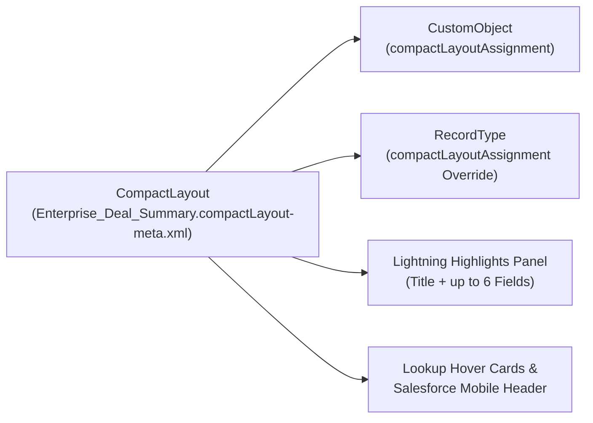

The `CompactLayout` metadata type controls which key summary fields appear in the **Lightning Experience Highlights Panel**, lookup hover cards, Global Search preview panels, Outlook/Gmail sidebars, and the Salesforce Mobile app record header. Introduced in API version 29.0, a well-designed `CompactLayout` lets users scan a record's identity, status, owner, and value at a glance without scrolling through tabs.

In Salesforce DX projects, compact layouts are decomposed inside their parent object folder at `force-app/main/default/objects/<ObjectName>/compactLayouts/<LayoutName>.compactLayout-meta.xml`.



## Field Limits and Unsupported Field Types

- **Maximum Fields Defined**: Up to **10** `<fields>` per `CompactLayout`.
- **First Field Rule**: Always place the object's `Name` (or `CaseNumber` / `Subject` / `ContractNumber`) as the **first** `<fields>` entry, because Lightning Experience renders the first field in the large header font at the top-left of the Highlights Panel.
- **Unsupported Field Types**: You cannot include `TextArea`, `LongTextArea`, `Html` (Rich Text), or `MultiselectPicklist` fields in a `CompactLayout`.

## Key Metadata Fields

| Field | Type | Required | Description |
|---|---|---|---|
| `fullName` | `string` | No | Developer API name of the compact layout |
| `label` | `string` | Yes | UI display label shown in Object Manager -> Compact Layouts |
| `fields` | `string[]` | No | Ordered array of field API names (up to 10 fields) |

## Production-Grade XML Example

Below is a `CompactLayout` for `Opportunity` (`force-app/main/default/objects/Opportunity/compactLayouts/Enterprise_Deal_Summary.compactLayout-meta.xml`):

```xml
<?xml version="1.0" encoding="UTF-8"?>
<CompactLayout xmlns="http://soap.sforce.com/2006/04/metadata">
    <fullName>Enterprise_Deal_Summary</fullName>
    <fields>Name</fields>
    <fields>AccountId</fields>
    <fields>StageName</fields>
    <fields>Amount</fields>
    <fields>CloseDate</fields>
    <fields>OwnerId</fields>
    <fields>NextStep</fields>
    <label>Enterprise Deal Summary</label>
</CompactLayout>
```

> [!TIP]
> **Assigning Compact Layouts in CI/CD**: Deploying a `.compactLayout-meta.xml` file creates the layout, but it does not activate it by itself. Always include the parent [CustomObject](/docs/metadata/custom-object-metadata-type/) `<compactLayoutAssignment>` (and any [RecordType](/docs/metadata/record-type-metadata-type/) `<compactLayoutAssignment>` overrides) in the same deployment so the new layout is immediately active in the target org.

## Querying Compact Layouts via Tooling API

You can inspect compact layouts and their assigned fields using the Tooling API:

```sql
-- 1. List Compact Layouts for a specific object (Tooling API)
SELECT Id, DeveloperName, MasterLabel, SobjectType, NamespacePrefix
FROM CompactLayout
WHERE SobjectType = 'Opportunity'

-- 2. Inspect CompactLayoutInfo via standard/Tooling SOQL
SELECT Id, DeveloperName, MasterLabel, EntityDefinition.QualifiedApiName
FROM CompactLayoutInfo
WHERE EntityDefinition.QualifiedApiName = 'Opportunity'
```

## Retrieval and Deployment (`package.xml`)

In `package.xml`, reference `CompactLayout` members using the `<ObjectName>.<CompactLayoutName>` syntax:

```xml
<?xml version="1.0" encoding="UTF-8"?>
<Package xmlns="http://soap.sforce.com/2006/04/metadata">
    <types>
        <members>Opportunity.Enterprise_Deal_Summary</members>
        <name>CompactLayout</name>
    </types>
    <version>68.0</version>
</Package>
```

