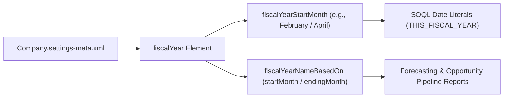

## Architectural Overview

Every date-driven aggregate in Salesforce—Opportunity pipeline reports, Collaborative Forecasts, Quota attainment, and Einstein Analytics fiscal bucketing—depends on the organization's fiscal calendar configuration. The `CompanySettings` metadata type allows architects to version-control and deploy the organization's fiscal year rules (`fiscalYear`) via `Company.settings-meta.xml`.

In multi-org enterprise environments or scratch org CI/CD pipelines, failing to align `CompanySettings` before loading test data or running Apex unit tests that query `THIS_FISCAL_QUARTER` or `THIS_FISCAL_YEAR` SOQL date literals causes subtle, calendar-dependent test failures whenever the corporate fiscal year starts in a month other than January (for example, February for retail or April/July for public sector and SaaS).



## SFDX Directory and File Suffix

| Property | Value |
| :--- | :--- |
| **Metadata Type Name** | `CompanySettings` (deployed via `Settings` type with member `Company`) |
| **SFDX Source File Path** | `force-app/main/default/settings/Company.settings-meta.xml` |
| **Classic Metadata File Path** | `settings/Company.settings` |
| **`package.xml` Type / Member** | `<name>Settings</name>` / `<members>Company</members>` |

## Key Metadata Fields

`CompanySettings` contains the nested `fiscalYear` (`FiscalYearSettings`) complex type that governs standard fiscal calendar calculations.

| Field Name | Type | Required | Architectural Purpose |
| :--- | :--- | :--- | :--- |
| `enableCustomFiscalYear` | `boolean` | No | Enables Custom Fiscal Years (such as 4-4-5 or 13-period retail calendars). **Irreversible once enabled.** |
| `fiscalYear` | `FiscalYearSettings` | No | Container defining the standard fiscal year start month and naming convention. |
| `fiscalYear.fiscalYearNameBasedOn` | `string` | Yes (inside `fiscalYear`) | Determines whether FY naming uses the `endingMonth` (most common, e.g., Feb 2026–Jan 2027 = FY27) or `startMonth`. |
| `fiscalYear.fiscalYearStartMonth` | `string` | Yes (inside `fiscalYear`) | The integer month (`1` through `12`) when the standard fiscal year begins (`1` = January, `2` = February, `4` = April). |

## Declarative XML Example

Below is a typical SaaS enterprise `Company.settings-meta.xml` configuring a February 1st fiscal year start where the fiscal year is named after the ending calendar year (mirroring Salesforce's own FY calendar).

```xml title="force-app/main/default/settings/Company.settings-meta.xml"
<?xml version="1.0" encoding="UTF-8"?>
<CompanySettings xmlns="http://soap.sforce.com/2006/04/metadata">
    <enableCustomFiscalYear>false</enableCustomFiscalYear>
    <fiscalYear>
        <fiscalYearNameBasedOn>endingMonth</fiscalYearNameBasedOn>
        <fiscalYearStartMonth>2</fiscalYearStartMonth>
    </fiscalYear>
</CompanySettings>
```

### `package.xml` Manifest

Like all org settings metadata types, `CompanySettings` is referenced in `package.xml` using the `<name>Settings</name>` tag and `<members>Company</members>`:

```xml title="manifest/package.xml"
<?xml version="1.0" encoding="UTF-8"?>
<Package xmlns="http://soap.sforce.com/2006/04/metadata">
    <types>
        <members>Company</members>
        <name>Settings</name>
    </types>
    <version>68.0</version>
</Package>
```

## Querying Fiscal Settings via SOQL and SFDX CLI

You can inspect the active `CompanySettings` state at runtime by querying the `Organization` and `FiscalYearSettings` standard objects in SOQL, or retrieve the declarative XML using the `sf` CLI.

### 1. Query Standard Fiscal Year Configuration on `Organization`
```soql
SELECT Id, Name, FiscalYearStartMonth, UsesStartDateAsFiscalYearName, DefaultLocaleSidKey, TimeZoneSidKey
FROM Organization
LIMIT 1
```

### 2. Query Custom or Standard Fiscal Periods via `FiscalYearSettings`
```soql
SELECT Id, Name, StartDate, EndDate, YearType, IsStandardYear, Description
FROM FiscalYearSettings
ORDER BY StartDate DESC
LIMIT 10
```

### 3. SFDX CLI Retrieve and Deploy Commands
```bash
# Retrieve CompanySettings into force-app/main/default/settings/Company.settings-meta.xml
sf project retrieve start --metadata Settings:Company

# Deploy updated fiscal year settings to a sandbox or scratch org
sf project deploy start --metadata Settings:Company
```

## Architect Best Practices and Gotchas

> [!WARNING]
> **Never set `<enableCustomFiscalYear>true</enableCustomFiscalYear>` unless your business genuinely requires non-Gregorian periods (such as 4-4-5 or 4-5-4 retail quarters).** Once Custom Fiscal Years are enabled in an org, standard SOQL fiscal date literals and standard forecasting period generation change permanently, and the setting **cannot** be turned back to `false`.

- **Include in Scratch Org Definition or Baseline Package:** Always include `Company.settings-meta.xml` (or set `companySettings` in `config/project-scratch-def.json`) in your CI/CD baseline so scratch orgs match Production's `FiscalYearStartMonth` before Apex tests execute.
- **Forecast Recalculation Impact:** Changing `fiscalYearStartMonth` in an active sandbox or production org triggers an immediate recalculation of all Opportunity fiscal period stamps (`Fiscal`, `FiscalQuarter`, `FiscalYear` fields on `Opportunity`) and invalidates existing Collaborative Forecast quotas for misaligned periods.

> [!TIP]
> When writing Apex unit tests that depend on `THIS_FISCAL_YEAR` or `NEXT_FISCAL_QUARTER`, query `Organization.FiscalYearStartMonth` dynamically in your `@TestSetup` factory rather than hardcoding calendar quarter dates (`Date.newInstance(year, 1, 1)`).
