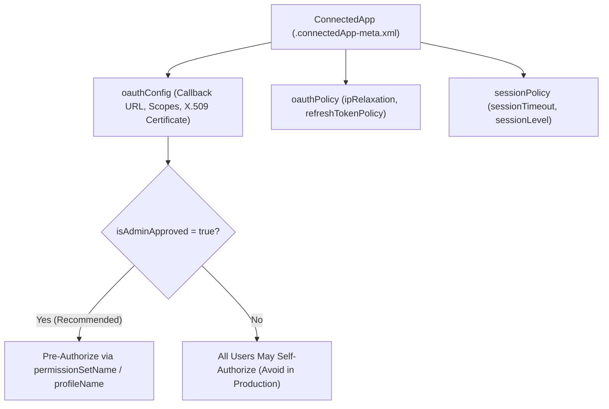

## Overview

The `ConnectedApp` metadata type (`connectedApps/<AppName>.connectedApp-meta.xml`) configures an OAuth 2.0, OpenID Connect, SAML 2.0 Single Sign-On, or Canvas integration boundary for external applications, middleware, mobile apps, and headless CI/CD pipelines (`sf org login jwt`).

An important architectural milestone for Salesforce developers: starting in **Spring '26 (API v66.0)**, Salesforce restricted the creation of *new* `ConnectedApp` components in favor of the modern, second-generation packaging-friendly `ExternalClientApplication` metadata architecture. Existing `ConnectedApp` definitions continue to run and can be updated via Metadata API across sandboxes and production orgs.

> [!RELEASE] Spring '26
> Creating new `ConnectedApp` components is restricted starting in Spring '26. Existing connected apps remain supported during and after Spring '26 and Winter '27, but new integrations should use `ExternalClientApplication` (`ExtlClntAppOauthSettings` and `ExtlClntAppConfigurablePolicies`).



As shown in the diagram above, a secure enterprise `ConnectedApp` locks down `oauthConfig` with least-privilege scopes, sets `isAdminApproved` to `true`, and delegates access strictly through `<permissionSetName>` assignments rather than allowing arbitrary users to self-authorize.

## Prerequisites

- **Permissions:** "Manage Connected Apps" and "Customize Application" permissions.
- **Certificate for JWT / Client Credentials:** A PEM-encoded X.509 public certificate string (without `-----BEGIN CERTIFICATE-----` headers) when configuring headless JWT Bearer authentication.
- **API Version:** Introduced in API version 29.0. Verified against API version `68.0` (Winter '27).

## Key ConnectedApp XML Security Elements

| XML Element | Parent Block | Purpose & Security Best Practice |
| :--- | :--- | :--- |
| `contactEmail` / `label` | Root | **Required.** Administrative point of contact and display label. |
| `permissionSetName` | Root | Array of [PermissionSet](/docs/metadata/permission-set-metadata-type/) labels pre-authorized to use this Connected App when `isAdminApproved` is `true`. |
| `callbackUrl` | `oauthConfig` | **Required for OAuth.** Allowed redirect URIs (one per line). Use `http://localhost:1717/OauthRedirect` for local CLI/JWT setup. |
| `scopes` | `oauthConfig` | OAuth scopes (`Api`, `Web`, `RefreshToken`, `OpenID`, `Chatter`, `CustomPermissions`). Never grant `Full` when `Api` suffices. |
| `isAdminApproved` | `oauthConfig` | Set to `true` ("Admin approved users are pre-authorized") for all server-to-server, JWT, and enterprise apps. |
| `isConsumerSecretOptional` | `oauthConfig` | Set to `false` to require client secret validation on token exchanges. |
| `certificate` | `oauthConfig` | Base64 X.509 public certificate used to verify RS256 signatures in the OAuth 2.0 JWT Bearer Flow. |
| `ipRelaxation` | `oauthPolicy` | Controls IP enforcement (`ENFORCE`, `BYPASS`, `ENFORCE_CONDITIONAL`). Prefer `ENFORCE` for enterprise security. |
| `refreshTokenPolicy` | `oauthPolicy` | Expiration policy (`zero`, `infinite`, `specific_lifetime:90:DAYS`, `specific_inactivity:30:DAYS`). |

> [!WARNING]
> When retrieving a `ConnectedApp` from a source org, Salesforce exports `<consumerKey>` in the XML. **Always strip `<consumerKey>` before deploying a new `ConnectedApp` to another org**, because Consumer Keys must be globally unique across all Salesforce instances worldwide.

## Querying Connected Apps and Active OAuth Tokens via SOQL

You can audit installed and local Connected Apps along with active user tokens using standard SOQL on `ConnectedApplication` and `OauthToken`.

### 1. Audit All Connected Apps and Their Security Policies (Standard SOQL)
```soql
SELECT Id, Name, OptionsAllowAdminApprovedUsersOnly,
       OptionsRefreshTokenValidityMetric, RefreshTokenValidityPeriod,
       SessionTimeout, PinLength, CreatedBy.Name, LastModifiedDate
FROM ConnectedApplication
ORDER BY Name ASC
```

### 2. Inspect Active OAuth Tokens and Usage Counts by App (Standard SOQL)
Identify which Connected Apps have active tokens and when they were last used:

```soql
SELECT AppName, User.Username, UseCount, CreatedDate, LastUsedDate
FROM OauthToken
ORDER BY LastUsedDate DESC
LIMIT 100
```

## Example

The following `GitHub_Actions_CI.connectedApp-meta.xml` configures a hardened, pre-authorized Connected App for headless CI/CD pipelines (`sf org login jwt`), restricted to the `CI_CD_Deployment_Bot` permission set with least-privilege `Api` and `RefreshToken` scopes.

```xml title="force-app/main/default/connectedApps/GitHub_Actions_CI.connectedApp-meta.xml"
<?xml version="1.0" encoding="UTF-8"?>
<ConnectedApp xmlns="http://soap.sforce.com/2006/04/metadata">
    <contactEmail>devops-security@example.com</contactEmail>
    <description>Headless OAuth 2.0 JWT Bearer Connected App for GitHub Actions CI/CD deployments.</description>
    <label>GitHub Actions CI</label>
    <oauthConfig>
        <callbackUrl>http://localhost:1717/OauthRedirect</callbackUrl>
        <certificate>MIIDjTCCAnWgAwIBAgIJAK8...base64EncodedX509Cert...</certificate>
        <isAdminApproved>true</isAdminApproved>
        <isClientCredentialEnabled>false</isClientCredentialEnabled>
        <isCodeCredentialEnabled>false</isCodeCredentialEnabled>
        <isConsumerSecretOptional>false</isConsumerSecretOptional>
        <isIntrospectAllTokens>false</isIntrospectAllTokens>
        <isNamedUserJwtEnabled>false</isNamedUserJwtEnabled>
        <isPkceRequired>true</isPkceRequired>
        <isRefreshTokenRotationEnabled>false</isRefreshTokenRotationEnabled>
        <isSecretRequiredForRefreshToken>true</isSecretRequiredForRefreshToken>
        <isSecretRequiredForTokenExchange>false</isSecretRequiredForTokenExchange>
        <isTokenExchangeEnabled>false</isTokenExchangeEnabled>
        <scopes>Api</scopes>
        <scopes>RefreshToken</scopes>
    </oauthConfig>
    <oauthPolicy>
        <ipRelaxation>ENFORCE</ipRelaxation>
        <isTokenExchangeFlowEnabled>false</isTokenExchangeFlowEnabled>
        <refreshTokenPolicy>zero</refreshTokenPolicy>
    </oauthPolicy>
    <permissionSetName>CI_CD_Deployment_Bot</permissionSetName>
    <sessionPolicy>
        <sessionLevel>HIGH_ASSURANCE</sessionLevel>
        <sessionTimeout>120</sessionTimeout>
    </sessionPolicy>
</ConnectedApp>
```

## Limits and Gotchas

- **PermissionSet and Profile Names Use Labels in ConnectedApp XML:** Uniquely in Metadata API, `<permissionSetName>` and `<profileName>` inside `ConnectedApp` reference the **Label** of the Permission Set or Profile in many API versions—ensure your Permission Set `label` and `fullName` match or verify in a scratch org before deploying to Production.
- **2–10 Minute Propagation Delay:** After creating or updating a `ConnectedApp`'s `consumerKey` or `certificate`, Salesforce's global OAuth edge gateways take **2 to 10 minutes** to propagate the change. Immediate JWT login attempts may return `invalid_client_id` during the first few minutes.
- **Removing All PermissionSets on Deploy:** To clear all assigned permission sets from a `ConnectedApp` via Metadata API, deploy an empty `<permissionSetName></permissionSetName>` element.

## Related Official Documentation

- [ConnectedApp Metadata API Reference](https://developer.salesforce.com/docs/atlas.en-us.api_meta.meta/api_meta/meta_connectedapp.htm): Complete XML specification for `ConnectedApp`, `ConnectedAppOauthConfig`, and `ConnectedAppOauthPolicy`.
- [ExternalClientApplication Metadata API Reference](https://developer.salesforce.com/docs/atlas.en-us.api_meta.meta/api_meta/meta_externalclientapplication.htm): Next-generation replacement for Connected Apps in Spring '26 and Winter '27.
