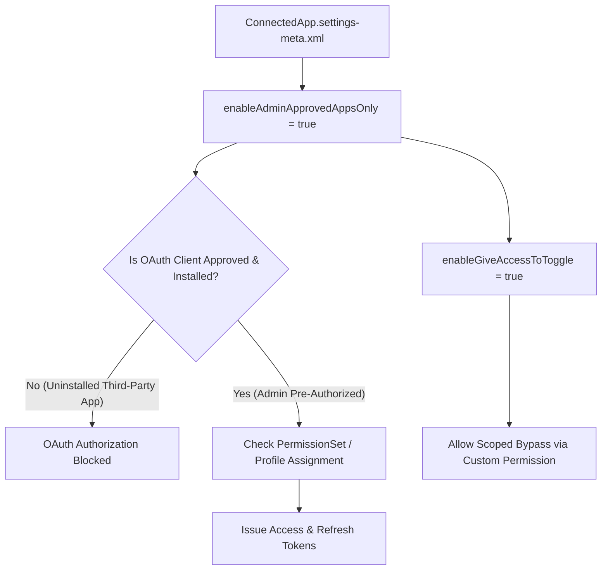

## Architectural Overview

One of the most critical Zero-Trust security controls in Salesforce is **API Access Control**. By default in older orgs, any user with the "API Enabled" permission could click through an OAuth consent screen for an unverified third-party application (such as a browser plugin or external data loader), granting that app an OAuth refresh token scoped to the user's data access.

The `ConnectedAppSettings` metadata type (`ConnectedApp.settings-meta.xml`) allows security architects to enforce **API Access Control** declaratively across all environments. By locking down connected app access at the org level (`enableAdminApprovedAppsOnly`), all connected apps are blocked by default unless they are explicitly installed and configured as "Admin approved users are pre-authorized" with assigned [PermissionSet](/docs/metadata/permission-set-metadata-type/) or [Profile](/docs/metadata/profile-metadata-type/) grants.



## SFDX Directory and File Suffix

| Property | Value |
| :--- | :--- |
| **Metadata Type Name** | `ConnectedAppSettings` (deployed via `Settings` type with member `ConnectedApp`) |
| **SFDX Source File Path** | `force-app/main/default/settings/ConnectedApp.settings-meta.xml` |
| **Classic Metadata File Path** | `settings/ConnectedApp.settings` |
| **`package.xml` Type / Member** | `<name>Settings</name>` / `<members>ConnectedApp</members>` |

## Key Metadata Fields

`ConnectedAppSettings` exposes boolean flags that control org-wide API Access Control enforcement.

| Field Name | Type | Required | Architectural Purpose |
| :--- | :--- | :--- | :--- |
| `enableAdminApprovedAppsOnly` | `boolean` | No | Enforces org-wide API Access Control ("For admin-approved users, limit API access to only allowlisted connected apps"). Blocks self-authorization of uninstalled OAuth apps. |
| `enableGiveAccessToToggle` | `boolean` | No | Enables the "Allow Users to Use Any Connected App" system permission so designated integration admins or developers can still connect unapproved CLI/IDE tools when `enableAdminApprovedAppsOnly` is `true`. |
| `enableSkipUserProvisioningWizard` | `boolean` | No | Controls whether administrators skip the legacy multi-step user provisioning wizard when configuring connected app user provisioning. |

> [!NOTE]
> The API Access Control feature managed by `enableAdminApprovedAppsOnly` must be activated in the org (available by default in Enterprise, Performance, Unlimited, and Developer Editions; in some older orgs, verify under **Setup -> Connected Apps OAuth Usage** or **API Access Control**).

## Declarative XML Example

The following `ConnectedApp.settings-meta.xml` enforces strict API Access Control across the org while allowing a controlled escape hatch (`enableGiveAccessToToggle`) via the "Use Any API Client" permission for system administrators.

```xml title="force-app/main/default/settings/ConnectedApp.settings-meta.xml"
<?xml version="1.0" encoding="UTF-8"?>
<ConnectedAppSettings xmlns="http://soap.sforce.com/2006/04/metadata">
    <enableAdminApprovedAppsOnly>true</enableAdminApprovedAppsOnly>
    <enableGiveAccessToToggle>true</enableGiveAccessToToggle>
    <enableSkipUserProvisioningWizard>true</enableSkipUserProvisioningWizard>
</ConnectedAppSettings>
```

### `package.xml` Manifest

Deploy `ConnectedAppSettings` using the `Settings` metadata type with the `ConnectedApp` member:

```xml title="manifest/package.xml"
<?xml version="1.0" encoding="UTF-8"?>
<Package xmlns="http://soap.sforce.com/2006/04/metadata">
    <types>
        <members>ConnectedApp</members>
        <name>Settings</name>
    </types>
    <version>68.0</version>
</Package>
```

## Auditing OAuth App Usage via SOQL and SFDX CLI

Before deploying `enableAdminApprovedAppsOnly = true` to Production, always audit which connected apps currently have active OAuth tokens so you do not inadvertently break critical middleware, ETL pipelines, or Salesforce CLI integrations.

### 1. Audit Active OAuth Tokens by Connected App (`OauthToken`)
```soql
SELECT AppName, UserId, User.Username, UseCount, LastUsedDate, CreatedDate
FROM OauthToken
ORDER BY LastUsedDate DESC
LIMIT 100
```

### 2. Inspect Installed Connected Apps (`ConnectedApplication`)
```soql
SELECT Id, Name, OptionsAllowAdminApprovedUsersOnly, OptionsRefreshTokenValidityMetric,
       RefreshTokenValidityPeriod, CreatedDate
FROM ConnectedApplication
ORDER BY Name ASC
```

### 3. SFDX CLI Retrieve and Deploy Commands
```bash
# Retrieve current ConnectedAppSettings from the target org
sf project retrieve start --metadata Settings:ConnectedApp

# Deploy hardened ConnectedAppSettings to enforce API Access Control
sf project deploy start --metadata Settings:ConnectedApp
```

## Architect Best Practices and Gotchas

> [!WARNING]
> **Audit `OauthToken` Before Enabling `enableAdminApprovedAppsOnly`:** Turning on `enableAdminApprovedAppsOnly` immediately blocks token refreshes and new OAuth flows for any uninstalled connected app (including Salesforce CLI `PlatformCLI`, Workbench, Dataloader.io, and VS Code extensions) unless those apps are installed in the org and assigned via a Permission Set, or the user has the **Use Any API Client** permission.

- **Pre-Install First-Party Tools:** Before flipping `enableAdminApprovedAppsOnly` to `true`, navigate to **Setup -> Connected Apps OAuth Usage**, click **Install** next to `Salesforce CLI`, `Salesforce for Outlook`, or your CI/CD [ConnectedApp](/docs/metadata/connected-app-metadata-type/), and assign a dedicated [PermissionSet](/docs/metadata/permission-set-metadata-type/) to your DevOps service accounts.
- **Avoid Broadly Granting "Use Any API Client":** When `enableGiveAccessToToggle` is `true`, treat the "Use Any API Client" system permission as a privileged administrative capability equivalent to "Modify All Data" for OAuth client consent. Never assign it to standard Sales or Service users.

> [!TIP]
> Combine `ConnectedAppSettings` with Transaction Security Policies on the `ApiEvent` and `LoginEvent` streams to monitor any anomalous token usage even from allowlisted connected apps.
