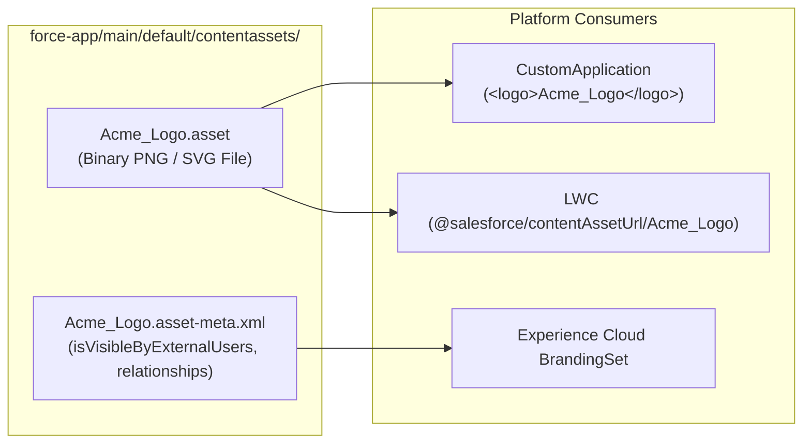

## Why the `ContentAsset` Metadata Type Matters

In Salesforce Classic, custom application logos were stored in the legacy `Document` object. In Lightning Experience, standard Salesforce Files (`ContentDocument` / `ContentVersion`) are data records—meaning they cannot be deployed via `package.xml` on their own.

**`ContentAsset`** (`contentassets/<Name>.asset` and `.asset-meta.xml`) bridges Data and Metadata by wrapping a `ContentDocument` into a deployable **Asset File** that can be referenced by:

1. **[`CustomApplication`](/docs/metadata/custom-application-metadata-type/) Logos:** Referenced via `<logo>Acme_Brand_Logo</logo>` in `.app-meta.xml`.
2. **Experience Cloud Branding & Themes:** Company logos, login background images, and tile banners.
3. **Lightning Web Components:** Imported directly via `import MY_ASSET from '@salesforce/contentAssetUrl/Acme_Brand_Logo';`.



---

## Key Metadata Fields on `ContentAsset`

| Field | Type | Required | Description |
|---|---|---|---|
| `masterLabel` | `string` | Yes | Display name of the Asset File in Setup (`Setup → Asset Files`). |
| `language` | `string` | Yes | Locale code of the asset label (e.g., `en_US`). |
| `isVisibleByExternalUsers` | `boolean` | No | *(API v44.0+)* Grants unauthenticated guest users public read access to the asset file. |
| `format` | `ContentAssetFormat` | No | `Original` (single file version, default) or `ZippedVersions` (multiple versions packaged in a zip). |
| `relationships.organization` | `ContentAssetLink` | No | Grants org-wide `VIEWER` access via an automatic `ContentDocumentLink`. |
| `versions.version` | `ContentAssetVersion[]` | Yes | Specifies `<number>1</number>` and `<pathOnClient>filename.ext</pathOnClient>`. |

---

## Real-World XML Example (`contentassets/Acme_Console_Logo.asset-meta.xml`)

```xml
<?xml version="1.0" encoding="UTF-8"?>
<ContentAsset xmlns="http://soap.sforce.com/2006/04/metadata">
    <isVisibleByExternalUsers>true</isVisibleByExternalUsers>
    <language>en_US</language>
    <masterLabel>Acme Console Logo</masterLabel>
    <relationships>
        <organization>
            <access>VIEWER</access>
        </organization>
    </relationships>
    <versions>
        <version>
            <number>1</number>
            <pathOnClient>acme-console-logo.png</pathOnClient>
        </version>
    </versions>
</ContentAsset>
```

---

## Querying `ContentAsset` via SOQL

You can query `ContentAsset` in standard SOQL and traverse directly to its backing `ContentDocument`:

```sql
SELECT Id, DeveloperName, MasterLabel, IsVisibleByExternalUsers,
       ContentDocumentId, ContentDocument.Title,
       ContentDocument.FileExtension, ContentDocument.ContentSize
FROM ContentAsset
WHERE NamespacePrefix = null
ORDER BY DeveloperName ASC
```

---

## Senior Architect Best Practices

> [!WARNING]
> **Include `ContentAsset` When Deploying a `CustomApplication`:** If you customize the logo of a Lightning App in App Manager, Salesforce adds `<logo>My_App_Logo</logo>` to the `CustomApplication` XML and creates a `ContentAsset` in `contentassets/`. Deploying the `CustomApplication` without including the `ContentAsset` in your commit will fail with `In field: logo - no ContentAsset named My_App_Logo found`!
