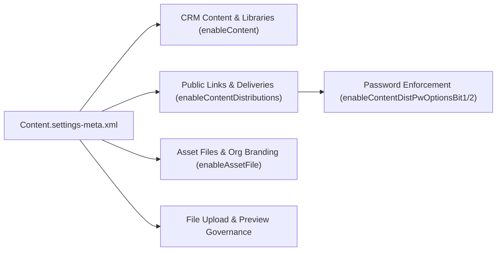

## Architectural Overview

Salesforce Files (`ContentDocument`, `ContentVersion`, `ContentDocumentLink`, and `ContentDistribution`) form the unified document storage architecture across Sales Cloud, Service Cloud, and Experience Cloud. However, unconfigured file sharing settings can easily create data exfiltration paths—such as unauthenticated public links (`ContentDistribution`) without expiration dates or passwords, or unindexed attachment uploads.

The `ContentSettings` metadata type (`Content.settings-meta.xml`) gives architects declarative control over Salesforce Files, CRM Content Libraries (`ContentWorkspace`), Content Deliveries, and Asset File generation. Version-controlling `Content.settings-meta.xml` ensures every sandbox, scratch org, and production environment enforces identical document security policies.



## SFDX Directory and File Suffix

| Property | Value |
| :--- | :--- |
| **Metadata Type Name** | `ContentSettings` (deployed via `Settings` type with member `Content`) |
| **SFDX Source File Path** | `force-app/main/default/settings/Content.settings-meta.xml` |
| **Classic Metadata File Path** | `settings/Content.settings` |
| **`package.xml` Type / Member** | `<name>Settings</name>` / `<members>Content</members>` |

## Key Metadata Fields

The `ContentSettings` metadata schema controls both legacy CRM Content features and modern Lightning Files / Content Delivery policies.

| Field Name | Type | Required | Architectural Purpose |
| :--- | :--- | :--- | :--- |
| `enableContent` | `boolean` | No | Enables Salesforce CRM Content and Files Libraries (`ContentWorkspace`). |
| `enableContentDistributions` | `boolean` | No | Enables **Content Deliveries**, allowing users to convert documents into online formats viewable via external URLs (`ContentDistribution`). |
| `enableChatterFileLink` | `boolean` | No | Enables **Public Links** for Salesforce Files so users can generate shareable external links. |
| `enableContentDistPwOptionsBit1` / `Bit2` | `boolean` | No | Controls password protection defaults on Content Deliveries (optional vs. defaulted vs. required for external links). |
| `enableContentAutoAssign` | `boolean` | No | Automatically assigns the "Salesforce CRM Content User" feature license to new users when created. |
| `enableContentSupportMultiLanguage` | `boolean` | No | Allows authors to tag and search CRM Content documents across multiple languages. |
| `enableFilesUsrShareNetRestricted` | `boolean` | No | Restricts internal files shared by internal users from being visible to external Experience Cloud network members unless explicitly shared. |
| `enableLibraryManagedFiles` | `boolean` | No | Allows folders and managed files inside Salesforce Files Libraries. |
| `enableUploadFilesOnAttachments` | `boolean` | No | Replaces legacy `Attachment` uploads in the Notes & Attachments related list with modern Salesforce Files (`ContentDocument`). |
| `skipContentAssetTriggers` | `boolean` | No | Bypasses `ContentDocument` / `ContentVersion` Apex triggers when deploying static [ContentAsset](/docs/metadata/content-asset-metadata-type/) files via Metadata API. |

## Declarative XML Example

Below is a security-hardened `Content.settings-meta.xml` file that routes Notes & Attachments uploads into Salesforce Files, restricts accidental exposure of internal user files in Experience Cloud portals, and bypasses custom file triggers during `ContentAsset` metadata deployments.

```xml title="force-app/main/default/settings/Content.settings-meta.xml"
<?xml version="1.0" encoding="UTF-8"?>
<ContentSettings xmlns="http://soap.sforce.com/2006/04/metadata">
    <enableChatterFileLink>true</enableChatterFileLink>
    <enableContent>true</enableContent>
    <enableContentAutoAssign>false</enableContentAutoAssign>
    <enableContentDistPwOptionsBit1>true</enableContentDistPwOptionsBit1>
    <enableContentDistPwOptionsBit2>true</enableContentDistPwOptionsBit2>
    <enableContentDistributions>true</enableContentDistributions>
    <enableContentSupportMultiLanguage>true</enableContentSupportMultiLanguage>
    <enableFilesUsrShareNetRestricted>true</enableFilesUsrShareNetRestricted>
    <enableLibraryManagedFiles>true</enableLibraryManagedFiles>
    <enableUploadFilesOnAttachments>true</enableUploadFilesOnAttachments>
    <skipContentAssetTriggers>true</skipContentAssetTriggers>
</ContentSettings>
```

### `package.xml` Manifest

Reference `ContentSettings` under the `Settings` metadata type with member `Content`:

```xml title="manifest/package.xml"
<?xml version="1.0" encoding="UTF-8"?>
<Package xmlns="http://soap.sforce.com/2006/04/metadata">
    <types>
        <members>Content</members>
        <name>Settings</name>
    </types>
    <version>68.0</version>
</Package>
```

## Auditing File Sharing & Retrieving via SFDX CLI

In addition to managing `Content.settings-meta.xml` via CLI, architects should periodically run SOQL queries against `ContentDistribution` to audit active public links created under these settings.

### 1. Audit Unprotected Public File Links (`ContentDistribution`)
```soql
SELECT Id, Name, ContentDocumentId, DistributionPublicUrl,
       PreferencesPasswordRequired, PreferencesExpires, ExpiryDate, ViewCount, CreatedBy.Username
FROM ContentDistribution
WHERE PreferencesPasswordRequired = false
ORDER BY ViewCount DESC
LIMIT 100
```

### 2. SFDX CLI Retrieve and Deploy Commands
```bash
# Retrieve ContentSettings from the active org
sf project retrieve start --metadata Settings:Content

# Deploy ContentSettings to enforce file security and library settings
sf project deploy start --metadata Settings:Content
```

## Architect Best Practices and Gotchas

> [!TIP]
> **Always set `<skipContentAssetTriggers>true</skipContentAssetTriggers>` in enterprise orgs.** When you have strict `ContentVersion` or `ContentDocumentLink` Apex triggers (for example, virus-scanning callouts or custom naming validation), deploying a [ContentAsset](/docs/metadata/content-asset-metadata-type/) (such as an app logo or Experience Cloud image) can fail if your custom trigger fires during the Metadata API deployment transaction. Enabling `skipContentAssetTriggers` cleanly isolates `ContentAsset` deployments from runtime user upload triggers.

- **Enforce Passwords on Public Links:** Setting both `enableContentDistPwOptionsBit1` and `enableContentDistPwOptionsBit2` to `true` forces password protection to **Required** for all Content Deliveries (`PreferencesPasswordRequired = true`), preventing unauthenticated link scraping.
- **Experience Cloud File Leakage (`enableFilesUsrShareNetRestricted`):** Always set `enableFilesUsrShareNetRestricted` to `true` when external Experience Cloud sites exist. Without it, files posted to a user's profile or shared broadly with the internal company group can become visible to external portal users who have access to the user record.
- **Attachment Migration (`enableUploadFilesOnAttachments`):** Enabling `enableUploadFilesOnAttachments` ensures that even if a legacy page layout still includes the "Notes & Attachments" related list, clicking "Upload Files" creates a `ContentVersion` / `ContentDocumentLink` rather than a legacy binary `Attachment`.
