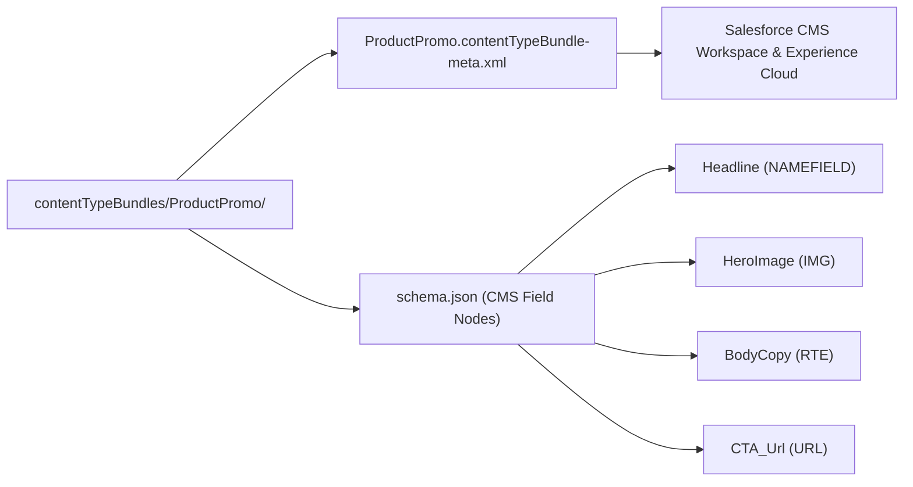

## Architectural Overview

Salesforce CMS powers headless digital experiences, Commerce Cloud storefronts, Marketing Cloud emails, and Experience Cloud portals. Out of the box, Salesforce CMS provides only basic content types (`cms_document`, `cms_image`, `news`). When enterprise content authors need structured domain models—such as **Product Announcements**, **Executive Bios**, **Clinical Trial Summaries**, or **Promotional Banners**—architects define custom CMS schemas using `ContentTypeBundle`.

Unlike flat XML metadata types, `ContentTypeBundle` is a **bundle metadata type** (similar to `LightningComponentBundle` or `ExperienceBundle`). It pairs an XML metadata descriptor (`<DeveloperName>.contentTypeBundle-meta.xml`) with a JSON schema definition (`schema.json`) that specifies each field's `nodeName`, `nodeType` (`TEXT`, `MTEXT`, `RTE`, `IMG`, `URL`, `DATE`, `DATETIME`, `NAMEFIELD`), and cardinality constraints.



## SFDX Directory and File Suffix

| Property | Value |
| :--- | :--- |
| **Metadata Type Name** | `ContentTypeBundle` |
| **SFDX Source Directory** | `force-app/main/default/contentTypeBundles/<BundleName>/` |
| **XML Descriptor File** | `<BundleName>.contentTypeBundle-meta.xml` |
| **Schema Definition File** | `schema.json` |

## Key Metadata Fields

The XML descriptor defines bundle-level metadata, while `schema.json` defines the typed content nodes.

### `<BundleName>.contentTypeBundle-meta.xml` Fields

| Field Name | Type | Required | Architectural Purpose |
| :--- | :--- | :--- | :--- |
| `description` | `string` | No | Explains the purpose and target channel of the custom CMS content type. |
| `masterLabel` | `string` | Yes | The label displayed to content authors when clicking **Add Content** in a Salesforce CMS workspace. |

### `schema.json` Node Properties

| Property Name | Type | Required | Architectural Purpose |
| :--- | :--- | :--- | :--- |
| `nodeName` | `string` | Yes | Unique API identifier for the CMS field node (alphanumeric and underscores, max 80 chars). |
| `nodeLabel` | `string` | Yes | Author-facing field label in the Salesforce CMS editor UI. |
| `nodeType` | `string` | Yes | Field data type: `NAMEFIELD` (exactly one required per type), `TEXT`, `MTEXT` (multiline text), `RTE` (rich text), `IMG` (CMS image reference), `URL`, `DATE`, or `DATETIME`. |
| `required` | `boolean` | No | Whether content authors must populate this field before publishing the CMS item. |
| `placeholderText` | `string` | No | Instructional placeholder text inside the CMS input control. |
| `helpText` | `string` | No | Tooltip guidance shown next to the field label in the CMS authoring editor. |

## Declarative Bundle Example

A complete `ContentTypeBundle` named `Product_Launch_Banner` requires two files inside `force-app/main/default/contentTypeBundles/Product_Launch_Banner/`:

### 1. Metadata XML Descriptor
```xml title="force-app/main/default/contentTypeBundles/Product_Launch_Banner/Product_Launch_Banner.contentTypeBundle-meta.xml"
<?xml version="1.0" encoding="UTF-8"?>
<ContentTypeBundle xmlns="http://soap.sforce.com/2006/04/metadata">
    <description>Structured promotional banner with hero image, rich text body, and call-to-action link for Commerce and Experience Cloud sites.</description>
    <masterLabel>Product Launch Banner</masterLabel>
</ContentTypeBundle>
```

### 2. CMS Node Definition (`schema.json`)
```json title="force-app/main/default/contentTypeBundles/Product_Launch_Banner/schema.json"
{
  "contentType": {
    "developerName": "Product_Launch_Banner",
    "masterLabel": "Product Launch Banner",
    "description": "Structured promotional banner for Commerce and Experience Cloud.",
    "nodes": [
      {
        "nodeName": "BannerTitle",
        "nodeLabel": "Banner Headline",
        "nodeType": "NAMEFIELD",
        "required": true,
        "placeholderText": "Enter the primary campaign headline"
      },
      {
        "nodeName": "SubtitleText",
        "nodeLabel": "Subtitle Summary",
        "nodeType": "MTEXT",
        "required": false,
        "helpText": "Short summary displayed beneath the headline (under 200 characters)."
      },
      {
        "nodeName": "HeroBackground",
        "nodeLabel": "Hero Background Image",
        "nodeType": "IMG",
        "required": true
      },
      {
        "nodeName": "PromoDetails",
        "nodeLabel": "Promotional Body Copy",
        "nodeType": "RTE",
        "required": false
      },
      {
        "nodeName": "CallToActionUrl",
        "nodeLabel": "Call to Action URL",
        "nodeType": "URL",
        "required": true,
        "placeholderText": "https://www.example.com/products/new"
      },
      {
        "nodeName": "EmbargoReleaseDate",
        "nodeLabel": "Embargo Release Date",
        "nodeType": "DATETIME",
        "required": false
      }
    ]
  }
}
```

### `package.xml` Manifest

```xml title="manifest/package.xml"
<?xml version="1.0" encoding="UTF-8"?>
<Package xmlns="http://soap.sforce.com/2006/04/metadata">
    <types>
        <members>Product_Launch_Banner</members>
        <name>ContentTypeBundle</name>
    </types>
    <version>68.0</version>
</Package>
```

## Querying via Tooling API and SFDX CLI

You can inspect deployed custom content types via the Tooling API `ManagedContentType` object or retrieve the bundle files using the `sf` CLI.

### 1. Query Deployed Custom CMS Content Types via Tooling API
```soql
SELECT Id, DeveloperName, MasterLabel, Description, ManageableState, CreatedDate
FROM ManagedContentType
ORDER BY DeveloperName ASC
```

### 2. SFDX CLI Retrieve and Deploy Commands
```bash
# Retrieve a specific ContentTypeBundle
sf project retrieve start --metadata ContentTypeBundle:Product_Launch_Banner

# Deploy the ContentTypeBundle directory to a target org
sf project deploy start --source-dir force-app/main/default/contentTypeBundles/Product_Launch_Banner
```

## Architect Best Practices and Gotchas

> [!WARNING]
> **Schema Immutability Once Content Exists:** Treat `ContentTypeBundle` node definitions like published database columns. Once CMS authors create `ManagedContent` records using `Product_Launch_Banner`, Salesforce blocks deployments that attempt to change a node's `nodeType`, delete an existing node, or flip `required` from `false` to `true`.

- **Exactly One `NAMEFIELD` Node Required:** Every `schema.json` file must include **exactly one** node with `"nodeType": "NAMEFIELD"` and `"required": true`. Omitting `NAMEFIELD` or defining two `NAMEFIELD` nodes fails deployment immediately.
- **15-Node Governor Limit:** A custom `ContentTypeBundle` supports at most **15 nodes** per content type and **100 custom content types** per org. Design cohesive, channel-agnostic content models rather than bloated 40-field schemas.

> [!TIP]
> After deploying a `ContentTypeBundle`, map its fields to Experience Builder repeater/collection components or retrieve published items headlessly via the Connect REST API (`/connect/cms/delivery/channels/<channelId>/contents/query?contentTypeFQN=Product_Launch_Banner`).
