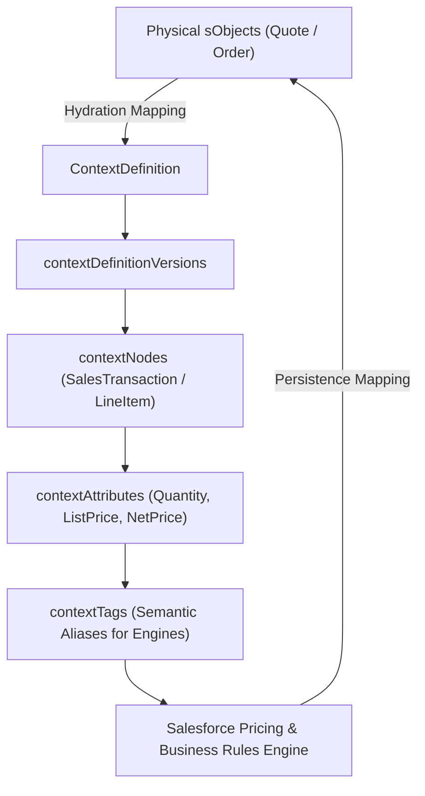

## Architectural Overview

Modern Salesforce Industry Clouds and **Revenue Lifecycle Management (RLM)**—including Salesforce Pricing, Product Configurator, Dynamic Revenue Orchestrator (DRO), and Business Rules Engine (BRE)—decouple business logic from physical sObject schemas using **Salesforce Context Service**. At the heart of Context Service is the `ContextDefinition` metadata type.

Architecturally, `ContextDefinition` defines an abstract, hierarchical domain model (`contextNodes` and `contextAttributes`), semantic aliases (`contextTags`), and bidirectional data mappings (`contextMappings`) that hydrate data from sObjects (like `Quote`, `QuoteLineItem`, `Order`, `OrderItem`) or external JSON payloads into a high-speed in-memory cache. Pricing Procedures and Expression Sets read and write against **Context Tags** rather than hardcoding `QuoteLineItem` or `OrderItem` fields, allowing a single pricing engine to price Carts, Quotes, Orders, and Contracts without duplicate rules.



## SFDX Directory and File Suffix

| Property | Value |
| :--- | :--- |
| **Metadata Type Name** | `ContextDefinition` |
| **SFDX Source Directory** | `force-app/main/default/contextDefinitions/` |
| **SFDX File Suffix** | `.contextDefinition-meta.xml` |
| **Classic Metadata Suffix** | `.contextDefinition` |

## Key Metadata Fields

A `ContextDefinition` wraps one or more versioned schemas (`contextDefinitionVersions`), each containing its hierarchical nodes, attributes, tags, and sObject mappings.

| Field Name | Type | Required | Architectural Purpose |
| :--- | :--- | :--- | :--- |
| `masterLabel` | `string` | Yes | Human-readable label for the context definition in Setup -> Context Service. |
| `developerName` | `string` | Yes | Unique API name referenced by Pricing Procedures, Expression Sets, and Flow actions. |
| `description` | `string` | No | Architectural notes detailing which domain processes consume this context definition. |
| `inheritedFrom` | `string` | No | DeveloperName of a standard or parent `ContextDefinition` (such as `SalesTransactionContext`) that this definition extends. |
| `isActive` | `boolean` | No | Indicates whether the context definition is active and available for runtime hydration. |
| `startDate` | `dateTime` | Yes | Effective start timestamp for the context definition. |
| `ttlInMinutes` | `int` | No | Time-to-live (in minutes) for cached runtime context instances in platform memory. |
| `contextDefinitionVersions` | `ContextDefinitionVersion[]` | No | Versioned container holding `contextNodes`, `contextMappings`, and effective date ranges. |

### `ContextNode` and `ContextAttribute` Subtype Fields

| Field Name | Type | Description |
| :--- | :--- | :--- |
| `contextNodes.title` | `string` | Name of the node in the context hierarchy (e.g., `SalesTransaction`, `SalesTransactionItem`). |
| `contextNodes.isTransposable` | `boolean` | Allows the node to be transposed during matrix/attribute-based pricing evaluations. |
| `contextAttributes.title` | `string` | Name of the attribute on the node (e.g., `PartnerTier__c`, `DiscountPercent`). |
| `contextAttributes.dataType` | `ContextAttrDataType` | Attribute type: `STRING`, `NUMBER`, `CURRENCY`, `PERCENT`, `BOOLEAN`, `DATETIME`, `DATE`, or `OBJECT`. |
| `contextAttributes.domainType` | `ContextAttrDomainType` | Specifies `Input`, `Output`, or `InputOutput` directionality during rule evaluation. |
| `contextTags.title` | `string` | The tag alias exposed to Pricing Procedures and Expression Sets. |

## Declarative XML Example

Below is a representative `Enterprise_Sales_Context.contextDefinition-meta.xml` extending the standard sales transaction context with a custom `ChannelPartnerTier` attribute and mapping it to `Quote`.

```xml title="force-app/main/default/contextDefinitions/Enterprise_Sales_Context.contextDefinition-meta.xml"
<?xml version="1.0" encoding="UTF-8"?>
<ContextDefinition xmlns="http://soap.sforce.com/2006/04/metadata">
    <contextDefinitionVersions>
        <contextNodes>
            <contextAttributes>
                <contextTags>
                    <title>ChannelPartnerTierTag</title>
                </contextTags>
                <dataType>STRING</dataType>
                <domainType>InputOutput</domainType>
                <isKey>false</isKey>
                <title>ChannelPartnerTier</title>
                <valueType>SObject</valueType>
            </contextAttributes>
            <contextAttributes>
                <contextTags>
                    <title>TransactionTotalAmountTag</title>
                </contextTags>
                <dataType>CURRENCY</dataType>
                <domainType>InputOutput</domainType>
                <isKey>false</isKey>
                <scale>2</scale>
                <title>TransactionTotalAmount</title>
                <valueType>SObject</valueType>
            </contextAttributes>
            <isTransposable>false</isTransposable>
            <title>SalesTransaction</title>
        </contextNodes>
        <description>Version 1 of Enterprise Sales Context with Partner Tier hydration.</description>
        <isActive>true</isActive>
        <startDate>2026-01-01T00:00:00.000Z</startDate>
        <versionNumber>1</versionNumber>
    </contextDefinitionVersions>
    <description>Custom Context Service definition for B2B Quote and Order pricing hydration.</description>
    <developerName>Enterprise_Sales_Context</developerName>
    <inheritedFrom>SalesTransactionContext</inheritedFrom>
    <isActive>true</isActive>
    <masterLabel>Enterprise Sales Context</masterLabel>
    <startDate>2026-01-01T00:00:00.000Z</startDate>
    <ttlInMinutes>30</ttlInMinutes>
</ContextDefinition>
```

### `package.xml` Manifest

```xml title="manifest/package.xml"
<?xml version="1.0" encoding="UTF-8"?>
<Package xmlns="http://soap.sforce.com/2006/04/metadata">
    <types>
        <members>Enterprise_Sales_Context</members>
        <name>ContextDefinition</name>
    </types>
    <version>68.0</version>
</Package>
```

## Querying ContextDefinitions via SOQL and SFDX CLI

You can query `ContextDefinition` and `ContextDefinitionVersion` in SOQL or Tooling API to inspect active versions, inheritance chains, and TTL settings across environments.

### 1. Query Active Context Definitions and Inheritance
```soql
SELECT Id, DeveloperName, MasterLabel, InheritedFrom, IsActive, TtlInMinutes, EffectiveFromDate
FROM ContextDefinition
WHERE IsActive = true
ORDER BY DeveloperName ASC
```

### 2. SFDX CLI Retrieve and Deploy Commands
```bash
# Retrieve a specific ContextDefinition from the source org
sf project retrieve start --metadata ContextDefinition:Enterprise_Sales_Context

# Deploy the ContextDefinition to a target org
sf project deploy start --metadata ContextDefinition:Enterprise_Sales_Context
```

## Architect Best Practices and Gotchas

> [!WARNING]
> **Never Modify Standard Out-of-the-Box Context Definitions Directly:** Standard definitions such as `SalesTransactionContext` or `ProductDiscoveryContext` are upgraded by Salesforce during seasonal releases. Always clone or extend (`<inheritedFrom>`) the standard definition into a custom `ContextDefinition` before adding custom attributes or sObject mappings.

- **Active Version Locking:** In target orgs where `Enterprise_Sales_Context` is already `isActive = true`, attempting to deploy structural changes to an existing active `versionNumber` will fail. Deactivate the context definition first or deploy a new `<contextDefinitionVersions>` block with an incremented `<versionNumber>`.
- **Sync Context Definitions After Deployment:** When extending a standard context definition after a Salesforce release upgrade, run the **Sync** action in Setup -> Context Definitions (or redeploy your extended definition) so newly introduced standard nodes propagate to your custom child definition.
- **Tune `ttlInMinutes` Carefully:** Setting `ttlInMinutes` too high in high-volume CPQ/RLM orgs increases platform cache retention; setting it too low (under 10 minutes) can expire an interactive configurator session while a sales rep is mid-quote. `20` to `30` minutes is the recommended enterprise baseline.
