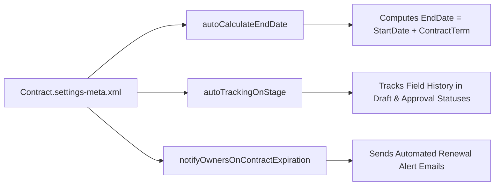

## Architectural Overview

The standard `Contract` object is the backbone of post-sale lifecycle management across Sales Cloud, Salesforce CPQ, and Revenue Lifecycle Management (RLM). However, several core runtime behaviors of the `Contract` object—such as whether `EndDate` is automatically calculated from `StartDate` + `ContractTerm`, and whether field history tracking (`ContractHistory`) records edits made while a contract is still in `Draft` status—are governed globally by the `ContractSettings` metadata type (`Contract.settings-meta.xml`).

Architects must include `Contract.settings-meta.xml` in source control so that sandbox refreshes, scratch org builds, and production deployments maintain consistent date calculation and compliance auditing rules.



## SFDX Directory and File Suffix

| Property | Value |
| :--- | :--- |
| **Metadata Type Name** | `ContractSettings` (deployed via `Settings` type with member `Contract`) |
| **SFDX Source File Path** | `force-app/main/default/settings/Contract.settings-meta.xml` |
| **Classic Metadata File Path** | `settings/Contract.settings` |
| **`package.xml` Type / Member** | `<name>Settings</name>` / `<members>Contract</members>` |

## Key Metadata Fields

`ContractSettings` exposes four boolean flags that govern standard `Contract` lifecycle behavior across the entire organization.

| Field Name | Type | Required | Architectural Purpose |
| :--- | :--- | :--- | :--- |
| `autoCalculateEndDate` | `boolean` | No | Automatically calculates `Contract.EndDate` based on `StartDate` and `ContractTerm` (months). |
| `autoExpirationDelay` | `string` | No | Legacy/optional delay window setting for automatic contract expiration processing. |
| `autoExpireContracts` | `boolean` | No | Automatically updates contract status when the contract reaches its `EndDate`. |
| `autoTrackingOnStage` | `boolean` | No | Tracks field history (`ContractHistory`) across **all** contract statuses (including `Draft` and `In Approval Process`), rather than only after `Activated`. |
| `notifyOwnersOnContractExpiration` | `boolean` | No | Sends automated email notifications to Account and Contract owners prior to contract expiration based on `OwnerExpirationNotice`. |

## Declarative XML Example

Below is a recommended enterprise `Contract.settings-meta.xml` configuration that enables full audit history across all contract statuses (`autoTrackingOnStage = true`) while disabling legacy system email notifications in favor of modern [Flow](/docs/metadata/flow-metadata-type/) renewal orchestrations.

```xml title="force-app/main/default/settings/Contract.settings-meta.xml"
<?xml version="1.0" encoding="UTF-8"?>
<ContractSettings xmlns="http://soap.sforce.com/2006/04/metadata">
    <autoCalculateEndDate>true</autoCalculateEndDate>
    <autoExpireContracts>false</autoExpireContracts>
    <autoTrackingOnStage>true</autoTrackingOnStage>
    <notifyOwnersOnContractExpiration>false</notifyOwnersOnContractExpiration>
</ContractSettings>
```

### `package.xml` Manifest

Retrieve and deploy `ContractSettings` via the `Settings` metadata type with member `Contract`:

```xml title="manifest/package.xml"
<?xml version="1.0" encoding="UTF-8"?>
<Package xmlns="http://soap.sforce.com/2006/04/metadata">
    <types>
        <members>Contract</members>
        <name>Settings</name>
    </types>
    <version>68.0</version>
</Package>
```

## Querying Contracts and Managing Settings via SFDX CLI

While `ContractSettings` itself is retrieved via Metadata API, you can verify its runtime effect on `Contract` and `ContractHistory` via SOQL.

### 1. Query Contracts Approaching Expiration with Owner Notice Window
```soql
SELECT Id, ContractNumber, Account.Name, Status, StartDate, EndDate,
       ContractTerm, OwnerExpirationNotice, Owner.Email
FROM Contract
WHERE Status = 'Activated'
  AND EndDate = NEXT_N_DAYS:60
ORDER BY EndDate ASC
```

### 2. SFDX CLI Retrieve and Deploy Commands
```bash
# Retrieve ContractSettings into force-app/main/default/settings/Contract.settings-meta.xml
sf project retrieve start --metadata Settings:Contract

# Deploy ContractSettings to target org
sf project deploy start --metadata Settings:Contract
```

## Architect Best Practices and Gotchas

> [!TIP]
> **Always Enable `autoTrackingOnStage` for SOX and Audit Compliance:** By default (`autoTrackingOnStage = false`), Salesforce ignores field history tracking on a `Contract` while its status is `Draft` or `In Approval Process`. Legal redlines, payment term edits, and discount approvals almost always occur before activation—so set `<autoTrackingOnStage>true</autoTrackingOnStage>` to capture pre-activation changes in `ContractHistory`.

- **Co-Terminated Contracts & `autoCalculateEndDate`:** In Salesforce CPQ or RLM implementations where renewal or amendment contracts are co-terminated to a specific mid-month date (e.g., a 7-month and 14-day stub period), having `<autoCalculateEndDate>true</autoCalculateEndDate>` can cause Salesforce to overwrite the exact `EndDate` with a whole-month calculation (`StartDate` + `ContractTerm`) whenever `StartDate` or `ContractTerm` is edited. In complex subscription architectures, set `autoCalculateEndDate` to `false` and let the billing/CPQ engine control `EndDate` explicitly.
- **Prefer Record-Triggered Flows Over `notifyOwnersOnContractExpiration`:** The built-in `notifyOwnersOnContractExpiration` setting sends a rigid plain-text system email only to the Contract and Account owners based on the `OwnerExpirationNotice` picklist (15, 30, 45, 60, or 90 days). For enterprise renewal teams, set `notifyOwnersOnContractExpiration` to `false` and use a scheduled or record-triggered [Flow](/docs/metadata/flow-metadata-type/) to create renewal Opportunities and Slack notifications.
