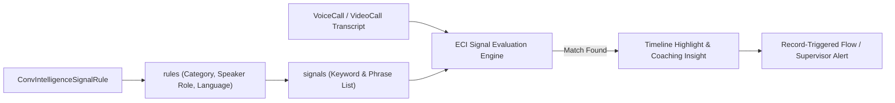

## Architectural Overview

When **Einstein Conversation Insights (ECI)** transcribes a `VoiceCall` or `VideoCall`, it evaluates the transcript against two sets of intelligence models: Salesforce's out-of-the-box NLP insights (such as *Next Steps*, *Question Asked*, or *Action Items*) and organization-specific keyword rules defined via `ConvIntelligenceSignalRule`.

Architecturally, `ConvIntelligenceSignalRule` allows Sales Enablement and Contact Center Architects to codify domain-specific taxonomy—such as **Competitor Mentions**, **Renewal Churn Signals**, **Pricing Discount Requests**, and **Mandatory Regulatory Disclosures**—as version-controlled XML metadata. When a signal matches during transcript processing, Salesforce creates a `CallCoachingMediaProvider` / signal insight record that can trigger record-triggered [Flows](/docs/metadata/flow-metadata-type/), populate coaching dashboards, and highlight exact timestamps on the call timeline player.



## SFDX Directory and File Suffix

| Property | Value |
| :--- | :--- |
| **Metadata Type Name** | `ConvIntelligenceSignalRule` |
| **SFDX Source Directory** | `force-app/main/default/convIntelligenceSignalRules/` |
| **SFDX File Suffix** | `.convIntelligenceSignalRule-meta.xml` |
| **Classic Metadata Suffix** | `.convIntelligenceSignalRule` |

## Key Metadata Fields

A `ConvIntelligenceSignalRule` acts as a container for one or more `rules` (`ConvIntelligenceSignalSubRule`), each containing the list of `signals` (keywords) to detect.

| Field Name | Type | Required | Architectural Purpose |
| :--- | :--- | :--- | :--- |
| `active` | `boolean` | No | Controls whether this signal rule is actively evaluated on new voice and video transcripts. |
| `conversationType` | `ConvIntelligenceConversationType` | Yes | Target call domain: `VoiceAndVideo` (Sales/Service ECI) or `Messaging`. |
| `masterLabel` | `string` | No | Display label of the signal rule group in Setup -> Call Explorer / Conversation Insights. |
| `rules` | `ConvIntelligenceSignalSubRule[]` | No | Defines individual signal categories, speaker role filters, languages, and keyword lists. |

### `ConvIntelligenceSignalSubRule` (`rules`) Subtype Fields

| Field Name | Type | Required | Description |
| :--- | :--- | :--- | :--- |
| `category` | `ConvIntelligenceSignalCategory` | Yes | Classification type: `Competitor`, `Product`, `Custom`, `Objection`, or `Compliance`. |
| `categoryValue` | `string` | Yes | Specific display name of the insight badge (e.g., `Competitor: Globex Corp` or `Churn Risk`). |
| `language` | `string` | No | ISO language code for transcript evaluation (e.g., `en_US`, `es`, `de`, `fr`). |
| `participantRole` | `ConvIntelligenceParticipantRole` | No | Filters detection by speaker: `Customer` (prospect/caller), `Rep` (sales rep/service agent), or `All`. |
| `signals` | `ConvIntelligenceSignal[]` | No | Array of `<signalValue>` keyword phrases (up to 25 keywords per sub-rule) matched against the transcript. |
| `signals.signalValue` | `string` | Yes | Exact word or multi-word phrase to match (case-insensitive lemmatized matching). |
| `signals.type` | `ConvIntelligenceSignalType` | Yes | Signal matching type, typically `Keyword`. |

## Declarative XML Example

Below is a production `Enterprise_Competitor_And_Churn_Signals.convIntelligenceSignalRule-meta.xml` defining both a **Competitor** mention rule and a customer-spoken **Churn Risk** objection rule.

```xml title="force-app/main/default/convIntelligenceSignalRules/Enterprise_Competitor_And_Churn_Signals.convIntelligenceSignalRule-meta.xml"
<?xml version="1.0" encoding="UTF-8"?>
<ConvIntelligenceSignalRule xmlns="http://soap.sforce.com/2006/04/metadata">
    <active>true</active>
    <conversationType>VoiceAndVideo</conversationType>
    <masterLabel>Enterprise Competitor and Churn Signals</masterLabel>
    <rules>
        <category>Competitor</category>
        <categoryValue>Globex Cloud</categoryValue>
        <language>en_US</language>
        <participantRole>All</participantRole>
        <signals>
            <signalValue>Globex</signalValue>
            <type>Keyword</type>
        </signals>
        <signals>
            <signalValue>Globex Enterprise Suite</signalValue>
            <type>Keyword</type>
        </signals>
    </rules>
    <rules>
        <category>Custom</category>
        <categoryValue>Cancellation and Churn Risk</categoryValue>
        <language>en_US</language>
        <participantRole>Customer</participantRole>
        <signals>
            <signalValue>cancel our contract</signalValue>
            <type>Keyword</type>
        </signals>
        <signals>
            <signalValue>not renewing</signalValue>
            <type>Keyword</type>
        </signals>
        <signals>
            <signalValue>switching providers</signalValue>
            <type>Keyword</type>
        </signals>
    </rules>
</ConvIntelligenceSignalRule>
```

### `package.xml` Manifest

Deploy `ConvIntelligenceSignalRule` together with `ConversationalIntelligenceSettings`:

```xml title="manifest/package.xml"
<?xml version="1.0" encoding="UTF-8"?>
<Package xmlns="http://soap.sforce.com/2006/04/metadata">
    <types>
        <members>ConversationalIntelligence</members>
        <name>Settings</name>
    </types>
    <types>
        <members>Enterprise_Competitor_And_Churn_Signals</members>
        <name>ConvIntelligenceSignalRule</name>
    </types>
    <version>68.0</version>
</Package>
```

## SFDX CLI Retrieval and Deployment

Manage `ConvIntelligenceSignalRule` files across environments using the `sf` CLI:

```bash
# Retrieve all Einstein Conversation Insights signal rules
sf project retrieve start --metadata ConvIntelligenceSignalRule

# Deploy a specific signal rule to a target org
sf project deploy start --metadata ConvIntelligenceSignalRule:Enterprise_Competitor_And_Churn_Signals
```

## Architect Best Practices and Gotchas

> [!NOTE]
> **Forward-Only Transcript Evaluation:** Deploying or updating a `ConvIntelligenceSignalRule` applies **only to new calls** processed after the deployment completes. Salesforce does not retroactively re-scan historical `VoiceCall` or `VideoCall` transcripts when new keywords are added.

- **Governor Limits on Custom Insights:** Orgs can configure up to **100 custom insights (`rules`)** per conversation type, with up to **25 keywords (`signals`)** per insight sub-rule. Consolidate synonymous phrases under a single `categoryValue` rather than creating separate rules for each spelling variant.
- **Scope `participantRole` to Reduce False Positives:** For objection and churn signals, always set `<participantRole>Customer</participantRole>` so sales reps asking discovery questions don't inadvertently trigger false-positive churn alerts. Conversely, for mandatory legal disclosures ("This call is recorded for quality assurance"), set `<participantRole>Rep</participantRole>`.
