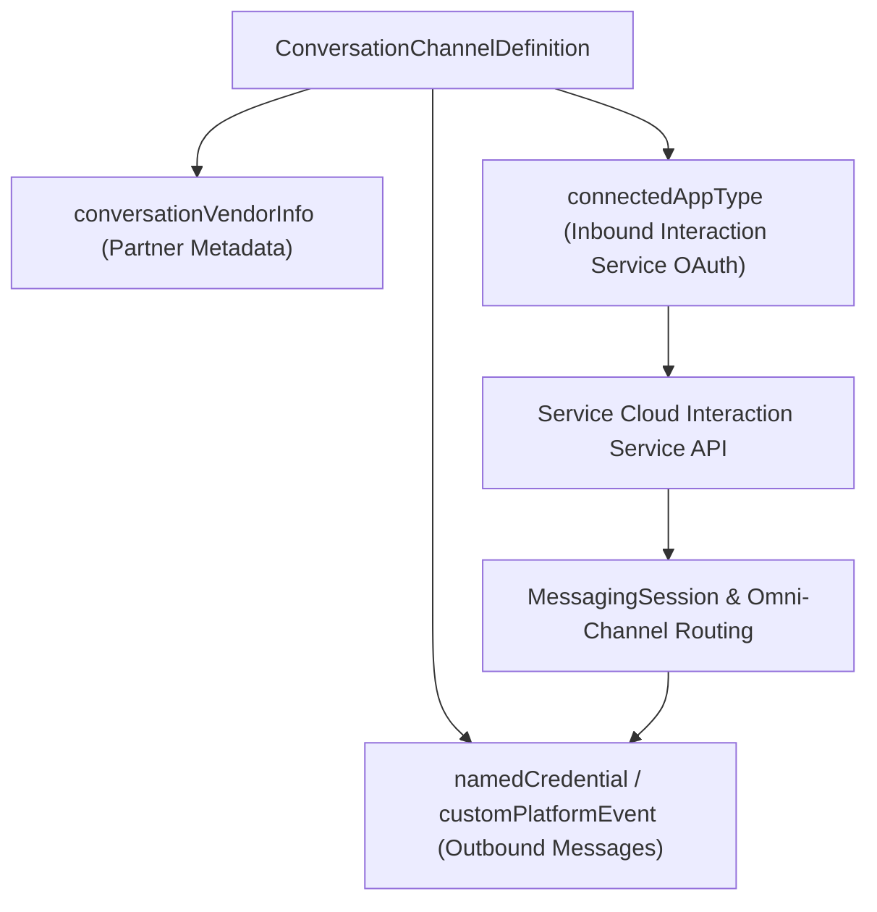

## Architectural Overview

Salesforce **Bring Your Own Channel (BYOC)** for Messaging and CCaaS allows enterprises and ISV partners to integrate any external messaging platform (such as regional messaging apps, proprietary mobile chat, or custom CCaaS routers) directly into the native Service Cloud Console and Omni-Channel routing engine (`MessagingSession` and `ConversationEntry`).

The `ConversationChannelDefinition` metadata type is the technical bridge of the BYOC architecture. It connects four foundational pillars into a unified messaging channel definition:
1. **Partner Identity:** References a [ConversationVendorInfo](/docs/metadata/conversation-vendor-info-metadata-type/) metadata record (`conversationVendorInfo`).
2. **Inbound Authentication:** Links the [ConnectedApp](/docs/metadata/connected-app-metadata-type/) (`connectedAppType`) used by the external vendor to call Salesforce's **Interaction Service API** (`/api/v1/interactions`).
3. **Outbound Delivery:** Binds a `NamedCredential` (`namedCredential`) or Platform Event channel (`customEventType` / `customPlatformEvent`) to push agent replies, typing indicators, and routing requests back to the external messaging gateway.
4. **Channel Capabilities:** Declares supported rich content capabilities (`isTypingIndicatorDisabled`, `areReadReceiptsDisabled`, `maxFileSize`, supported file extensions).



## SFDX Directory and File Suffix

| Property | Value |
| :--- | :--- |
| **Metadata Type Name** | `ConversationChannelDefinition` |
| **SFDX Source Directory** | `force-app/main/default/conversationChannelDefinitions/` |
| **SFDX File Suffix** | `.conversationChannelDefinition-meta.xml` |
| **Classic Metadata Suffix** | `.conversationChannelDefinition` |

## Key Metadata Fields

`ConversationChannelDefinition` configures the authentication, event transport, and rich media capabilities of a custom conversation channel.

| Field Name | Type | Required | Architectural Purpose |
| :--- | :--- | :--- | :--- |
| `masterLabel` | `string` | Yes | Display name of the custom messaging channel in Setup -> Messaging Settings. |
| `conversationVendorInfo` | `string` | Yes | DeveloperName of the parent [ConversationVendorInfo](/docs/metadata/conversation-vendor-info-metadata-type/) component. |
| `connectedAppType` | `string` | Yes | DeveloperName of the OAuth `ConnectedApp` authorized to invoke the Salesforce Interaction Service APIs. |
| `routingOwner` | `ConversationRoutingOwnerType` | Yes | Specifies who controls conversation routing: `Salesforce` (Omni-Channel Flow/Queue) or `Partner` (external CCaaS router). |
| `consentOwner` | `ConversationConsentOwnerType` | No | Specifies whether opt-in/opt-out consent is managed by `Salesforce` or `Partner`. |
| `customEventType` | `string` | No | DeveloperName of the `PlatformEventChannel` used for outbound messaging events. |
| `customPlatformEvent` | `string` | No | API name of the custom Platform Event (`__e`) published when agents send messages or status updates. |
| `namedCredential` | `string` | No | DeveloperName of the `NamedCredential` used for outbound HTTP callouts to the vendor endpoint. |
| `areReadReceiptsDisabled` | `boolean` | No | When `true`, hides read/delivery receipt indicators in the Service Console Enhanced Conversation component. |
| `isTypingIndicatorDisabled` | `boolean` | No | When `true`, disables bidirectional typing indicators for this channel. |
| `capabilitiesSupportsCustomChannelParameters` | `boolean` | No | Allows passing custom context parameters from the external channel into `MessagingSession` mappings. |
| `CapabilitiesSupportsIso8601Duration` | `boolean` | No | Enables ISO-8601 duration formatting in structured messaging payloads. |

## Declarative XML Example

Below is a complete `Line_Enterprise_Channel.conversationChannelDefinition-meta.xml` configuring a BYOC Messaging integration where Salesforce Omni-Channel owns routing (`routingOwner = Salesforce`) and outbound messages are emitted via a custom Platform Event (`Vendor_Outbound_Message__e`).

```xml title="force-app/main/default/conversationChannelDefinitions/Line_Enterprise_Channel.conversationChannelDefinition-meta.xml"
<?xml version="1.0" encoding="UTF-8"?>
<ConversationChannelDefinition xmlns="http://soap.sforce.com/2006/04/metadata">
    <areReadReceiptsDisabled>false</areReadReceiptsDisabled>
    <capabilitiesSupportsCustomChannelParameters>true</capabilitiesSupportsCustomChannelParameters>
    <connectedAppType>Line_BYOC_Interaction_ConnectedApp</connectedAppType>
    <consentOwner>Partner</consentOwner>
    <conversationVendorInfo>Line_Messaging_Vendor</conversationVendorInfo>
    <customEventType>Line_Outbound_Event_Channel</customEventType>
    <customPlatformEvent>Vendor_Outbound_Message__e</customPlatformEvent>
    <isTypingIndicatorDisabled>false</isTypingIndicatorDisabled>
    <masterLabel>LINE Enterprise Messaging Channel</masterLabel>
    <namedCredential>Line_Messaging_Gateway_API</namedCredential>
    <routingOwner>Salesforce</routingOwner>
</ConversationChannelDefinition>
```

### `package.xml` Manifest

Always bundle `ConversationChannelDefinition` with its required `ConversationVendorInfo`, `ConnectedApp`, `PlatformEventChannel`, and `CustomObject` (`__e`) dependencies:

```xml title="manifest/package.xml"
<?xml version="1.0" encoding="UTF-8"?>
<Package xmlns="http://soap.sforce.com/2006/04/metadata">
    <types>
        <members>Line_Enterprise_Channel</members>
        <name>ConversationChannelDefinition</name>
    </types>
    <types>
        <members>Line_Messaging_Vendor</members>
        <name>ConversationVendorInfo</name>
    </types>
    <types>
        <members>Line_Outbound_Event_Channel</members>
        <name>PlatformEventChannel</name>
    </types>
    <types>
        <members>Vendor_Outbound_Message__e</members>
        <name>CustomObject</name>
    </types>
    <version>68.0</version>
</Package>
```

## Querying via SOQL and SFDX CLI

You can query `ConversationChannelDefinition` directly in SOQL or Tooling API to inspect configured BYOC adapters and routing ownership.

### 1. Query Configured BYOC Channel Definitions via SOQL
```soql
SELECT Id, DeveloperName, MasterLabel, RoutingOwner, ConsentOwner,
       ConversationVendorInfoId, CustomPlatformEvent, CreatedDate
FROM ConversationChannelDefinition
ORDER BY DeveloperName ASC
```

### 2. SFDX CLI Retrieve and Deploy Commands
```bash
# Retrieve a specific ConversationChannelDefinition
sf project retrieve start --metadata ConversationChannelDefinition:Line_Enterprise_Channel

# Deploy the BYOC channel definition
sf project deploy start --metadata ConversationChannelDefinition:Line_Enterprise_Channel
```

## Architect Best Practices and Gotchas

> [!WARNING]
> **Dependency Ordering in CI/CD:** `ConversationChannelDefinition` has strict foreign-key metadata dependencies on `ConversationVendorInfo`, `ConnectedApp`, `PlatformEventChannel`, and the custom Platform Event (`__e`). Deploying `ConversationChannelDefinition` before those four artifacts exist in the target org will fail immediately.

- **`routingOwner` Architectural Choice (`Salesforce` vs. `Partner`):**
  - Choose `Salesforce` (**BYOC for Messaging**) when you want Salesforce Omni-Channel Flows, Queues, Skills, and Einstein Bots / Agentforce Agents to control routing and agent assignment.
  - Choose `Partner` (**BYOC for CCaaS**) when an external contact center router (such as Genesys, Amazon Connect, or Nice CXone) controls agent state and pushes work assignments into Salesforce via the Interaction Service API.
- **Connected App OAuth Scope:** The `ConnectedApp` referenced in `<connectedAppType>` must include the `chatbot_api` and `sfap_api` (or Interaction Service) OAuth scopes and use the Client Credentials or JWT Bearer flow for machine-to-machine reliability.
