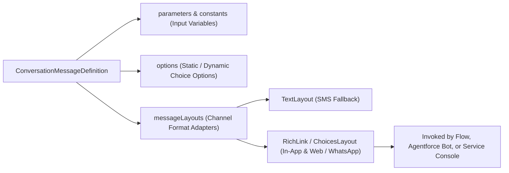

## Architectural Overview

In legacy Live Agent chat, interactions were limited to plain text. With **Enhanced Messaging** (Messaging for In-App and Web, Enhanced WhatsApp, Facebook Messenger, Apple Messages for Business, and BYOC), Service Cloud supports structured, interactive **Messaging Components**.

The `ConversationMessageDefinition` metadata type is the declarative XML representation of a Messaging Component. A single `ConversationMessageDefinition` can define an interactive payload (`type` = `ChoicesQuestion`, `TimeSelectorQuestion`, `FormRequest`, `Link`, `StaticContent`, or `ExternalTemplate`) along with channel-specific layout adaptation (`messageLayouts`). At runtime, Omni-Channel Flows, Service Agents, or Agentforce / Einstein Bots invoke the `ConversationMessageDefinition` and Salesforce automatically renders the appropriate native widget for the customer's channel (for example, an Apple Pay / Time Picker bubble on iOS or a WhatsApp Interactive List on WhatsApp).



## SFDX Directory and File Suffix

| Property | Value |
| :--- | :--- |
| **Metadata Type Name** | `ConversationMessageDefinition` |
| **SFDX Source Directory** | `force-app/main/default/conversationMessageDefinitions/` |
| **SFDX File Suffix** | `.conversationMessageDefinition-meta.xml` |
| **Classic Metadata Suffix** | `.conversationMessageDefinition` |

## Key Metadata Fields

`ConversationMessageDefinition` combines input parameters, constant values, interactive options, and multi-channel layout definitions.

| Field Name | Type | Required | Architectural Purpose |
| :--- | :--- | :--- | :--- |
| `label` | `string` | Yes | Display name of the Messaging Component in Setup -> Messaging Components and Flow Builder. |
| `type` | `ConversationMessageType` | Yes | Component category: `StaticContent`, `Link`, `ChoicesQuestion`, `TimeSelectorQuestion`, `FormRequest`, `AuthenticationRequest`, `PaymentRequest`, or `ExternalTemplate`. |
| `description` | `string` | No | Documents when and where the messaging component is sent. |
| `constants` | `ConversationMessageConstant[]` | No | Defines reusable static text, URLs, or `ContentAsset` image constants used across layout formats. |
| `parameters` | `ConversationMessageParameter[]` | No | Declares dynamic runtime input variables (`Text`, `Number`, `Boolean`, `RecordId`, `CustomPrimitiveList`) passed from Flows or Bots. |
| `options` | `ConversationMessageOption[]` | No | Defines selectable choices for `ChoicesQuestion` components. |
| `messageLayouts` | `ConversationMessageLayout[]` | Yes | Specifies how the component renders across layout formats (`Text`, `RichLink`, `Buttons`, `CardCarousel`, `ListSelector`, `ExternalTemplate`). |

## Declarative XML Example

Below is a production `Order_Status_Rich_Link.conversationMessageDefinition-meta.xml` defining a `Link` Messaging Component that accepts a dynamic `TrackingUrl` parameter from a Flow and renders both a Rich Link card (for In-App & Web and WhatsApp) and a plain-text SMS fallback.

```xml title="force-app/main/default/conversationMessageDefinitions/Order_Status_Rich_Link.conversationMessageDefinition-meta.xml"
<?xml version="1.0" encoding="UTF-8"?>
<ConversationMessageDefinition xmlns="http://soap.sforce.com/2006/04/metadata">
    <constants>
        <constantType>Title</constantType>
        <dataType>Text</dataType>
        <name>LinkTitleConstant</name>
        <textValue>Track Your Shipment Live</textValue>
    </constants>
    <constants>
        <constantType>Image</constantType>
        <dataType>ImageAsset</dataType>
        <imageAssetValue>Order_Tracking_Card_Banner</imageAssetValue>
        <name>BannerImageConstant</name>
    </constants>
    <description>Sends an interactive rich link card with live carrier tracking URL and SMS fallback.</description>
    <label>Order Status Rich Link</label>
    <messageLayouts>
        <formatType>RichLink</formatType>
        <layoutItems>
            <collectionType>None</collectionType>
            <name>linkItem</name>
            <value>
                <CleanName>RichLinkPayload</CleanName>
                <constantValue>LinkTitleConstant</constantValue>
            </value>
        </layoutItems>
        <messageType>StaticContent</messageType>
    </messageLayouts>
    <messageLayouts>
        <formatType>Text</formatType>
        <layoutItems>
            <collectionType>None</collectionType>
            <name>textFallback</name>
            <value>
                <formulaTemplate>Track your shipment here: {!$Parameters.TrackingUrl}</formulaTemplate>
                <type>FormulaTemplate</type>
            </value>
        </layoutItems>
        <messageType>StaticContent</messageType>
    </messageLayouts>
    <parameters>
        <dataType>Url</dataType>
        <description>Dynamic carrier tracking URL passed from the Order Lookup Flow.</description>
        <isList>false</isList>
        <isRequired>true</isRequired>
        <label>Tracking URL</label>
        <name>TrackingUrl</name>
    </parameters>
    <type>Link</type>
</ConversationMessageDefinition>
```

### `package.xml` Manifest

Include any referenced `ContentAsset` images and `ConversationMessageDefinitionTranslation` files when deploying `ConversationMessageDefinition`:

```xml title="manifest/package.xml"
<?xml version="1.0" encoding="UTF-8"?>
<Package xmlns="http://soap.sforce.com/2006/04/metadata">
    <types>
        <members>Order_Status_Rich_Link</members>
        <name>ConversationMessageDefinition</name>
    </types>
    <types>
        <members>Order_Tracking_Card_Banner</members>
        <name>ContentAsset</name>
    </types>
    <version>68.0</version>
</Package>
```

## Querying via SOQL and SFDX CLI

You can query `ConversationMessageDefinition` via Tooling API / SOQL to audit active Messaging Components across your org.

### 1. Query Messaging Components by Type
```soql
SELECT Id, DeveloperName, MasterLabel, Type, Description, ManageableState, LastModifiedDate
FROM ConversationMessageDefinition
ORDER BY Type, DeveloperName ASC
```

### 2. SFDX CLI Retrieve and Deploy Commands
```bash
# Retrieve a specific ConversationMessageDefinition
sf project retrieve start --metadata ConversationMessageDefinition:Order_Status_Rich_Link

# Deploy all ConversationMessageDefinition files
sf project deploy start --metadata ConversationMessageDefinition
```

## Architect Best Practices and Gotchas

> [!TIP]
> **Always Include a `Text` Format Layout Fallback:** Even if your primary channel is Messaging for In-App and Web (`RichLink`, `Buttons`, or `ListSelector`), always configure a `Text` (`formatType = Text`) entry inside `<messageLayouts>`. If the same Flow or Agentforce Bot is later connected to an SMS or basic third-party channel that does not support rich cards, Salesforce automatically falls back to the `Text` layout instead of failing the message send.

- **Deploy `ContentAsset` Dependencies First:** Whenever a `<constants>` block has `dataType = ImageAsset`, the target [ContentAsset](/docs/metadata/content-asset-metadata-type/) must be included in the package or already exist in the org.
- **Flow Action Coupling:** If a `ConversationMessageDefinition` is referenced by a **Send Conversation Messages** action inside an active [Flow](/docs/metadata/flow-metadata-type/), you cannot delete parameters or change parameter `dataType` values without first updating or deactivating the referencing Flow version.
