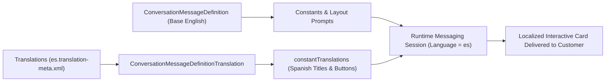

## Architectural Overview

Global Service Cloud deployments often serve customers across dozens of languages over WhatsApp, Apple Messages for Business, and Messaging for In-App and Web. Duplicating every [ConversationMessageDefinition](/docs/metadata/conversation-message-definition-metadata-type/) and every Omni-Channel Flow per language is an anti-pattern that multiplies maintenance overhead.

Instead, Salesforce provides `ConversationMessageDefinitionTranslation`. By localizing the constants (`constantTranslations`) and layout formula strings of a `ConversationMessageDefinition` through Translation Workbench (`Translations`), a single Messaging Component automatically renders in the customer's resolved conversation language (`es`, `fr`, `de`, `pt_BR`, `ja`) at runtime.



## SFDX Directory and File Suffix

| Property | Value |
| :--- | :--- |
| **Metadata Type Name** | `ConversationMessageDefinitionTranslation` (subtype of `Translations`) |
| **SFDX Source Directory** | `force-app/main/default/translations/` |
| **SFDX File Suffix** | `<lang>.translation-meta.xml` (e.g., `es.translation-meta.xml`, `fr.translation-meta.xml`) |
| **`package.xml` Parent Type** | `Translations` (combined with `ConversationMessageDefinition` in the manifest) |

## Key Metadata Fields

Within a `<lang>.translation-meta.xml` file, `<conversationMessageDefinitions>` entries represent instances of `ConversationMessageDefinitionTranslation`.

| Field Name | Type | Required | Architectural Purpose |
| :--- | :--- | :--- | :--- |
| `name` | `string` | Yes | DeveloperName of the parent [ConversationMessageDefinition](/docs/metadata/conversation-message-definition-metadata-type/) being translated. |
| `constantTranslations` | `ConversationMessageConstantTranslation[]` | No | Translated text values for each `Text` constant defined in the parent Messaging Component. |
| `constantTranslations.name` | `string` | Yes | API `name` of the `<constants>` entry in the parent `ConversationMessageDefinition` (e.g., `LinkTitleConstant`). |
| `constantTranslations.translation` | `string` | No | Localized text string for the target language. |
| `messageLayoutTranslations` | `ConversationMessageLayoutTranslation[]` | No | Translates layout-specific formula templates (`formulaTemplate`) per `formatType` (`Text`, `RichLink`, `Buttons`). |

## Declarative XML Example

Below is an excerpt from `force-app/main/default/translations/es.translation-meta.xml` containing the Spanish (`es`) `ConversationMessageDefinitionTranslation` for the `Order_Status_Rich_Link` Messaging Component.

```xml title="force-app/main/default/translations/es.translation-meta.xml"
<?xml version="1.0" encoding="UTF-8"?>
<Translations xmlns="http://soap.sforce.com/2006/04/metadata">
    <conversationMessageDefinitions>
        <constantTranslations>
            <name>LinkTitleConstant</name>
            <translation>Rastree su envío en tiempo real</translation>
        </constantTranslations>
        <messageLayoutTranslations>
            <formatType>Text</formatType>
            <layoutItemTranslations>
                <name>textFallback</name>
                <translation>Rastree su pedido aquí: {!$Parameters.TrackingUrl}</translation>
            </layoutItemTranslations>
            <messageType>StaticContent</messageType>
        </messageLayoutTranslations>
        <name>Order_Status_Rich_Link</name>
    </conversationMessageDefinitions>
</Translations>
```

### `package.xml` Manifest

In Metadata API, translations for a specific metadata component are only retrieved and deployed when **both** the target component (`ConversationMessageDefinition`) and `Translations` are included in `package.xml`:

```xml title="manifest/package.xml"
<?xml version="1.0" encoding="UTF-8"?>
<Package xmlns="http://soap.sforce.com/2006/04/metadata">
    <types>
        <members>Order_Status_Rich_Link</members>
        <name>ConversationMessageDefinition</name>
    </types>
    <types>
        <members>es</members>
        <members>fr</members>
        <name>Translations</name>
    </types>
    <version>68.0</version>
</Package>
```

## SFDX CLI Retrieval and Deployment

Retrieve and deploy `ConversationMessageDefinitionTranslation` entries by pairing `ConversationMessageDefinition` and `Translations` in your CLI command:

```bash
# Retrieve Spanish and French translations for Order_Status_Rich_Link
sf project retrieve start \
  --metadata ConversationMessageDefinition:Order_Status_Rich_Link \
  --metadata Translations:es \
  --metadata Translations:fr

# Deploy the Messaging Component and its translations together
sf project deploy start \
  --metadata ConversationMessageDefinition:Order_Status_Rich_Link \
  --metadata Translations:es
```

## Architect Best Practices and Gotchas

> [!WARNING]
> **Retrieving `Translations` Alone Omits `ConversationMessageDefinitionTranslation`:** Just like Custom Labels and Flow translations, running `sf project retrieve start --metadata Translations:es` by itself will **not** return `<conversationMessageDefinitions>` nodes unless `ConversationMessageDefinition` is also specified in the same retrieve request or `package.xml` manifest.

- **Use `constants` Instead of Hardcoded Layout Strings:** Always store translatable titles, subtitles, prompt questions, and button labels inside `<constants>` in the parent `ConversationMessageDefinition`. Constants map cleanly 1:1 to `<constantTranslations>` by name and are preserved even if you rearrange layout items.
- **Preserve Merge Field Syntax in `layoutItemTranslations`:** When translating a `FormulaTemplate` item (such as `Track your shipment here: {!$Parameters.TrackingUrl}`), never translate the `{!$Parameters.TrackingUrl}` merge token itself—translating the parameter name breaks runtime variable binding.

> [!TIP]
> Ensure `TranslationSettings` (`enableTranslationWorkbench = true`) is deployed in your scratch org definition before deploying `Translations` metadata in automated CI pipelines.
