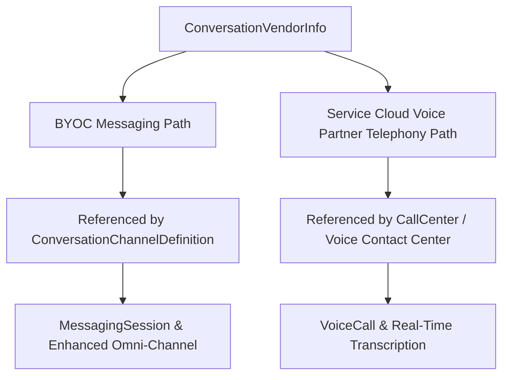

## Architectural Overview

Whether you are integrating an enterprise CTI platform via **Service Cloud Voice for Partner Telephony** (such as Genesys Cloud, Avaya, or Cisco Webex) or building a **Bring Your Own Channel (BYOC)** messaging connector, Salesforce requires a registered vendor definition before any contact center (`CallCenter`) or messaging channel (`ConversationChannelDefinition`) can be provisioned.

The `ConversationVendorInfo` metadata type represents this partner registration artifact. It stores the vendor's identity (`masterLabel`, `developerName`), integration classification (`vendorType`), authentication bridge (`clientAuthMode`), and optional partner telephony connector links (`integrationClass`, `telephonySettings`). ISV partners package `ConversationVendorInfo` in their AppExchange solutions, and enterprise architects create custom `ConversationVendorInfo` records when building bespoke BYOC messaging adapters.



## SFDX Directory and File Suffix

| Property | Value |
| :--- | :--- |
| **Metadata Type Name** | `ConversationVendorInfo` |
| **SFDX Source Directory** | `force-app/main/default/conversationVendorInfos/` |
| **SFDX File Suffix** | `.conversationVendorInfo-meta.xml` |
| **Classic Metadata Suffix** | `.conversationVendorInfo` |

## Key Metadata Fields

`ConversationVendorInfo` defines the vendor's identity, authentication mode, and supported channel capabilities.

| Field Name | Type | Required | Architectural Purpose |
| :--- | :--- | :--- | :--- |
| `masterLabel` | `string` | Yes | Display name of the telephony or messaging vendor in Service Cloud Setup wizards. |
| `developerName` | `string` | No | Unique API identifier (inferred from file name in SFDX source format). |
| `vendorType` | `string` | Yes | Identifies the vendor integration category (e.g., `BringYourOwnChannel`, `BringYourOwnChannelForCCaaS`, `PartnerTelephony`). |
| `clientAuthMode` | `ConversationVendorClientAuthMode` | No | Authentication mechanism used by the vendor client (`Custom`, `JWT`, `OAuth`, or `SAML`). |
| `namedCredentialSupported` | `boolean` | No | Indicates whether outbound callouts to the vendor use a Salesforce `NamedCredential`. |
| `customConfig` | `string` | No | JSON or XML vendor-specific configuration payload passed to the partner connector. |
| `integrationClass` | `string` | No | Name of the [ApexClass](/docs/metadata/apex-class-metadata-type/) implementing the vendor telephony/messaging lifecycle interface. |
| `bridgeComponent` | `string` | No | Aura or LWC bridge component loaded inside the Service Console utility bar or Omni-Channel widget for client-side vendor SDK events. |
| `partnerContactCenterListSupported` | `boolean` | No | Indicates whether the vendor supports retrieving a list of remote contact centers during setup. |
| `serverKeySupported` | `boolean` | No | Indicates whether server-to-server public key verification is used for vendor webhooks. |

## Declarative XML Example

Below is a production `Line_Messaging_Vendor.conversationVendorInfo-meta.xml` registering a custom BYOC messaging provider that authenticates via `NamedCredential` and OAuth.

```xml title="force-app/main/default/conversationVendorInfos/Line_Messaging_Vendor.conversationVendorInfo-meta.xml"
<?xml version="1.0" encoding="UTF-8"?>
<ConversationVendorInfo xmlns="http://soap.sforce.com/2006/04/metadata">
    <clientAuthMode>OAuth</clientAuthMode>
    <masterLabel>LINE Enterprise Messaging Connector</masterLabel>
    <namedCredentialSupported>true</namedCredentialSupported>
    <partnerContactCenterListSupported>false</partnerContactCenterListSupported>
    <serverKeySupported>false</serverKeySupported>
    <vendorType>BringYourOwnChannel</vendorType>
</ConversationVendorInfo>
```

### `package.xml` Manifest

Deploy `ConversationVendorInfo` alongside its dependent `ConversationChannelDefinition`:

```xml title="manifest/package.xml"
<?xml version="1.0" encoding="UTF-8"?>
<Package xmlns="http://soap.sforce.com/2006/04/metadata">
    <types>
        <members>Line_Messaging_Vendor</members>
        <name>ConversationVendorInfo</name>
    </types>
    <types>
        <members>Line_Enterprise_Channel</members>
        <name>ConversationChannelDefinition</name>
    </types>
    <version>68.0</version>
</Package>
```

## Querying via SOQL and SFDX CLI

`ConversationVendorInfo` is queryable via SOQL and Tooling API, making it easy to verify installed Partner Telephony and BYOC vendors in any org.

### 1. Query Installed Conversation Vendors via SOQL
```soql
SELECT Id, DeveloperName, MasterLabel, VendorType, ClientAuthMode,
       NamedCredentialSupported, NamespacePrefix
FROM ConversationVendorInfo
ORDER BY VendorType, MasterLabel ASC
```

### 2. SFDX CLI Retrieve and Deploy Commands
```bash
# Retrieve a specific ConversationVendorInfo component
sf project retrieve start --metadata ConversationVendorInfo:Line_Messaging_Vendor

# Deploy ConversationVendorInfo to a target org
sf project deploy start --metadata ConversationVendorInfo:Line_Messaging_Vendor
```

## Architect Best Practices and Gotchas

> [!WARNING]
> **Immutable `vendorType` After Creation:** Once a `ConversationVendorInfo` record is deployed and referenced by a `ConversationChannelDefinition` or Service Cloud Voice Contact Center, you cannot change its `vendorType` (for example, switching from `BringYourOwnChannel` to `BringYourOwnChannelForCCaaS`). You must create a new `ConversationVendorInfo` record if the routing architecture changes.

- **Scratch Org Prerequisites:** Deploying `ConversationVendorInfo` to a scratch org requires Digital Engagement / Messaging (`"LiveMessage"`) or Service Cloud Voice (`"ServiceCloudVoice"`) features enabled in `config/project-scratch-def.json`.
- **Deletion Protection:** You cannot delete a `ConversationVendorInfo` component while any active or inactive `ConversationChannelDefinition` or `MessagingChannel` record still references it.
