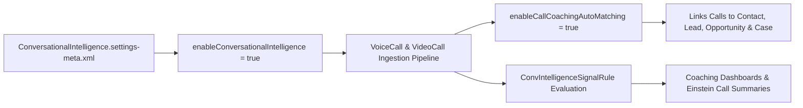

## Architectural Overview

**Einstein Conversation Insights (ECI)** processes voice calls (`VoiceCall`) and video meetings (`VideoCall`) to generate searchable transcripts, detect competitor or pricing objections, trigger automated coaching workflows, and power Agentforce / Einstein Generative AI call summaries.

The `ConversationalIntelligenceSettings` metadata type (`ConversationalIntelligence.settings-meta.xml`) controls the foundational org-wide switches for ECI. By managing `ConversationalIntelligence.settings-meta.xml` in SFDX, architects ensure that sandbox environments and production orgs have identical call processing pipelines enabled before deploying dependent [ConvIntelligenceSignalRule](/docs/metadata/conv-intelligence-signal-rule-metadata-type/) definitions or call-triggered Flows.



## SFDX Directory and File Suffix

| Property | Value |
| :--- | :--- |
| **Metadata Type Name** | `ConversationalIntelligenceSettings` (deployed via `Settings` type with member `ConversationalIntelligence`) |
| **SFDX Source File Path** | `force-app/main/default/settings/ConversationalIntelligence.settings-meta.xml` |
| **Classic Metadata File Path** | `settings/ConversationalIntelligence.settings` |
| **`package.xml` Type / Member** | `<name>Settings</name>` / `<members>ConversationalIntelligence</members>` |

## Key Metadata Fields

`ConversationalIntelligenceSettings` provides boolean toggles for core ECI features, automatic CRM record linking, and generative insights.

| Field Name | Type | Required | Architectural Purpose |
| :--- | :--- | :--- | :--- |
| `enableConversationalIntelligence` | `boolean` | No | Master switch that enables Einstein Conversation Insights (Call Coaching) in the org. |
| `enableCallCoachingAutoMatching` | `boolean` | No | Automatically matches ingested `VoiceCall` and `VideoCall` records to relevant `Contact`, `Lead`, `Account`, and `Opportunity` records based on participant email or phone number. |
| `enableCiAttributedSignals` | `boolean` | No | Enables attribution of detected conversation signals to specific speaker roles (Agent/Rep vs. Customer). |
| `enableCiOpptyRecordPage` | `boolean` | No | Surfaces aggregated call insights and mention highlights directly on the Opportunity record page component. |
| `enableDynamicPlaybooks` | `boolean` | No | Enables dynamic guidance and playbook triggers derived from detected conversation signals. |
| `enableUnifiedActivities` | `boolean` | No | Integrates ECI voice and video call records into the unified Activity Timeline alongside Einstein Activity Capture events. |

## Declarative XML Example

Below is a production `ConversationalIntelligence.settings-meta.xml` configuration enabling Einstein Conversation Insights, automatic CRM record matching, speaker-attributed signals, and Opportunity page aggregation.

```xml title="force-app/main/default/settings/ConversationalIntelligence.settings-meta.xml"
<?xml version="1.0" encoding="UTF-8"?>
<ConversationalIntelligenceSettings xmlns="http://soap.sforce.com/2006/04/metadata">
    <enableCallCoachingAutoMatching>true</enableCallCoachingAutoMatching>
    <enableCiAttributedSignals>true</enableCiAttributedSignals>
    <enableCiOpptyRecordPage>true</enableCiOpptyRecordPage>
    <enableConversationalIntelligence>true</enableConversationalIntelligence>
    <enableDynamicPlaybooks>true</enableDynamicPlaybooks>
    <enableUnifiedActivities>true</enableUnifiedActivities>
</ConversationalIntelligenceSettings>
```

### `package.xml` Manifest

Deploy `ConversationalIntelligenceSettings` before or alongside `ConvIntelligenceSignalRule` components:

```xml title="manifest/package.xml"
<?xml version="1.0" encoding="UTF-8"?>
<Package xmlns="http://soap.sforce.com/2006/04/metadata">
    <types>
        <members>ConversationalIntelligence</members>
        <name>Settings</name>
    </types>
    <types>
        <members>*</members>
        <name>ConvIntelligenceSignalRule</name>
    </types>
    <version>68.0</version>
</Package>
```

## SFDX CLI Retrieval and Deployment

Use Salesforce CLI to retrieve and deploy `ConversationalIntelligenceSettings`:

```bash
# Retrieve ConversationalIntelligenceSettings from the org
sf project retrieve start --metadata Settings:ConversationalIntelligence

# Deploy ConversationalIntelligenceSettings to a target org
sf project deploy start --metadata Settings:ConversationalIntelligence
```

## Architect Best Practices and Gotchas

> [!TIP]
> **Deploy `ConversationalIntelligenceSettings` Prior to Signal Rules:** If your CI/CD pipeline deploys [ConvIntelligenceSignalRule](/docs/metadata/conv-intelligence-signal-rule-metadata-type/) metadata into a fresh scratch org or sandbox where `enableConversationalIntelligence` is still `false`, the signal rule deployment will fail because the ECI engine is inactive. Always include `"conversationalIntelligenceSettings": { "enableConversationalIntelligence": true }` in `project-scratch-def.json` and in your `Settings` package directory.

- **License & Permission Set Readiness:** Enabling `enableConversationalIntelligence` at the org level requires active ECI or Sales/Service Cloud Einstein licenses (`CallCoachingUser` permission set license). Users will not see call players or insights until assigned the **Conversation Insights for Sales** or **Conversation Insights for Service** permission set.
- **PII & Consent Governance:** When `enableCallCoachingAutoMatching` is `true`, calls are automatically linked to matching `Lead`, `Contact`, and `Opportunity` records. Ensure your telephony/video provider respects regional two-party recording consent laws before pushing recordings into the ECI pipeline.
