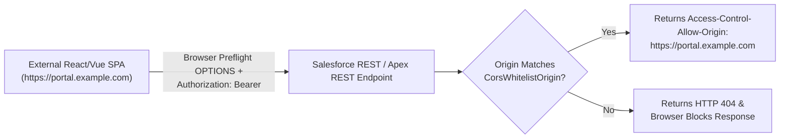

The `CorsWhitelistOrigin` metadata type registers an origin pattern in Salesforce's **Cross-Origin Resource Sharing (CORS)** allowlist. Introduced in API version 32.0, adding an origin to `CorsWhitelistOrigin` instructs Salesforce to return the `Access-Control-Allow-Origin` HTTP response header when a web application hosted on that external domain (or a Chrome/Firefox browser extension) calls Salesforce REST APIs, Custom `@RestResource` Apex endpoints, GraphQL API, or OAuth 2.0 endpoints directly from client-side JavaScript.

In Salesforce DX projects, CORS origins are stored in `force-app/main/default/corsWhitelistOrigins/` with the `.corswhitelistorigin-meta.xml` suffix.



## Key Metadata Fields

| Field | Type | Required | Description |
|---|---|---|---|
| `urlPattern` | `string` | Yes | Origin pattern (`https://app.example.com`, `https://*.example.com:8443`, `chrome-extension://<32-char-id>`, or `moz-extension://<uuid>`) |

## Production-Grade XML Examples

### 1. External Single-Page Application Origin (`Customer_Checkout_SPA.corswhitelistorigin-meta.xml`)

```xml
<?xml version="1.0" encoding="UTF-8"?>
<CorsWhitelistOrigin xmlns="http://soap.sforce.com/2006/04/metadata">
    <urlPattern>https://checkout.example.com</urlPattern>
</CorsWhitelistOrigin>
```

### 2. Internal Chrome Extension Origin (`Sales_Companion_Extension.corswhitelistorigin-meta.xml`)

```xml
<?xml version="1.0" encoding="UTF-8"?>
<CorsWhitelistOrigin xmlns="http://soap.sforce.com/2006/04/metadata">
    <urlPattern>chrome-extension://abdkkegmcbiomijcbdaodaflgehfffed</urlPattern>
</CorsWhitelistOrigin>
```

> [!WARNING]
> **Avoid Overly Broad Wildcards on Shared Cloud Hosting Domains**: Never add shared multi-tenant PaaS domains such as `https://*.herokuapp.com`, `https://*.vercel.app`, or `https://*.cloudflarepages.com` to `CorsWhitelistOrigin`, as doing so would allow any third-party tenant hosted on that platform to make cross-origin requests if a user holds an active session/token. Always bind a custom subdomain (`https://app.yourcompany.com`) and allowlist that specific origin.

## Querying `CorsWhitelistOrigin` with SOQL

```sql
-- Audit all allowlisted CORS origins in standard SOQL
SELECT Id, DeveloperName, MasterLabel, UrlPattern, CreatedDate, LastModifiedBy.Name
FROM CorsWhitelistOrigin
ORDER BY UrlPattern ASC
```

