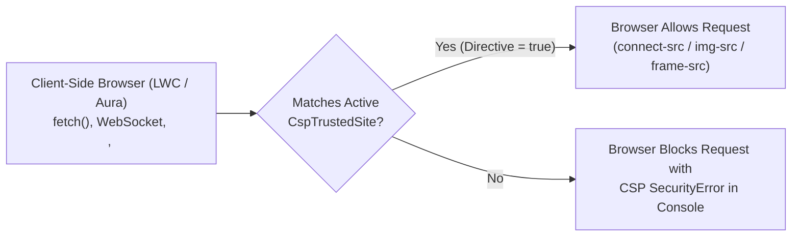

The `CspTrustedSite` metadata type represents a **Trusted URL** (formerly *CSP Trusted Site*) in Salesforce Setup. Introduced in API version 39.0 (and expanded with Permissions-Policy directives in API version 59.0), `CspTrustedSite` instructs the browser's **Content Security Policy (CSP)** to allow client-side [LightningComponentBundle](/docs/metadata/lightning-component-bundle-metadata-type/) JavaScript (`fetch()`, `XMLHttpRequest`, `WebSocket`), `` tags, `<iframe>` embeds, `@font-face` fonts, and stylesheets to load from external third-party domains.

In Salesforce DX projects, trusted URLs are stored in `force-app/main/default/cspTrustedSites/` with the `.cspTrustedSite-meta.xml` suffix.



## `CspTrustedSite` vs. `RemoteSiteSetting` vs. `CorsWhitelistOrigin`

| Metadata Type | Direction & Layer | Primary Use Case |
|---|---|---|
| `CspTrustedSite` | **Outbound from Browser** (Client-Side) | LWC calls external API via `fetch()`, opens a `wss://` WebSocket, or embeds an external `<iframe>` / `` |
| [RemoteSiteSetting](/docs/metadata/remote-site-setting-metadata-type/) | **Outbound from Server** (Server-Side) | Apex `Http.send(HttpRequest)` calls an external API from Salesforce servers |
| [CorsWhitelistOrigin](/docs/metadata/cors-whitelist-origin-metadata-type/) | **Inbound from External Browser** | External website (`https://app.example.com`) calls Salesforce REST APIs from browser JS |

## Key Metadata Fields

| Field | Type | Required | Description |
|---|---|---|---|
| `endpointUrl` | `string` | Yes | Domain URL (`https://api.example.com`, `https://*.example.com`, or `wss://stream.example.com`) |
| `isActive` | `boolean` | Yes | Enables (`true`) or disables (`false`) the Trusted URL |
| `context` | `CspTrustedSiteContext` | No | Scope: `All`, `LEX` (Lightning Experience), `Communities` (Experience Cloud), `VisualForce`, or `FieldServiceMobileExtension` |
| `isApplicableToConnectSrc` | `boolean` | No | Allows `fetch()`, `XMLHttpRequest`, and `WebSocket` (`connect-src`) |
| `isApplicableToImgSrc` | `boolean` | No | Allows loading images (`img-src`) |
| `isApplicableToFrameSrc` | `boolean` | No | Allows embedding inside `<iframe>` elements (`frame-src`) |
| `isApplicableToStyleSrc` | `boolean` | No | Allows external CSS stylesheets (`style-src`) |
| `isApplicableToFontSrc` | `boolean` | No | Allows external web fonts (`font-src`) |
| `isApplicableToMediaSrc` | `boolean` | No | Allows `<audio>` and `<video>` streams (`media-src`) |
| `canAccessCamera` / `canAccessMicrophone` | `boolean` | No | Grants `Permissions-Policy` access to camera/microphone (v59.0+) |

## Production-Grade XML Example

Below is a `CspTrustedSite` (`Mapbox_Telemetry_API.cspTrustedSite-meta.xml`) scoped strictly to Lightning Experience (`LEX`) with `connect-src` and `img-src` enabled:

```xml
<?xml version="1.0" encoding="UTF-8"?>
<CspTrustedSite xmlns="http://soap.sforce.com/2006/04/metadata">
    <canAccessCamera>false</canAccessCamera>
    <canAccessMicrophone>false</canAccessMicrophone>
    <context>LEX</context>
    <description>Allows the Territory Map LWC to fetch vector tiles and static map images from Mapbox.</description>
    <endpointUrl>https://*.mapbox.com</endpointUrl>
    <isActive>true</isActive>
    <isApplicableToConnectSrc>true</isApplicableToConnectSrc>
    <isApplicableToFontSrc>false</isApplicableToFontSrc>
    <isApplicableToFrameSrc>false</isApplicableToFrameSrc>
    <isApplicableToImgSrc>true</isApplicableToImgSrc>
    <isApplicableToMediaSrc>false</isApplicableToMediaSrc>
    <isApplicableToStyleSrc>false</isApplicableToStyleSrc>
</CspTrustedSite>
```

> [!WARNING]
> **Watch the 12 KB HTTP Header Size Limit**: Every active `CspTrustedSite` appends its `endpointUrl` to the `Content-Security-Policy` HTTP header on page loads. Use wildcard subdomains (`https://*.example.com`), scope entries to `LEX` or `Communities` via `<context>`, and enable only the specific `isApplicableTo*` directives required so your CSP header stays well under 12 KB.

## Querying `CspTrustedSite` with SOQL

```sql
-- Audit all active Trusted URLs and their enabled CSP directives in standard SOQL
SELECT Id, DeveloperName, EndpointUrl, Context, IsActive,
       IsApplicableToConnectSrc, IsApplicableToFrameSrc, IsApplicableToImgSrc,
       IsApplicableToStyleSrc, IsApplicableToFontSrc, CanAccessCamera, CanAccessMicrophone
FROM CspTrustedSite
WHERE IsActive = true
ORDER BY Context, DeveloperName ASC
```

