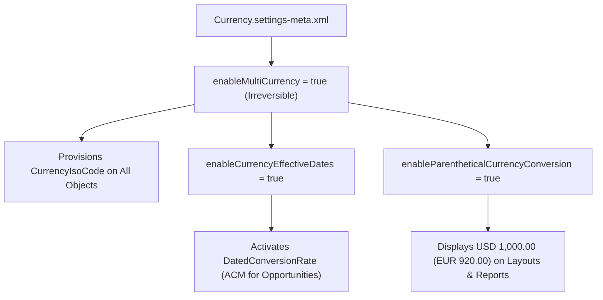

## Architectural Overview

Enabling **Multi-Currency** and **Advanced Currency Management (ACM)** is one of the highest-impact architectural decisions in Salesforce. The moment `<enableMultiCurrency>true</enableMultiCurrency>` is deployed via `CurrencySettings` (`Currency.settings-meta.xml`), Salesforce permanently alters the database schema of the entire org:
- Every standard and custom object automatically receives a `CurrencyIsoCode` picklist field.
- Standard `CurrencyType` and `DatedConversionRate` objects are provisioned.
- All `Currency` fields display both the record's transaction currency and the user's personal converted currency in parentheses (when `enableParentheticalCurrencyConversion` is enabled).

By managing `Currency.settings-meta.xml` in SFDX, architects guarantee that scratch orgs, developer sandboxes, and integration environments mirror Production's multi-currency state so SOQL queries referencing `CurrencyIsoCode` or `convertCurrency(Amount)` compile and pass tests reliably.



## SFDX Directory and File Suffix

| Property | Value |
| :--- | :--- |
| **Metadata Type Name** | `CurrencySettings` (deployed via `Settings` type with member `Currency`) |
| **SFDX Source File Path** | `force-app/main/default/settings/Currency.settings-meta.xml` |
| **Classic Metadata File Path** | `settings/Currency.settings` |
| **`package.xml` Type / Member** | `<name>Settings</name>` / `<members>Currency</members>` |

## Key Metadata Fields

`CurrencySettings` exposes boolean flags that control Multi-Currency, Advanced Currency Management, and visual currency formatting.

| Field Name | Type | Required | Architectural Purpose |
| :--- | :--- | :--- | :--- |
| `enableMultiCurrency` | `boolean` | No | Permanently activates Multi-Currency across the entire organization. **Cannot be disabled once enabled.** |
| `enableCurrencyEffectiveDates` | `boolean` | No | Enables **Advanced Currency Management (ACM)**, allowing dated exchange rates (`DatedConversionRate`) on `Opportunity` and `OpportunityLineItem`. |
| `enableCurrencySymbolWithIso` | `boolean` | No | Displays the currency symbol alongside the 3-letter ISO code where applicable. |
| `enableParentheticalCurrencyConversion` | `boolean` | No | Displays converted currency amounts in parentheses next to the primary record currency (e.g., `EUR 50,000.00 (USD 54,500.00)`). |
| `isParallelExecEnabled` | `boolean` | No | Optimizes parallel batch processing when recalculating currency exchange rates across large data volumes. |

## Declarative XML Example

Below is a standard global enterprise `Currency.settings-meta.xml` enabling Multi-Currency, Advanced Currency Management (dated exchange rates), and parenthetical currency conversion.

```xml title="force-app/main/default/settings/Currency.settings-meta.xml"
<?xml version="1.0" encoding="UTF-8"?>
<CurrencySettings xmlns="http://soap.sforce.com/2006/04/metadata">
    <enableCurrencyEffectiveDates>true</enableCurrencyEffectiveDates>
    <enableCurrencySymbolWithIso>false</enableCurrencySymbolWithIso>
    <enableMultiCurrency>true</enableMultiCurrency>
    <enableParentheticalCurrencyConversion>true</enableParentheticalCurrencyConversion>
    <isParallelExecEnabled>true</isParallelExecEnabled>
</CurrencySettings>
```

### `package.xml` Manifest

Reference `CurrencySettings` via the `Settings` metadata type with member `Currency`:

```xml title="manifest/package.xml"
<?xml version="1.0" encoding="UTF-8"?>
<Package xmlns="http://soap.sforce.com/2006/04/metadata">
    <types>
        <members>Currency</members>
        <name>Settings</name>
    </types>
    <version>68.0</version>
</Package>
```

## Querying Active Currencies and Dated Rates via SOQL

Once `CurrencySettings` enables Multi-Currency and ACM, use standard SOQL to inspect active currencies (`CurrencyType`), dated exchange rates (`DatedConversionRate`), and converted amounts (`convertCurrency()`).

### 1. Query Active Org Currencies and Corporate Currency (`CurrencyType`)
```soql
SELECT Id, IsoCode, ConversionRate, DecimalPlaces, IsActive, IsCorporate
FROM CurrencyType
WHERE IsActive = true
ORDER BY IsCorporate DESC, IsoCode ASC
```

### 2. Query Dated Exchange Rates (`DatedConversionRate`)
```soql
SELECT Id, IsoCode, ConversionRate, StartDate, NextStartDate
FROM DatedConversionRate
WHERE StartDate <= TODAY AND NextStartDate > TODAY
ORDER BY IsoCode ASC
```

### 3. SFDX CLI Retrieve and Deploy Commands
```bash
# Retrieve CurrencySettings from the org
sf project retrieve start --metadata Settings:Currency

# Deploy CurrencySettings to a scratch org or sandbox
sf project deploy start --metadata Settings:Currency
```

## Architect Best Practices and Gotchas

> [!WARNING]
> **Advanced Currency Management (`enableCurrencyEffectiveDates`) Breaks Cross-Object Rollup Summary Fields to `Account` or Custom Objects:** When `enableCurrencyEffectiveDates` is `true`, Salesforce **blocks** Roll-Up Summary fields (`SUM`, `MIN`, `MAX`) on `Account` that aggregate currency fields from `Opportunity`, as well as Roll-Up Summary fields from `Opportunity` to custom Master-Detail child objects containing currency fields. If your architecture relies on declarative Roll-Up Summary fields from `Opportunity` to `Account`, verify this constraint before enabling `enableCurrencyEffectiveDates`.

- **Irreversible Multi-Currency Activation:** Never deploy `<enableMultiCurrency>true</enableMultiCurrency>` to Production without full UAT sign-off. Once enabled, `enableMultiCurrency` cannot be reverted to `false` even by Salesforce Support.
- **ISV Managed Package Compatibility:** If you are building a Managed Package (1GP or 2GP), avoid hardcoding `CurrencyIsoCode` in static SOQL queries unless Multi-Currency is a mandatory package dependency. Use Dynamic SOQL and `Schema.getGlobalDescribe()` / `UserInfo.isMultiCurrencyOrganization()` so your package works in both single-currency and multi-currency subscriber orgs.
