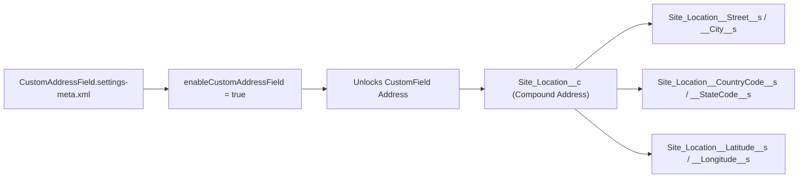

## Architectural Overview

For years, Salesforce architects had to build custom addresses on custom objects (like `Warehouse__c`, `Property__c`, or `Service_Site__c`) by creating five separate text fields (`Street__c`, `City__c`, `State__c`, `Postal_Code__c`, `Country__c`), sacrificing native Google Maps autocomplete, compound SOQL `Address` queries, and automatic State & Country Picklist enforcement.

The `CustomAddressFieldSettings` metadata type (`CustomAddressField.settings-meta.xml`) turns on **Custom Address Fields** (`enableCustomAddressField = true`) across the org. Once enabled, developers can deploy [CustomField](/docs/metadata/custom-field-metadata-type/) components with `<type>Address</type>`, provisioning a first-class compound address column (`__c`) that exposes standard `__Street__s`, `__City__s`, `__StateCode__s`, `__PostalCode__s`, `__CountryCode__s`, `__Latitude__s`, and `__Longitude__s` component fields.



## SFDX Directory and File Suffix

| Property | Value |
| :--- | :--- |
| **Metadata Type Name** | `CustomAddressFieldSettings` (deployed via `Settings` type with member `CustomAddressField`) |
| **SFDX Source File Path** | `force-app/main/default/settings/CustomAddressField.settings-meta.xml` |
| **Classic Metadata File Path** | `settings/CustomAddressField.settings` |
| **`package.xml` Type / Member** | `<name>Settings</name>` / `<members>CustomAddressField</members>` |

## Key Metadata Fields

`CustomAddressFieldSettings` contains a single org-wide activation boolean.

| Field Name | Type | Required | Architectural Purpose |
| :--- | :--- | :--- | :--- |
| `enableCustomAddressField` | `boolean` | No | Enables the creation and deployment of custom compound `Address` fields (`<type>Address</type>`) on standard and custom sObjects. |

## Declarative XML Example

Below is `CustomAddressField.settings-meta.xml` alongside an example custom compound address field (`Warehouse_Address__c`) that depends on it.

### 1. Org Settings File (`CustomAddressField.settings-meta.xml`)
```xml title="force-app/main/default/settings/CustomAddressField.settings-meta.xml"
<?xml version="1.0" encoding="UTF-8"?>
<CustomAddressFieldSettings xmlns="http://soap.sforce.com/2006/04/metadata">
    <enableCustomAddressField>true</enableCustomAddressField>
</CustomAddressFieldSettings>
```

### 2. Dependent Custom Compound Address Field (`Warehouse_Address__c.field-meta.xml`)
```xml title="force-app/main/default/objects/Warehouse__c/fields/Warehouse_Address__c.field-meta.xml"
<?xml version="1.0" encoding="UTF-8"?>
<CustomField xmlns="http://soap.sforce.com/2006/04/metadata">
    <fullName>Warehouse_Address__c</fullName>
    <description>Physical shipping dock address for inventory fulfillment routing.</description>
    <label>Warehouse Address</label>
    <trackHistory>true</trackHistory>
    <type>Address</type>
</CustomField>
```

### `package.xml` Manifest

Always include `Settings:CustomAddressField` in your manifest when deploying custom `Address` fields to a new sandbox or scratch org:

```xml title="manifest/package.xml"
<?xml version="1.0" encoding="UTF-8"?>
<Package xmlns="http://soap.sforce.com/2006/04/metadata">
    <types>
        <members>CustomAddressField</members>
        <name>Settings</name>
    </types>
    <types>
        <members>Warehouse__c.Warehouse_Address__c</members>
        <name>CustomField</name>
    </types>
    <version>68.0</version>
</Package>
```

## Querying Custom Address Subfields via SOQL and SFDX CLI

Once `CustomAddressFieldSettings` is active and a custom `Address` field is deployed, query either the compound `System.Address` field or its `__s` component columns in SOQL:

### 1. Query Compound and Component Subfields in SOQL
```soql
SELECT Id, Name, Warehouse_Address__c,
       Warehouse_Address__Street__s, Warehouse_Address__City__s,
       Warehouse_Address__StateCode__s, Warehouse_Address__PostalCode__s,
       Warehouse_Address__CountryCode__s, Warehouse_Address__Latitude__s,
       Warehouse_Address__Longitude__s
FROM Warehouse__c
WHERE Warehouse_Address__CountryCode__s = 'US'
LIMIT 50
```

### 2. SFDX CLI Retrieve and Deploy Commands
```bash
# Retrieve CustomAddressFieldSettings
sf project retrieve start --metadata Settings:CustomAddressField

# Deploy CustomAddressFieldSettings and dependent custom Address field
sf project deploy start \
  --metadata Settings:CustomAddressField \
  --metadata CustomField:Warehouse__c.Warehouse_Address__c
```

## Architect Best Practices and Gotchas

> [!WARNING]
> **Field Allocation Multiplier (9 Fields per Custom Address):** Each custom `Address` field consumes **9 custom field slots** against the object's custom field limit (one compound descriptor plus 8 physical database columns for street, city, state, postal code, country, latitude, longitude, and geocode accuracy). Do not create multiple redundant custom `Address` fields on objects that are already near the 500/800 custom field governor limit.

- **Subfield Suffix Convention (`__s`):** Unlike standard compound addresses (`BillingStreet`, `BillingCity`), custom compound address subfields replace `__c` with `__<Component>__s` (for example, `Warehouse_Address__Street__s` and `Warehouse_Address__CountryCode__s`). Notice that state and country subfields always use `StateCode__s` and `CountryCode__s` (ISO codes) rather than full state/country text names in DML operations.
- **Data Loader & Bulk API Considerations:** You cannot insert or update the parent compound field (`Warehouse_Address__c`) directly in DML or Bulk API—always map your CSV or Apex DML statements to the individual `__s` component fields (`Warehouse_Address__Street__s`, `Warehouse_Address__City__s`, `Warehouse_Address__CountryCode__s`).
