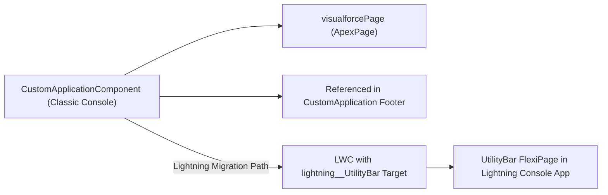

## Architectural Overview

In Salesforce Classic Service Cloud and Sales Cloud Console applications, persistent footer widgets—such as legacy CTI dialers, supervisor queue monitors, and global scratchpads—are defined using the `CustomApplicationComponent` metadata type. Each `CustomApplicationComponent` wraps a Visualforce page (`visualforcePage`) and configures the dimensions (`height`, `width`) and button styling (`buttonText`, `buttonStyle`, `buttonIconUrl`) of its console footer popup.

For modern Salesforce Technical Architects, `CustomApplicationComponent` is relevant in two primary scenarios:
1. **Maintaining Hybrid / Legacy Classic Console Orgs:** Keeping existing Classic Console footer tools version-controlled in SFDX alongside `CustomApplication` (`<customApplicationComponents>`).
2. **Classic-to-Lightning Console Migration:** Auditing all `CustomApplicationComponent` definitions in an org to map each Visualforce footer widget to a modern Lightning Web Component (`lightning__UtilityBar` target) inside the Lightning App's `<utilityBar>` (`FlexiPage`).



## SFDX Directory and File Suffix

| Property | Value |
| :--- | :--- |
| **Metadata Type Name** | `CustomApplicationComponent` |
| **SFDX Source Directory** | `force-app/main/default/customApplicationComponents/` |
| **SFDX File Suffix** | `.customApplicationComponent-meta.xml` |
| **Classic Metadata Suffix** | `.customApplicationComponent` |

## Key Metadata Fields

`CustomApplicationComponent` defines the Visualforce page binding and the visual geometry of the console footer button and popup window.

| Field Name | Type | Required | Architectural Purpose |
| :--- | :--- | :--- | :--- |
| `buttonIconUrl` | `string` | No | URL or static resource path for the icon displayed on the Classic console footer button. |
| `buttonStyle` | `string` | No | Inline CSS styling applied to the console footer button element. |
| `buttonText` | `string` | No | Label text displayed on the console footer button (up to 50 characters). |
| `buttonWidth` | `int` | No | Width in pixels of the button in the console footer bar. |
| `height` | `int` | No | Height in pixels of the popup overlay window when opened by the agent. |
| `width` | `int` | No | Width in pixels of the popup overlay window when opened by the agent. |
| `isHeightFixed` | `boolean` | Yes | Prevents or allows the user to vertically resize the component window. |
| `isHidden` | `boolean` | Yes | When `true`, hides the button from the console footer (used for headless background JavaScript listeners utilizing the Console Integration Toolkit). |
| `isWidthFixed` | `boolean` | Yes | Prevents or allows the user to horizontally resize the component window. |
| `visualforcePage` | `string` | Yes | DeveloperName of the `ApexPage` (Visualforce page) rendered inside the component. |

## Declarative XML Example

Below is an example `Legacy_Supervisor_Ticker.customApplicationComponent-meta.xml` that embeds a `SupervisorQueueMonitor` Visualforce page as a 400x300 pixel widget in the Classic Console footer.

```xml title="force-app/main/default/customApplicationComponents/Legacy_Supervisor_Ticker.customApplicationComponent-meta.xml"
<?xml version="1.0" encoding="UTF-8"?>
<CustomApplicationComponent xmlns="http://soap.sforce.com/2006/04/metadata">
    <buttonStyle>font-weight:bold;color:#0176d3;</buttonStyle>
    <buttonText>Queue Ticker</buttonText>
    <buttonWidth>140</buttonWidth>
    <height>300</height>
    <isHeightFixed>false</isHeightFixed>
    <isHidden>false</isHidden>
    <isWidthFixed>false</isWidthFixed>
    <visualforcePage>SupervisorQueueMonitor</visualforcePage>
    <width>400</width>
</CustomApplicationComponent>
```

### `package.xml` Manifest

When deploying a `CustomApplicationComponent`, its backing `ApexPage` must also be included:

```xml title="manifest/package.xml"
<?xml version="1.0" encoding="UTF-8"?>
<Package xmlns="http://soap.sforce.com/2006/04/metadata">
    <types>
        <members>Legacy_Supervisor_Ticker</members>
        <name>CustomApplicationComponent</name>
    </types>
    <types>
        <members>SupervisorQueueMonitor</members>
        <name>ApexPage</name>
    </types>
    <version>68.0</version>
</Package>
```

## SFDX CLI Retrieval and Deployment

Retrieve and audit `CustomApplicationComponent` artifacts using the `sf` CLI:

```bash
# Retrieve all Classic Console CustomApplicationComponents in the org
sf project retrieve start --metadata CustomApplicationComponent

# Deploy a specific CustomApplicationComponent and its Visualforce page
sf project deploy start \
  --metadata CustomApplicationComponent:Legacy_Supervisor_Ticker \
  --metadata ApexPage:SupervisorQueueMonitor
```

## Architect Best Practices and Gotchas

> [!TIP]
> **Detecting "Headless" Background Console Listeners (`isHidden = true`):** During a Classic-to-Lightning migration, always inspect every `CustomApplicationComponent` where `<isHidden>true</isHidden>`. In Classic Console, architects frequently used hidden `CustomApplicationComponent` Visualforce pages with `sforce.console.addEventListener` to run background tab-close validations or CTI screen pops. In Lightning Experience, replace these with a **Lightning Web Component Background Utility Item** implementing `lightning__UtilityBar` and `lightning/platformWorkspaceApi`.

- **Deletion Dependency on `CustomApplication`:** You cannot delete a `CustomApplicationComponent` (or its underlying `ApexPage`) while it is still referenced in the `<customApplicationComponents>` list of any `CustomApplication` (`.app-meta.xml`) file. Remove the reference from the `.app-meta.xml` first before running `destructiveChanges.xml`.
