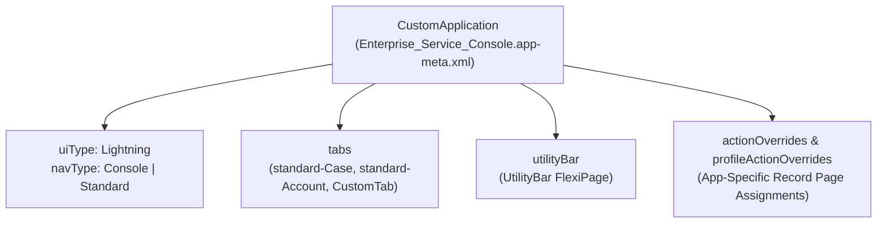

The `CustomApplication` metadata type represents a custom or standard Salesforce application accessible from the **App Launcher**. Available in API version 10.0 and later (with Lightning Experience extensions introduced in API version 38.0), `CustomApplication` controls the app's branding (`brand`), navigation model (`navType`: `Standard` vs `Console`), navigation bar items (`tabs`), bottom `utilityBar`, and app-specific Lightning Record Page assignments (`actionOverrides` and `profileActionOverrides`).

In Salesforce DX projects, applications are stored in `force-app/main/default/applications/` with the `.app-meta.xml` suffix.



## Key Metadata Fields

| Field | Type | Required | Description |
|---|---|---|---|
| `label` | `string` | No | Display name of the application in the App Launcher |
| `uiType` | `UiType` | No | **Not updateable**. `Lightning` (Lightning Experience) or `Aloha` (Classic) |
| `navType` | `NavType` | No | **Not updateable**. `Standard` (horizontal tab bar) or `Console` (workspace tabs + subtabs) |
| `formFactors` | `FormFactor[]` | No | `Large` (Desktop) and/or `Small` (Salesforce Mobile app) |
| `tabs` | `string[]` | No | Ordered list of navigation items (`standard-Account`, `Invoice__c`, etc.) |
| `utilityBar` | `string` | No | Developer name of the `UtilityBar` [FlexiPage](/docs/metadata/flexipage-metadata-type/) |
| `actionOverrides` | `AppActionOverride[]` | No | App-default record page overrides (`actionName: View`, `content: FlexiPage_Name`) |
| `profileActionOverrides` | `AppProfileActionOverride[]` | No | Granular `App + RecordType + Profile` record page overrides |
| `workspaceConfig` | `AppWorkspaceConfig` | No | Maps which child records open as subtabs of parent workspace tabs in `Console` apps |
| `isNavPersonalizationDisabled` | `boolean` | No | Prevents end users from reordering or adding personal tabs to the navigation bar |
| `isNavTabPersistenceDisabled` | `boolean` | No | Clears open workspace tabs on every new console session when `true` (v54.0+) |

## Production-Grade XML Example (Lightning Console App)

Below is a Lightning Service Console application (`Enterprise_Service_Console.app-meta.xml`) that opens `Case` records as subtabs of `Account`, assigns an App Default record page for `Case`, and locks navigation bar personalization:

```xml
<?xml version="1.0" encoding="UTF-8"?>
<CustomApplication xmlns="http://soap.sforce.com/2006/04/metadata">
    <actionOverrides>
        <actionName>View</actionName>
        <comment>App default Case record page for Enterprise Service Console</comment>
        <content>Enterprise_Case_Console_Record_Page</content>
        <formFactor>Large</formFactor>
        <skipRecordTypeSelect>false</skipRecordTypeSelect>
        <type>Flexipage</type>
        <pageOrSobjectType>Case</pageOrSobjectType>
    </actionOverrides>
    <brand>
        <headerColor>#0176D3</headerColor>
        <shouldOverrideOrgTheme>false</shouldOverrideOrgTheme>
    </brand>
    <description>Workspace console for Tier 2 and Tier 3 support engineers.</description>
    <formFactors>Large</formFactors>
    <isNavAutoTempTabsDisabled>false</isNavAutoTempTabsDisabled>
    <isNavPersonalizationDisabled>true</isNavPersonalizationDisabled>
    <isNavTabPersistenceDisabled>false</isNavTabPersistenceDisabled>
    <label>Enterprise Service Console</label>
    <navType>Console</navType>
    <tabs>standard-Case</tabs>
    <tabs>standard-Account</tabs>
    <tabs>standard-Contact</tabs>
    <tabs>standard-Dashboard</tabs>
    <uiType>Lightning</uiType>
    <utilityBar>Enterprise_Service_Console_UtilityBar</utilityBar>
    <workspaceConfig>
        <mappings>
            <tab>standard-Account</tab>
        </mappings>
        <mappings>
            <fieldName>AccountId</fieldName>
            <tab>standard-Case</tab>
        </mappings>
    </workspaceConfig>
</CustomApplication>
```

> [!WARNING]
> **Profile Bloat in `profileActionOverrides`**: Every `<profileActionOverrides>` entry inside a `.app-meta.xml` file creates a hard dependency on a specific `<profile>` name and `<recordType>` name. Prefer **App Default** (`<actionOverrides>`) combined with Dynamic Forms visibility rules inside your [FlexiPage](/docs/metadata/flexipage-metadata-type/) so your `CustomApplication` deploys cleanly without requiring every Profile in your `package.xml`.

## Querying Installed Applications with SOQL

```sql
-- 1. Query Lightning and Classic apps via AppDefinition
SELECT DurableId, DeveloperName, Label, UiType, NavType, Description, UtilityBar
FROM AppDefinition
ORDER BY Label ASC

-- 2. Inspect App Launcher ordering and visibility via AppMenuItem
SELECT Id, Name, Label, Type, ApplicationId, SortOrder, IsVisible
FROM AppMenuItem
WHERE Type = 'TabSet'
ORDER BY SortOrder ASC
```

