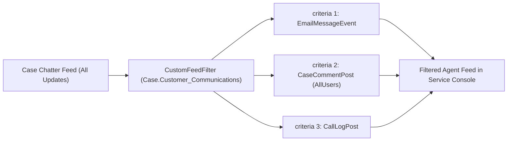

## Architectural Overview

In complex Service Cloud B2B support centers, a single long-running `Case` can accumulate hundreds of feed items: inbound/outbound `EmailMessage` threads, CTI `CallLogPost` entries, Experience Cloud customer comments (`CaseCommentPost`), internal Swarm chatter posts (`TextPost`), and automated field tracking updates (`ChangeStatusPost`). Forcing support engineers to scroll through an unfiltered chronological feed increases Average Handle Time (AHT).

The `CustomFeedFilter` metadata type enables architects to define curated feed views for the `Case` object (such as **"Customer Communications Only"** or **"Escalation & Call History"**) and surface them inside the Case Page Layout's Feed View settings.



## SFDX Directory and File Suffix

| Property | Value |
| :--- | :--- |
| **Metadata Type Name** | `CustomFeedFilter` |
| **SFDX Source Directory** | `force-app/main/default/objects/Case/feedFilters/` (or `customFeedFilters/`) |
| **SFDX File Suffix** | `.feedFilter-meta.xml` (or `.customFeedFilter-meta.xml`) |
| **`package.xml` Member Format** | `Case.<DeveloperName>` (e.g., `Case.Customer_Communications`) |

## Key Metadata Fields

`CustomFeedFilter` contains a label, description, and an array of `criteria` (`FeedFilterCriterion`) that determine which `FeedItem` types pass the filter.

| Field Name | Type | Required | Architectural Purpose |
| :--- | :--- | :--- | :--- |
| `label` | `string` | Yes | Display name shown to Service Console agents in the Case Feed filter list. |
| `description` | `string` | No | Explains what feed activity types are included in the filter. |
| `isProtected` | `boolean` | No | Used in managed packages to protect the feed filter from subscriber modification. |
| `criteria` | `FeedFilterCriterion[]` | Yes | List of feed item type and visibility rules evaluated with OR logic across criteria rows. |

### `FeedFilterCriterion` (`criteria`) Subtype Fields

| Field Name | Type | Required | Description |
| :--- | :--- | :--- | :--- |
| `feedItemType` | `FeedItemType` | Yes | Type of feed item to include: `EmailMessageEvent`, `CallLogPost`, `CaseCommentPost`, `TextPost`, `ChangeStatusPost`, `ActivityEvent`, `AttachArticleEvent`, or `ChatTranscriptPost`. |
| `feedItemVisibility` | `FeedItemVisibility` | No | Filters by visibility boundary: `AllUsers` (visible to external Experience Cloud customers) or `InternalUsers` (internal-only agent notes). |
| `relatedSObjectType` | `string` | No | Optional related sObject filter when `feedItemType` is `ActivityEvent` (`Task` or `Event`). |

## Declarative XML Example

Below is a production `Customer_External_Comms.feedFilter-meta.xml` file for the `Case` object that filters the Case Feed to show only inbound/outbound emails and public Experience Cloud portal comments, hiding noisy internal status changes and task updates.

```xml title="force-app/main/default/objects/Case/feedFilters/Customer_External_Comms.feedFilter-meta.xml"
<?xml version="1.0" encoding="UTF-8"?>
<CustomFeedFilter xmlns="http://soap.sforce.com/2006/04/metadata">
    <criteria>
        <feedItemType>EmailMessageEvent</feedItemType>
    </criteria>
    <criteria>
        <feedItemType>CaseCommentPost</feedItemType>
        <feedItemVisibility>AllUsers</feedItemVisibility>
    </criteria>
    <criteria>
        <feedItemType>ChatTranscriptPost</feedItemType>
    </criteria>
    <description>Displays only external customer emails, public portal comments, and chat transcripts.</description>
    <isProtected>false</isProtected>
    <label>Customer Communications</label>
</CustomFeedFilter>
```

### `package.xml` Manifest

Always prefix the member name with `Case.` when referencing `CustomFeedFilter` in `package.xml`:

```xml title="manifest/package.xml"
<?xml version="1.0" encoding="UTF-8"?>
<Package xmlns="http://soap.sforce.com/2006/04/metadata">
    <types>
        <members>Case.Customer_External_Comms</members>
        <name>CustomFeedFilter</name>
    </types>
    <version>68.0</version>
</Package>
```

## SFDX CLI Retrieval and Deployment

Use Salesforce CLI (`sf`) to retrieve and deploy `CustomFeedFilter` definitions:

```bash
# Retrieve a specific Case CustomFeedFilter
sf project retrieve start --metadata CustomFeedFilter:Case.Customer_External_Comms

# Deploy the CustomFeedFilter to a target org
sf project deploy start --metadata CustomFeedFilter:Case.Customer_External_Comms
```

## Architect Best Practices and Gotchas

> [!WARNING]
> **Always Include the `Case.` Prefix in `package.xml` and CLI Commands:** Because `CustomFeedFilter` is a child component of `Case`, passing `<members>Customer_External_Comms</members>` without the `Case.` prefix fails with an invalid fullName error. Always use `Case.Customer_External_Comms`.

- **Activate in Feed View on the Case Page Layout:** Deploying a `CustomFeedFilter` makes the filter available in the org, but agents will not see it until it is added to the `<feedLayout>` -> `<feedFilterPosition>` / `<feedFilters>` section of the assigned Case `Layout` (or configured in the Lightning Chatter Feed component properties on the Case `FlexiPage`).
- **Feed Tracking Must Be Enabled on `Case`:** Ensure `<enableFeeds>true</enableFeeds>` is set on `Case.object-meta.xml` before deploying `CustomFeedFilter` components to a scratch org.
