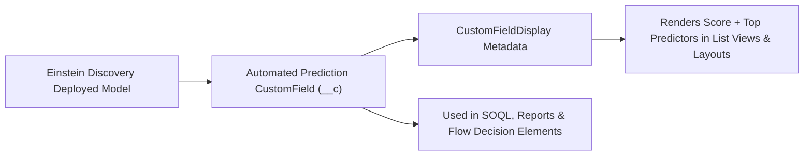

## Architectural Overview

When deploying predictive machine learning models in **Einstein Discovery** (CRM Analytics / Einstein Studio), architects often configure **Automated Prediction Fields** so predicted outcomes—such as *Predicted Propensity to Buy*, *Attrition Risk Score*, or *Invoice Late Payment Probability*—are stored directly on the sObject record and sortable in standard List Views and Reports.

The `CustomFieldDisplay` metadata type controls how these AI-powered fields render in the Salesforce user interface, linking the underlying [CustomField](/docs/metadata/custom-field-metadata-type/) to its predictive display metadata (`displayType`, `modelName`, and display formatting rules). By committing `CustomFieldDisplay` artifacts into SFDX version control, DevOps teams can promote predictive field UI configurations alongside their `CustomField` and `AIApplication` / `MLPredictionDefinition` metadata.



## SFDX Directory and File Suffix

| Property | Value |
| :--- | :--- |
| **Metadata Type Name** | `CustomFieldDisplay` |
| **SFDX Source Directory** | `force-app/main/default/customFieldDisplays/` |
| **SFDX File Suffix** | `.customFieldDisplay-meta.xml` |
| **Classic Metadata Suffix** | `.customFieldDisplay` |

## Key Metadata Fields

`CustomFieldDisplay` binds a target custom field to its predictive display configuration and label settings.

| Field Name | Type | Required | Architectural Purpose |
| :--- | :--- | :--- | :--- |
| `customField` | `string` | Yes | Fully qualified `Object.Field__c` API name of the custom field storing the prediction output. |
| `displayType` | `CustomFieldDisplayType` | Yes | Specifies the visual rendering style (e.g., `DiscoveryPrediction` for Einstein Discovery score and factor popover). |
| `masterLabel` | `string` | Yes | Human-readable label for the field display configuration in Setup. |
| `modelName` | `string` | No | DeveloperName of the deployed Einstein Discovery prediction definition supplying the explanations. |
| `isActive` | `boolean` | No | Indicates whether the enhanced predictive display renderer is active on the field. |

## Declarative XML Example

Below is an example `Opportunity_Win_Score_Display.customFieldDisplay-meta.xml` binding the `Opportunity.Predicted_Win_Score__c` field to the `Enterprise_Win_Propensity_Model` prediction definition.

```xml title="force-app/main/default/customFieldDisplays/Opportunity_Win_Score_Display.customFieldDisplay-meta.xml"
<?xml version="1.0" encoding="UTF-8"?>
<CustomFieldDisplay xmlns="http://soap.sforce.com/2006/04/metadata">
    <customField>Opportunity.Predicted_Win_Score__c</customField>
    <displayType>DiscoveryPrediction</displayType>
    <isActive>true</isActive>
    <masterLabel>Opportunity Predicted Win Score Display</masterLabel>
    <modelName>Enterprise_Win_Propensity_Model</modelName>
</CustomFieldDisplay>
```

### `package.xml` Manifest

Deploy `CustomFieldDisplay` together with the target `CustomField`:

```xml title="manifest/package.xml"
<?xml version="1.0" encoding="UTF-8"?>
<Package xmlns="http://soap.sforce.com/2006/04/metadata">
    <types>
        <members>Opportunity.Predicted_Win_Score__c</members>
        <name>CustomField</name>
    </types>
    <types>
        <members>Opportunity_Win_Score_Display</members>
        <name>CustomFieldDisplay</name>
    </types>
    <version>68.0</version>
</Package>
```

## SFDX CLI Retrieval and Deployment

Retrieve and deploy `CustomFieldDisplay` metadata using the `sf` CLI:

```bash
# Retrieve all CustomFieldDisplay configurations from the org
sf project retrieve start --metadata CustomFieldDisplay

# Deploy a specific CustomFieldDisplay component
sf project deploy start \
  --metadata CustomField:Opportunity.Predicted_Win_Score__c \
  --metadata CustomFieldDisplay:Opportunity_Win_Score_Display
```

## Architect Best Practices and Gotchas

> [!TIP]
> **Ensure `CustomField` Exists Before Deploying `CustomFieldDisplay`:** Always include the target `<customField>` (`Object.Field__c`) in the same deployment package or deploy it beforehand. For Einstein Discovery Automated Prediction fields, the underlying `CustomField` must be defined with the appropriate numeric/percent prediction type (`Number` or `AI` prediction field configuration).

- **License & Permission Requirements:** Users viewing the enriched `DiscoveryPrediction` popover on List Views or Record Pages require the **View Einstein Discovery Recommendations** permission (granted via CRM Analytics Plus or Einstein Predictions permission sets). Users without this permission still see the raw numeric value if granted standard Field-Level Security (FLS) on the `CustomField`.
- **Promote Model Definitions Alongside Field Displays:** If `modelName` references an Einstein Discovery prediction definition that has not yet been deployed to the target sandbox, deployment of `CustomFieldDisplay` will fail due to an unresolved model reference.
