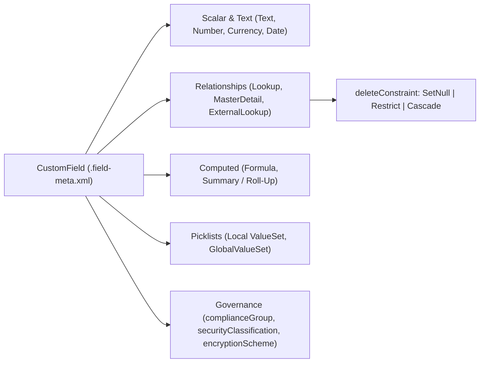

## Overview

The `CustomField` metadata type represents the definition of a custom field (`__c`) or a customizable standard field (such as `Account.Industry` or `Case.Status`) on standard objects, custom objects, external objects (`__x`), custom metadata types (`__mdt`), platform events (`__e`), and Data Cloud Data Model Objects (`__dlm`).

Use `CustomField` metadata to manage database column types, Lookup and Master-Detail relationships, Roll-Up Summary aggregations, Formula expressions, Shield Platform Encryption schemes, and Data Governance classifications (`securityClassification` and `complianceGroup`). In Salesforce DX source format, every field lives in its own isolated `.field-meta.xml` file under `objects/<ObjectName>/fields/`, eliminating team merge conflicts.



As illustrated above, a `CustomField` definition encompasses four primary data categories alongside relationship integrity constraints (`deleteConstraint`) and enterprise governance attributes (`complianceGroup`, `securityClassification`, and `encryptionScheme`).

## Prerequisites

- **Permissions:** "Customize Application" permission to deploy field definitions; "Manage Encryption Keys" if configuring Shield `encryptionScheme`.
- **Parent Object:** The enclosing [CustomObject](/docs/metadata/custom-object-metadata-type/) must exist in the target org or be included in the same deployment batch.
- **API Version:** Verified against API version `68.0` (Winter '27).

## Critical CustomField XML Properties by Data Type

In API version 60.0 and later, Salesforce strictly validates that a `CustomField` XML file contains only properties supported by its `<type>`. Including irrelevant tags causes deployment errors.

| Field Type | Required XML Elements | Key Optional Elements |
| :--- | :--- | :--- |
| `Text` | `label`, `length` (1–255), `type` | `externalId`, `unique`, `caseSensitive`, `encryptionScheme` |
| `LongTextArea` / `Html` | `label`, `length` (256–131,072), `visibleLines`, `type` | `encryptionScheme` |
| `Number` / `Currency` / `Percent` | `label`, `precision` (total digits ≤18), `scale` (decimal places), `type` | `externalId` (Number only), `unique`, `defaultValue` |
| `Lookup` | `label`, `referenceTo`, `relationshipLabel`, `relationshipName`, `type` | `deleteConstraint` (`SetNull` or `Restrict`), `lookupFilter` |
| `MasterDetail` | `label`, `referenceTo`, `relationshipLabel`, `relationshipName`, `type` | `reparentableMasterDetail`, `writeRequiresMasterRead`, `relationshipOrder` (`0` or `1`) |
| `Formula` | `label`, `formula`, `type` (return type: `Text`, `Number`, `Checkbox`, `Date`) | `formulaTreatBlanksAs` (`BlankAsZero` or `BlankAsBlank`) |
| `Summary` (Roll-Up) | `label`, `summarizedField`, `summaryForeignKey`, `summaryOperation`, `type` | `summaryFilterItems` |
| `Picklist` / `MultiselectPicklist` | `label`, `valueSet`, `type` | `visibleLines` (required for `MultiselectPicklist`, ≥3) |

> [!WARNING]
> For `Number` and `Currency` fields, `precision` is the **total number of digits** (both left and right of the decimal point), not just the integer digits. A field with `16` integer digits and `2` decimal places requires `<precision>18</precision>` and `<scale>2</scale>`.

## Querying CustomField via SOQL and Tooling API

Salesforce provides two powerful tables for querying field metadata: `FieldDefinition` (available in both standard SOQL and Tooling API) and `CustomField` (available in Tooling API).

### 1. Audit Field-Level Data Governance and Shield Encryption (Standard SOQL)
Query `FieldDefinition` to inspect data sensitivity, compliance tags (`GDPR`, `PII`, `HIPAA`), and index status on an object:

```soql
SELECT QualifiedApiName, Label, DataType, IsIndexed,
       SecurityClassification, ComplianceGroup, BusinessStatus, Description
FROM FieldDefinition
WHERE EntityDefinition.QualifiedApiName = 'Account'
  AND QualifiedApiName LIKE '%__c'
ORDER BY QualifiedApiName ASC
```

### 2. Find All Formula Fields and Inspect Expressions (Tooling API)
Run this query using `sf data query --use-tooling-api` to audit custom fields on a specific object or across the org:

```soql
SELECT Id, DeveloperName, TableEnumOrId, ManageableState,
       CreatedDate, LastModifiedBy.Name
FROM CustomField
WHERE TableEnumOrId = 'Opportunity'
ORDER BY DeveloperName ASC
```

### 3. Identify All External ID and Unique Indexed Fields
External ID fields are essential for `upsert` operations in Bulk API 2.0 and Data Loader:

```soql
SELECT EntityDefinition.QualifiedApiName, QualifiedApiName, DataType, IsIndexed
FROM FieldDefinition
WHERE EntityDefinition.QualifiedApiName IN ('Account', 'Contact', 'Invoice__c')
  AND IsIndexed = true
```

## Example

Below are three production-ready `CustomField` source files demonstrating a Lookup with a lookup filter, a Formula Currency field, and a Global Value Set Picklist with Shield deterministic encryption and GDPR compliance metadata.

### 1. Filtered Lookup Relationship Field
```xml title="force-app/main/default/objects/Invoice__c/fields/Billing_Account__c.field-meta.xml"
<?xml version="1.0" encoding="UTF-8"?>
<CustomField xmlns="http://soap.sforce.com/2006/04/metadata">
    <fullName>Billing_Account__c</fullName>
    <businessStatus>Active</businessStatus>
    <deleteConstraint>Restrict</deleteConstraint>
    <description>Customer account responsible for settling this invoice. Restricts deletion if invoices exist.</description>
    <inlineHelpText>Select an active Customer Account.</inlineHelpText>
    <label>Billing Account</label>
    <lookupFilter>
        <active>true</active>
        <errorMessage>Billing Account must be an active Customer account.</errorMessage>
        <filterItems>
            <field>Account.Type</field>
            <operation>equals</operation>
            <value>Customer - Direct, Customer - Channel</value>
        </filterItems>
        <isOptional>false</isOptional>
    </lookupFilter>
    <referenceTo>Account</referenceTo>
    <relationshipLabel>Invoices</relationshipLabel>
    <relationshipName>Invoices</relationshipName>
    <required>true</required>
    <securityClassification>Internal</securityClassification>
    <trackFeedHistory>false</trackFeedHistory>
    <trackHistory>true</trackHistory>
    <type>Lookup</type>
</CustomField>
```

### 2. Encrypted External ID Field with Data Governance Tags
```xml title="force-app/main/default/objects/Invoice__c/fields/ERP_External_Id__c.field-meta.xml"
<?xml version="1.0" encoding="UTF-8"?>
<CustomField xmlns="http://soap.sforce.com/2006/04/metadata">
    <fullName>ERP_External_Id__c</fullName>
    <businessStatus>Active</businessStatus>
    <caseSensitive>false</caseSensitive>
    <complianceGroup>PII;GDPR</complianceGroup>
    <description>Unique primary key from NetSuite ERP used for idempotent Bulk API 2.0 upserts.</description>
    <encryptionScheme>CaseInsensitiveDeterministicEncryption</encryptionScheme>
    <externalId>true</externalId>
    <label>ERP External ID</label>
    <length>64</length>
    <required>false</required>
    <securityClassification>Confidential</securityClassification>
    <trackFeedHistory>false</trackFeedHistory>
    <trackHistory>true</trackHistory>
    <type>Text</type>
    <unique>true</unique>
</CustomField>
```

### 3. Retrieving Specific Custom and Standard Fields via `package.xml`
When using `CustomField` in `package.xml`, always qualify the field with its object name (`ObjectName.FieldName`):

```xml title="manifest/package.xml"
<?xml version="1.0" encoding="UTF-8"?>
<Package xmlns="http://soap.sforce.com/2006/04/metadata">
    <types>
        <members>Invoice__c.Billing_Account__c</members>
        <members>Invoice__c.ERP_External_Id__c</members>
        <members>Account.Industry</members>
        <name>CustomField</name>
    </types>
    <version>68.0</version>
</Package>
```

## Limits and Gotchas

- **Total Fields per Object:** Enterprise Edition allows 500 custom fields per object; Unlimited and Performance Editions allow 800 custom fields per object.
- **Relationship Limits:** Each object supports at most **40 total relationship fields** (Lookups + Master-Detail combined), with a hard ceiling of **2 Master-Detail relationships** per object.
- **Roll-Up Summary Limit:** An object can have up to **25 Roll-Up Summary (`Summary`) fields** by default (can be raised to 40 by Salesforce Support).
- **Long Text Area Character Pool:** An object can contain up to 1,638,400 characters across all Long Text Area and Rich Text Area fields combined.
- **Formula Compilation Size:** A formula expression is limited to 3,900 characters of source text and **5,000 bytes of compiled SQL size** (15,000 bytes for formula fields that reference other formulas).
- **External IDs per Object:** Up to **25 custom fields** on a single object can have `<externalId>true</externalId>` enabled.

> [!WARNING]
> Changing a field's `<type>` in XML (for example, from `Text` to `Picklist` or `Number`) during a deployment to Production can cause permanent data loss on existing records or fail if the field is referenced in Apex classes, Flows, or Validation Rules.

## Related Official Documentation

- [CustomField Metadata API Reference](https://developer.salesforce.com/docs/atlas.en-us.api_meta.meta/api_meta/customfield.htm): Complete specification of all `CustomField` XML elements and value sets.
- [FieldDefinition Tooling API Object](https://developer.salesforce.com/docs/atlas.en-us.api_tooling.meta/api_tooling/tooling_api_objects_fielddefinition.htm): Querying field metadata, data types, and governance classifications.
- [Custom Fields Allowed Per Object Limits](https://help.salesforce.com/s/articleView?id=platform.custom_field_allocations.htm&type=5): Official edition allocations and relationship limits.
