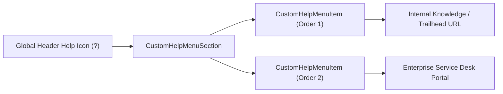

## Architectural Overview

The `CustomHelpMenuSection` metadata type represents the org-specific custom resource section inside the Lightning Experience global Help Menu (the question-mark icon in the top navigation bar). In enterprise Salesforce deployments, user adoption and self-service support depend on surfacing internal runbooks, Confluence pages, ServiceNow ticket portals, and WalkMe or Trailhead modules right where users work.

By managing `CustomHelpMenuSection` declaratively in version control, Release Managers ensure that sandbox refreshes and production cutovers consistently point users to the right support channels without post-deployment manual configuration.



## SFDX Directory and File Suffix

| Property | Value |
| :--- | :--- |
| **Metadata Type Name** | `CustomHelpMenuSection` |
| **Classic Directory** | `customHelpMenuSections/` |
| **Classic File Suffix** | `.customHelpMenuSection` |
| **SFDX Source Directory** | `force-app/main/default/customHelpMenuSections/` |
| **SFDX File Suffix** | `.customHelpMenuSection-meta.xml` |

> [!NOTE]
> Salesforce supports one `CustomHelpMenuSection` definition per org (typically named `CustomHelpMenuSection.customHelpMenuSection-meta.xml`).

## Key Metadata Fields

The `CustomHelpMenuSection` metadata type extends `Metadata` and contains the following fields:

| Field Name | Type | Required | Description & Architectural Guidance |
| :--- | :--- | :--- | :--- |
| `masterLabel` | `string` | Yes | The master label for the custom help menu section (up to 80 characters). |
| `customHelpMenuItems` | `CustomHelpMenuItem[]` | No | List of up to 15 custom links displayed inside the custom help menu section. |

### `CustomHelpMenuItem` Subtype Fields

| Field Name | Type | Required | Description |
| :--- | :--- | :--- | :--- |
| `linkUrl` | `string` | Yes | The destination URL (must be a valid URL such as `https://...`) opened when the user clicks the item. |
| `masterLabel` | `string` | Yes | The display label shown for the link in the Lightning Help Menu. |
| `sortOrder` | `int` | Yes | 1-based integer (`1` to `15`) controlling the vertical display order of the help link. |

## Declarative XML and `package.xml` Examples

### Source Format XML (`CustomHelpMenuSection.customHelpMenuSection-meta.xml`)

```xml title="force-app/main/default/customHelpMenuSections/CustomHelpMenuSection.customHelpMenuSection-meta.xml"
<?xml version="1.0" encoding="UTF-8"?>
<CustomHelpMenuSection xmlns="http://soap.sforce.com/2006/04/metadata">
    <customHelpMenuItems>
        <linkUrl>https://intranet.example.com/salesforce-sales-playbook</linkUrl>
        <masterLabel>Global Sales Playbook &amp; SOPs</masterLabel>
        <sortOrder>1</sortOrder>
    </customHelpMenuItems>
    <customHelpMenuItems>
        <linkUrl>https://servicedesk.example.com/create-crm-ticket</linkUrl>
        <masterLabel>Log a CRM Support Ticket</masterLabel>
        <sortOrder>2</sortOrder>
    </customHelpMenuItems>
    <customHelpMenuItems>
        <linkUrl>https://trailhead.salesforce.com</linkUrl>
        <masterLabel>Salesforce Trailhead Learning</masterLabel>
        <sortOrder>3</sortOrder>
    </customHelpMenuItems>
    <masterLabel>Enterprise CRM Resources</masterLabel>
</CustomHelpMenuSection>
```

### Manifest (`package.xml`)

```xml title="manifest/package.xml"
<?xml version="1.0" encoding="UTF-8"?>
<Package xmlns="http://soap.sforce.com/2006/04/metadata">
    <types>
        <members>*</members>
        <name>CustomHelpMenuSection</name>
    </types>
    <version>68.0</version>
</Package>
```

## SFDX CLI Retrieval and Tooling API Inspection

You can retrieve and deploy `CustomHelpMenuSection` using standard `sf` CLI commands or inspect items via Tooling API:

```bash
# Retrieve CustomHelpMenuSection metadata into your SFDX project
sf project retrieve start --metadata CustomHelpMenuSection

# Deploy updated help menu links to the target org
sf project deploy start --metadata CustomHelpMenuSection
```

You can also query `CustomHelpMenuSection` and `CustomHelpMenuItem` using the Tooling API:

```soql
SELECT Id, DeveloperName, MasterLabel
FROM CustomHelpMenuSection
```

```soql
SELECT Id, MasterLabel, LinkUrl, SortOrder, ParentId
FROM CustomHelpMenuItem
ORDER BY SortOrder ASC
```

## Architect Best Practices and Gotchas

- **Pair with `PathAssistantSettings` / `UserEngagementSettings`:** While `CustomHelpMenuSection` stores the items, the section header label and toggle for hiding standard Salesforce help content are managed via org-level engagement settings. Include both in your deployment manifest.
- **Contiguous `sortOrder` Sequence:** Always number `sortOrder` sequentially starting from `1` with no duplicate numbers, up to a maximum of `15` items.
- **Environment-Specific Help Portals:** If your UAT sandbox should link to a staging knowledge base or UAT bug-reporting form, use SFDX string replacements (`sfdx-project.json` replacements) on `<linkUrl>` during CI/CD builds.

> [!TIP]
> Escape ampersands (`&amp;`) in `<linkUrl>` query parameters and `<masterLabel>` strings so the XML parser does not reject the deployment.
