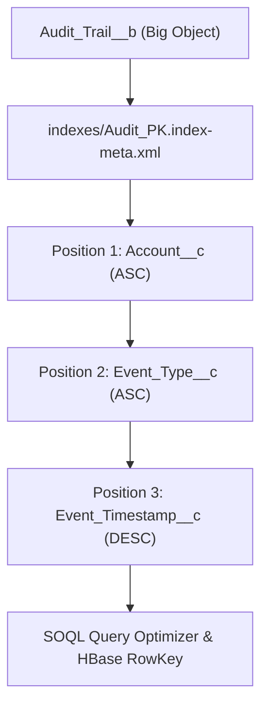

## Architectural Overview

The `CustomIndex` metadata type defines composite and single-field indexes for Salesforce objects—most notably defining the mandatory composite primary key for Big Objects (`__b`) and custom database indexes in Large Data Volume (LDV) architectures.

In a Big Object architecture, `CustomIndex` is the single most critical design decision a Technical Architect makes. Because Big Objects run on a non-relational distributed storage engine (Apache HBase / Phoenix under the hood), the `CustomIndex` dictates both **record uniqueness** (upserts overwrite records with identical index keys) and **query selectivity** (standard SOQL queries can only filter on fields included in the `CustomIndex` in strict positional order).



## SFDX Directory and File Suffix

In Salesforce DX source format, `CustomIndex` is decomposed out of `CustomObject` into a dedicated `indexes/` subfolder under the parent object directory:

| Property | Value |
| :--- | :--- |
| **Metadata Type Name** | `CustomIndex` |
| **Parent Object Type** | `CustomObject` |
| **SFDX Source Directory** | `force-app/main/default/objects/<ObjectName>/indexes/` |
| **SFDX File Suffix** | `.index-meta.xml` |
| **Package Manifest Name** | `CustomIndex` (referenced as `<ObjectName>.<IndexDeveloperName>`) or embedded via `CustomObject` |

## Key Metadata Fields

The `CustomIndex` metadata type (and its `<fields>` child element `IndexField`) includes the following properties:

| Field Name | Type | Required | Description & Architectural Guidance |
| :--- | :--- | :--- | :--- |
| `label` | `string` | Yes | User-friendly label for the custom index in Setup (up to 40 characters). |
| `fields` | `IndexField[]` | Yes | Ordered array of `IndexField` definitions specifying each indexed column and its sort direction. |

### `IndexField` Child Properties

| Field Name | Type | Required | Description |
| :--- | :--- | :--- | :--- |
| `name` | `string` | Yes | API name of the custom field included in the index (for example, `Account__c`). All indexed fields on a Big Object must have `<required>true</required>`. |
| `sortDirection` | `string` | Yes | Sort order in the index: `ASC` (ascending) or `DESC` (descending). Use `DESC` on timestamp fields when querying the most recent events first. |

## Declarative XML and `package.xml` Examples

### SFDX Decomposed Index File (`Audit_PK.index-meta.xml`)

```xml title="force-app/main/default/objects/Audit_Log__b/indexes/Audit_PK.index-meta.xml"
<?xml version="1.0" encoding="UTF-8"?>
<CustomIndex xmlns="http://soap.sforce.com/2006/04/metadata">
    <fields>
        <name>Account__c</name>
        <sortDirection>ASC</sortDirection>
    </fields>
    <fields>
        <name>Action_Category__c</name>
        <sortDirection>ASC</sortDirection>
    </fields>
    <fields>
        <name>Recorded_At__c</name>
        <sortDirection>DESC</sortDirection>
    </fields>
    <label>Audit Log Composite Primary Key</label>
</CustomIndex>
```

### Manifest (`package.xml`)

When deploying a Big Object index, you must deploy the parent `CustomObject`, its required `CustomField` definitions, and the `CustomIndex`:

```xml title="manifest/package.xml"
<?xml version="1.0" encoding="UTF-8"?>
<Package xmlns="http://soap.sforce.com/2006/04/metadata">
    <types>
        <members>Audit_Log__b</members>
        <name>CustomObject</name>
    </types>
    <types>
        <members>Audit_Log__b.Account__c</members>
        <members>Audit_Log__b.Action_Category__c</members>
        <members>Audit_Log__b.Recorded_At__c</members>
        <members>Audit_Log__b.Payload__c</members>
        <name>CustomField</name>
    </types>
    <types>
        <members>Audit_Log__b.Audit_PK</members>
        <name>CustomIndex</name>
    </types>
    <version>68.0</version>
</Package>
```

## SFDX CLI Commands and SOQL Query Rules

Retrieve or deploy the object and its index folder together using the `sf` CLI:

```bash
# Deploy the Big Object, its fields, and its CustomIndex together
sf project deploy start --source-dir force-app/main/default/objects/Audit_Log__b

# Retrieve a specific CustomIndex
sf project retrieve start --metadata CustomIndex:Audit_Log__b.Audit_PK
```

Once deployed, standard SOQL queries on `Audit_Log__b` must respect the exact `CustomIndex` field sequence (`Account__c` -> `Action_Category__c` -> `Recorded_At__c`):

```soql
SELECT Account__c, Action_Category__c, Recorded_At__c, Payload__c
FROM Audit_Log__b
WHERE Account__c = '001RO000004XyZ1YAK'
  AND Action_Category__c = 'SECURITY_LOGIN'
  AND Recorded_At__c >= 2026-01-01T00:00:00Z
```

## Architect Best Practices and Gotchas

- **Put High-Cardinality Equality Filters First:** Always place the most frequently filtered equality field (such as `Account__c` or `Customer_Id__c`) in position 1 of `<fields>`, and place range-filtered fields (such as `Recorded_At__c` with `>=` or `<=`) in the final position. In SOQL on Big Objects, you cannot filter on a subsequent index column after using a range operator (`>`, `<`, `>=`, `<=`) on a preceding column.
- **100-Character Composite Key Limit:** For Big Objects, the sum of `<length>` across all fields in `CustomIndex` cannot exceed 100 characters (Lookup fields count as 18, DateTime counts as 8, Number counts based on precision).
- **Immutability on Big Objects:** You cannot edit or delete a `CustomIndex` on an existing Big Object. Always test query access patterns in a scratch org before promoting a Big Object index to production.

> [!WARNING]
> Every field listed in `<fields>` inside a Big Object `CustomIndex` must have `<required>true</required>` in its corresponding `.field-meta.xml` file, or the Metadata API deployment will fail with `Required fields must be specified for index`.
