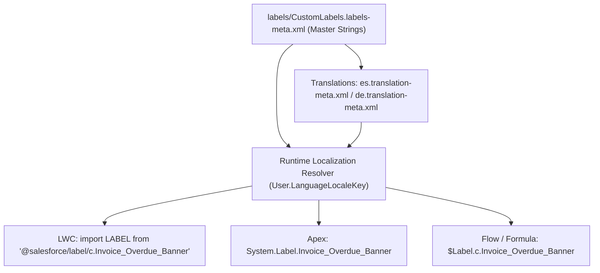

## Overview

The `CustomLabels` metadata type (`labels/CustomLabels.labels-meta.xml`) stores up to 5,000 translatable text strings (up to 1,000 characters per label) that can be referenced across Apex (`System.Label`), Lightning Web Components (`@salesforce/label`), Flows (`{!$Label}`), Validation Rules, Formula Fields, and Visualforce pages.

When Translation Workbench is enabled, each `CustomLabel` entry in `CustomLabels.labels-meta.xml` serves as the default master string (`language`), while localized translations for French, German, Japanese, or Spanish are stored in `Translations` metadata (`translations/<locale>.translation-meta.xml`) and resolved automatically at runtime based on the logged-in user's language locale.



As shown in the diagram above, `CustomLabels` defines the master text and `Translations` provides per-locale overrides, allowing LWC, Apex, and Flows to render localized UI text with zero hardcoding.

## Prerequisites

- **Permissions:** "Customize Application" permission to deploy custom labels; "View Setup and Configuration" to query via Tooling API.
- **Translation Workbench:** Enable Translation Workbench in Setup if deploying localized overrides via `Translations`.
- **API Version:** Verified against API version `68.0` (Winter '27).

## Key CustomLabel XML Elements

Inside `labels/CustomLabels.labels-meta.xml`, the root `<CustomLabels>` element wraps an array of `<labels>` (`CustomLabel`) items:

| XML Element | Type | Required | Description & Best Practice |
| :--- | :--- | :--- | :--- |
| `fullName` | `string` | ✅ Yes | API name (`Invoice_Overdue_Banner`). Cannot contain spaces or consecutive underscores (`__`). |
| `shortDescription` | `string` | ✅ Yes | Human-readable label name displayed in Setup list views and merge field pickers. |
| `value` | `string` | ✅ Yes | Master text value (≤1,000 characters). Supports `{0}`, `{1}` placeholders for `String.format()` in Apex. |
| `language` | `string` | ✅ Yes | Locale code of the master value (`en_US`). |
| `protected` | `boolean` | ✅ Yes | When `true` in a managed package, subscriber orgs cannot reference the label outside the package. Set `false` for standard enterprise projects. |
| `categories` | `string` | No | Comma-separated tags (≤255 chars, e.g., `Billing,ErrorMessages,LWC`) for filtering in Setup. |

> [!NOTE]
> In `package.xml`, **plural vs. singular matters**:
> - Use `<name>CustomLabels</name>` only with `<members>*</members>`.
> - Use `<name>CustomLabel</name>` (singular!) when specifying individual label names in `<members>`. Regardless of which you use in `package.xml`, Salesforce CLI writes the retrieved labels into `force-app/main/default/labels/CustomLabels.labels-meta.xml`.

## Querying CustomLabels (`ExternalString`) via Tooling API

In the Salesforce database and Tooling API, Custom Labels are stored in the **`ExternalString`** table (and translations in **`ExternalStringLocalization`**). Run these queries with `sf data query --use-tooling-api`.

### 1. Search Custom Labels by Category or Value (Tooling API)
```soql
SELECT Id, Name, MasterLabel, Value, Category,
       Language, IsProtected, ManageableState, LastModifiedDate
FROM ExternalString
WHERE ManageableState = 'unmanaged'
  AND Category LIKE '%Billing%'
ORDER BY Name ASC
```

### 2. Query Localized Translations for a Custom Label (Tooling API)
```soql
SELECT ExternalString.Name, Language, Value, LastModifiedBy.Name
FROM ExternalStringLocalization
WHERE ExternalString.Name = 'Invoice_Overdue_Banner'
ORDER BY Language ASC
```

## Example

### 1. `CustomLabels.labels-meta.xml` Definition
```xml title="force-app/main/default/labels/CustomLabels.labels-meta.xml"
<?xml version="1.0" encoding="UTF-8"?>
<CustomLabels xmlns="http://soap.sforce.com/2006/04/metadata">
    <labels>
        <fullName>Invoice_Overdue_Banner</fullName>
        <categories>Billing,LWC,Banners</categories>
        <language>en_US</language>
        <protected>false</protected>
        <shortDescription>Invoice Overdue Warning Banner</shortDescription>
        <value>This account has {0} overdue invoices totaling {1}. Please contact Billing Operations before extending credit.</value>
    </labels>
    <labels>
        <fullName>Invoice_Payment_Success_Toast</fullName>
        <categories>Billing,LWC,Toasts</categories>
        <language>en_US</language>
        <protected>false</protected>
        <shortDescription>Invoice Payment Success Toast</shortDescription>
        <value>Payment processed successfully.</value>
    </labels>
</CustomLabels>
```

### 2. Retrieving Specific Labels via Singular `CustomLabel` in `package.xml`
```xml title="manifest/package.xml"
<?xml version="1.0" encoding="UTF-8"?>
<Package xmlns="http://soap.sforce.com/2006/04/metadata">
    <types>
        <members>Invoice_Overdue_Banner</members>
        <members>Invoice_Payment_Success_Toast</members>
        <name>CustomLabel</name>
    </types>
    <version>68.0</version>
</Package>
```

### 3. Formatting Parameterized Custom Labels in Apex and LWC
In Apex, combine `System.Label` with `String.format()`:

```apex
String bannerMessage = String.format(
    System.Label.Invoice_Overdue_Banner,
    new List<Object>{ '3', '$42,500.00' }
);
```

In a Lightning Web Component, import from `@salesforce/label/c.<LabelName>`:

```javascript
import INVOICE_SUCCESS_TOAST from '@salesforce/label/c.Invoice_Payment_Success_Toast';
```

## Limits and Gotchas

- **Maximum Custom Labels per Org:** Up to **5,000 custom labels** per org (excluding managed packages).
- **Character Limit per Label:** **1,000 characters** maximum in `<value>`. If you need structured configuration or payloads larger than 1,000 characters, use [CustomMetadata](/docs/metadata/custom-metadata-records-type/) with a `LongTextArea` field instead.
- **Do Not Store Secrets or Endpoints in CustomLabels:** Custom labels are readable by any authenticated (and often guest) user in LWC/Aura payloads. Store URLs in [NamedCredential](/docs/metadata/named-credential-metadata-type/) and secrets in [ExternalCredential](/docs/metadata/external-credential-metadata-type/).

## Related Official Documentation

- [CustomLabels Metadata API Reference](https://developer.salesforce.com/docs/atlas.en-us.api_meta.meta/api_meta/meta_customlabels.htm): XML tags, manifest syntax, and translation workflow.
- [ExternalString Tooling API Object](https://developer.salesforce.com/docs/atlas.en-us.api_tooling.meta/api_tooling/tooling_api_objects_externalstring.htm): Querying Custom Labels via Tooling API.
