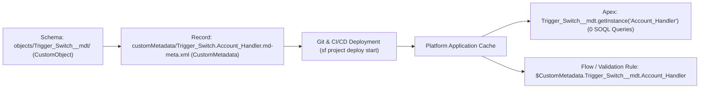

## Overview

The `CustomMetadata` metadata type (`customMetadata/<TypeName>.<RecordName>.md-meta.xml`) represents an individual **record** of a Custom Metadata Type (`__mdt`). While the schema of a Custom Metadata Type (its object container, custom fields, and validation rules) is deployed as a [CustomObject](/docs/metadata/custom-object-metadata-type/) (`objects/Tax_Rate__mdt/`), its records are metadata components themselves.

Because `CustomMetadata` records are metadata rather than database data (`__c`), you can track them in Git, deploy them through `sf project deploy start` and 2GP packages, access them inside `@IsTest` methods without `@TestSetup` DML, and retain them automatically across Sandbox refreshes. Use `CustomMetadata` for trigger bypass switches, API endpoint mappings, tax/pricing matrices, and business rule tables.



As shown in the architecture diagram above, `CustomObject` defines the `__mdt` table structure, while `CustomMetadata` deploys the configuration records directly into Salesforce's application cache for zero-SOQL retrieval in Apex, Flows, and Validation Rules.

## Prerequisites

- **Permissions:** "Customize Application" permission to create or deploy `CustomMetadata` records; "Restrict Access to Custom Metadata Types" org preference requires explicit `customMetadataTypeAccesses` in a [PermissionSet](/docs/metadata/permission-set-metadata-type/) or [Profile](/docs/metadata/profile-metadata-type/) for non-admin users in Flow/Aura/LWC contexts.
- **Parent Schema:** The target `<TypeName>__mdt` [CustomObject](/docs/metadata/custom-object-metadata-type/) and its [CustomField](/docs/metadata/custom-field-metadata-type/) definitions must exist or be deployed in the same transaction.
- **API Version:** Introduced in API version 31.0. Verified against API version `68.0` (Winter '27).

## File Naming & XML `xsi:type` Mapping Rules

Notice that the file name strips the `__mdt` suffix from the type name and joins the record's `DeveloperName` with a period (`.`):
- **Custom Metadata Type API Name:** `Trigger_Switch__mdt`
- **Record DeveloperName:** `Account_Handler`
- **SFDX File Path:** `force-app/main/default/customMetadata/Trigger_Switch.Account_Handler.md-meta.xml`
- **`package.xml` Member Name:** `<members>Trigger_Switch.Account_Handler</members>`

Each `<values>` node in the XML sets one field on the record using an `xsi:type` attribute corresponding to the field's data type:

| Custom Field Data Type | XML `xsi:type` Attribute | Example `<value>` |
| :--- | :--- | :--- |
| `Checkbox` | `xsi:type="xsd:boolean"` | `<value xsi:type="xsd:boolean">true</value>` |
| `Text` / `Picklist` / `Email` / `Phone` / `Url` / `TextArea` | `xsi:type="xsd:string"` | `<value xsi:type="xsd:string">Active</value>` |
| `Number` / `Percent` (Scale = `0`) | `xsi:type="xsd:int"` | `<value xsi:type="xsd:int">200</value>` |
| `Number` / `Percent` (Scale > `0`) | `xsi:type="xsd:double"` | `<value xsi:type="xsd:double">18.75</value>` |
| `Date` | `xsi:type="xsd:date"` | `<value xsi:type="xsd:date">2026-11-12</value>` |
| `DateTime` | `xsi:type="xsd:dateTime"` | `<value xsi:type="xsd:dateTime">2026-11-12T08:00:00.000Z</value>` |
| `MetadataRelationship` (`EntityDefinition` / `FieldDefinition`) | `xsi:type="xsd:string"` | `<value xsi:type="xsd:string">Account</value>` |
| Explicit `null` (Clears existing value) | `xsi:nil="true"` | `<value xsi:nil="true"/>` |

## Querying Custom Metadata via Apex Cache and SOQL

### 1. Zero-SOQL Apex Cache Methods (`getInstance` and `getAll`)
Whenever you do not need to read more than the first 255 characters of a Long Text Area field or traverse a `MetadataRelationship` lookup, use the built-in static cache methods instead of SOQL:

```apex
// Retrieve a single record by DeveloperName (0 SOQL queries, 0 query rows)
Trigger_Switch__mdt accountSwitch = Trigger_Switch__mdt.getInstance('Account_Handler');
Boolean isActive = accountSwitch != null && accountSwitch.Is_Active__c;

// Retrieve all records of the type as a Map<String, SObject>
Map<String, Trigger_Switch__mdt> allSwitches = Trigger_Switch__mdt.getAll();
```

### 2. Querying Custom Metadata with SOQL (Relationships & Long Text Areas)
Use SOQL when filtering dynamically, sorting with `ORDER BY`, or reading full `LongTextArea` payloads:

```soql
SELECT Id, DeveloperName, MasterLabel, NamespacePrefix,
       Target_Object__r.QualifiedApiName, Is_Active__c, Max_Batch_Size__c
FROM Trigger_Switch__mdt
WHERE Is_Active__c = true
ORDER BY DeveloperName ASC
```

> [!WARNING]
> While standard SOQL queries on `__mdt` do not count toward the 100 SOQL query governor limit, including **any Long Text Area field** in the `SELECT` list causes the query to count against both the 100 SOQL query limit and the 50,000 query row limit!

## Example

The following example shows a complete `Trigger_Switch.Account_Handler.md-meta.xml` record and an Apex utility class that evaluates the switch with a test-friendly override pattern.

```xml title="force-app/main/default/customMetadata/Trigger_Switch.Account_Handler.md-meta.xml"
<?xml version="1.0" encoding="UTF-8"?>
<CustomMetadata xmlns="http://soap.sforce.com/2006/04/metadata"
                xmlns:xsi="http://www.w3.org/2001/XMLSchema-instance"
                xmlns:xsd="http://www.w3.org/2001/XMLSchema">
    <description>Controls execution of AccountTriggerHandler in production and batch loads.</description>
    <label>Account Handler Switch</label>
    <protected>false</protected>
    <values>
        <field>Is_Active__c</field>
        <value xsi:type="xsd:boolean">true</value>
    </values>
    <values>
        <field>Max_Recursion_Depth__c</field>
        <value xsi:type="xsd:int">2</value>
    </values>
    <values>
        <field>Bypass_Permission_Name__c</field>
        <value xsi:type="xsd:string">Bypass_Account_Trigger</value>
    </values>
</CustomMetadata>
```

### Programmatic Deployment of CustomMetadata Records in Apex

When building a custom admin setup page in LWC, use the `Metadata` namespace to create or update `CustomMetadata` records asynchronously:

```apex title="CustomMetadataDeployService.cls"
public with sharing class CustomMetadataDeployService {

    public static Id updateTriggerSwitch(String recordDevName, Boolean isActive) {
        Metadata.CustomMetadata cmdRecord = new Metadata.CustomMetadata();
        cmdRecord.fullName = 'Trigger_Switch__mdt.' + recordDevName;
        cmdRecord.label = recordDevName.replace('_', ' ');

        Metadata.CustomMetadataValue activeVal = new Metadata.CustomMetadataValue();
        activeVal.field = 'Is_Active__c';
        activeVal.value = isActive;
        cmdRecord.values.add(activeVal);

        Metadata.DeployContainer container = new Metadata.DeployContainer();
        container.addMetadata(cmdRecord);

        return Metadata.Operations.enqueueDeployment(container, null);
    }
}
```

## Limits and Gotchas

- **Org Character Storage Limit:** An org can store up to **10 million characters** across all custom metadata records combined.
- **Records per Type / Fields per Type:** Up to 100 custom fields per `__mdt` type.
- **`getInstance()` Truncates Long Text Area at 255 Characters:** `CustomMetadata__mdt.getInstance()` only returns the first **255 characters** of any `LongTextArea` field. To retrieve characters beyond 255 in a `LongTextArea` field, you must execute a SOQL `SELECT` query.
- **No Formula Fields or Global Value Sets:** Custom Metadata Types (`__mdt`) do not support Formula fields, Master-Detail fields, or `GlobalValueSet` picklists (only local picklists are supported), though they **do** support [ValidationRule](/docs/metadata/validation-rule-metadata-type/) components.

## Related Official Documentation

- [CustomMetadata Metadata API Reference](https://developer.salesforce.com/docs/atlas.en-us.api_meta.meta/api_meta/meta_custommetadata.htm): XML schema, namespace rules, and `xsi:type` mappings.
- [Apex Custom Metadata Type Methods](https://developer.salesforce.com/docs/atlas.en-us.apexref.meta/apexref/apex_methods_system_custom_metadata_types.htm): `getAll()`, `getInstance()`, and caching behavior.
