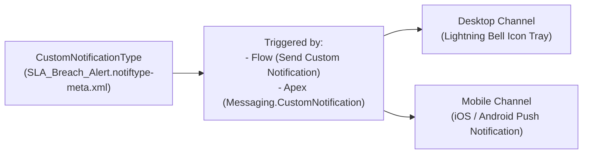

The `CustomNotificationType` metadata type registers a custom notification channel in Salesforce Setup (**Custom Notifications**). Introduced in API version 46.0, it enables [Flow](/docs/metadata/flow-metadata-type/) (`sendCustomNotification` core action), [ApexClass](/docs/metadata/apex-class-metadata-type/) (`Messaging.CustomNotification`), and REST API calls to push real-time alerts to the **Lightning Experience bell icon** (`desktop`) and the **Salesforce Mobile app** (`mobile`).

In Salesforce DX projects, notification types are stored in `force-app/main/default/notificationtypes/` with the `.notiftype-meta.xml` suffix.



## Key Metadata Fields

| Field | Type | Required | Description |
|---|---|---|---|
| `customNotifTypeName` | `string` | Yes | Internal notification type name (max 80 characters) |
| `masterLabel` | `string` | Yes | Display label shown in Setup and Flow Builder |
| `desktop` | `boolean` | Yes | Enables delivery to the Lightning Experience desktop bell tray (`true`/`false`) |
| `mobile` | `boolean` | Yes | Enables delivery as a Salesforce Mobile push notification (`true`/`false`) |
| `description` | `string` | No | Explains when this notification is triggered (max 255 characters) |
| `actionGroups` | `CustomNotificationActionGroup[]` | No | Beta mobile notification quick actions (`actions`, `groupName`) |

## Production-Grade XML Example

Below is a `CustomNotificationType` (`SLA_Breach_Alert.notiftype-meta.xml`) enabled for both desktop and mobile delivery:

```xml
<?xml version="1.0" encoding="UTF-8"?>
<CustomNotificationType xmlns="http://soap.sforce.com/2006/04/metadata">
    <customNotifTypeName>SLA_Breach_Alert</customNotifTypeName>
    <description>Real-time desktop and mobile alert sent when a Priority 1 Case approaches SLA breach.</description>
    <desktop>true</desktop>
    <masterLabel>SLA Breach Alert</masterLabel>
    <mobile>true</mobile>
</CustomNotificationType>
```

## Dispatching Custom Notifications in Apex (`Messaging.CustomNotification`)

Unlike emails, `Messaging.CustomNotification` does **not** count against daily single-email governor limits and supports up to 10,000 recipients per call when targeting a [Queue](/docs/metadata/queue-metadata-type/) or [Group](/docs/metadata/group-metadata-type/):

```java
public with sharing class SlaNotificationService {
    public static void notifyTier3Queue(Case escalatedCase, Id queueId) {
        CustomNotificationType notifType = [
            SELECT Id
            FROM CustomNotificationType
            WHERE DeveloperName = 'SLA_Breach_Alert'
            WITH SYSTEM_MODE
            LIMIT 1
        ];

        Messaging.CustomNotification notification = new Messaging.CustomNotification();
        notification.setNotificationTypeId(notifType.Id);
        notification.setTitle('P1 Case SLA Warning: ' + escalatedCase.CaseNumber);
        notification.setBody('Subject: ' + escalatedCase.Subject + ' requires immediate triage.');
        notification.setTargetId(escalatedCase.Id);

        // Passing a Queue Id or Public Group Id automatically notifies all active members
        notification.send(new Set<String>{ String.valueOf(queueId) });
    }
}
```

> [!WARNING]
> **No Wildcard (`*`) Support in `package.xml`**: `CustomNotificationType` does **not** support `<members>*</members>` in `package.xml`. Always list the explicit developer name of each notification type:
> ```xml
> <types>
>     <members>SLA_Breach_Alert</members>
>     <name>CustomNotificationType</name>
> </types>
> ```

## Querying `CustomNotificationType` with SOQL

```sql
-- Query all registered CustomNotificationTypes in standard SOQL
SELECT Id, DeveloperName, CustomNotifTypeName, MasterLabel, Desktop, Mobile, Description
FROM CustomNotificationType
ORDER BY MasterLabel ASC
```

